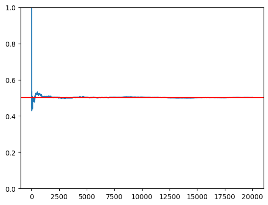
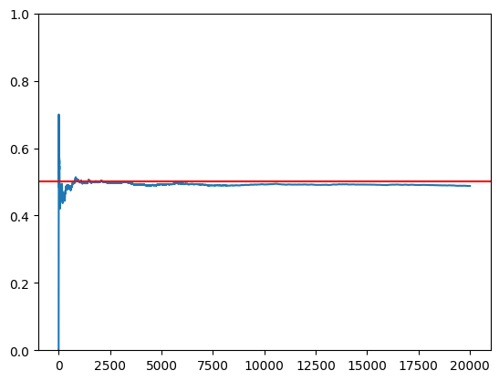
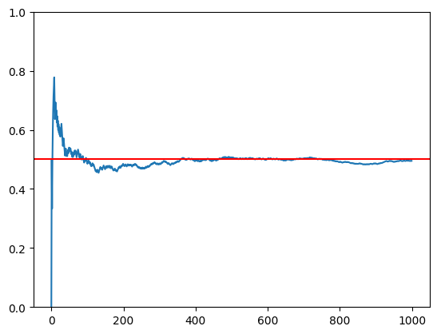
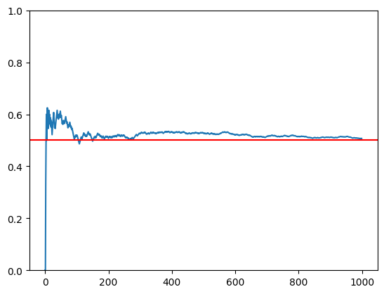
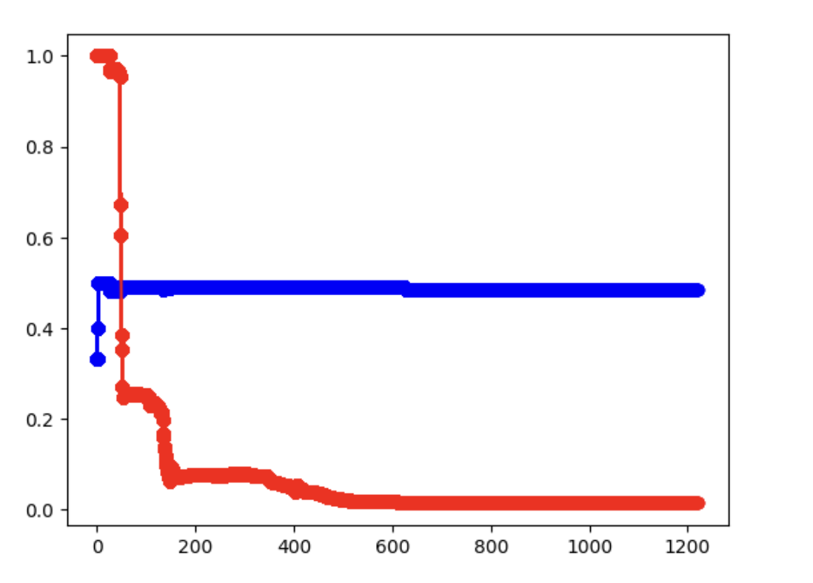

::: {.chart-note .orange}
**國科會大專生研究計畫**
計畫編號 112-2813-C-005-038-E · 指導教授：Prof. Yu-Tsung Tai · 執行期間：2023/07 -- 2024/02
:::

## 概述

本研究探討量子電腦的輸出是否符合**貝氏機率定律**。我們使用 IBM 的 Qiskit 框架，在真實的 IBMQ 硬體與模擬器上，針對量子位元的量測結果檢驗**大數法則**，並以**貝氏更新**分析量子位元的量測結果。

主要發現：**真實量子電腦與模擬器的行為不同**——量子電腦的累積機率出現系統性偏離理論值 0.5 的漂移，對量子態是否具有客觀隨機性提出了根本性的疑問。

## 研究方法

```{mermaid}
%%| fig-width: 100%
%%{init: {"theme": "base", "themeVariables": {"primaryColor": "#E3F2FD", "primaryTextColor": "#111", "primaryBorderColor": "#90CAF9", "lineColor": "#18A3A3", "secondaryColor": "#FFF3E0", "tertiaryColor": "#F3E5F5"}, "flowchart": {"curve": "basis", "padding": 35}, "fontSize": "18px"}}%%
flowchart TD
    A["第一階段：大數法則     "] --> B["建立 H 閘量子電路     "]
    B --> C["在模擬器上執行（20,000 次）     "]
    B --> D["在 IBMQ 硬體上執行（20,000 次）     "]
    C --> E["累積 P(0) 視覺化     "]
    D --> E
    E --> F["比較收斂行為     "]
    F --> G["第二階段：貝氏推論     "]
    G --> H["將量測結果存為 CSV     "]
    H --> I["以前 50 筆觀測建立先驗     "]
    I --> J["迭代貝氏更新（20,000 回合）     "]
    J --> K["求 P(0) 的 MAP 估計     "]

    style A fill:#E3F2FD,stroke:#90CAF9
    style B fill:#E3F2FD,stroke:#90CAF9
    style C fill:#E8F5E9,stroke:#A5D6A7
    style D fill:#FFF3E0,stroke:#FFCC80
    style E fill:#F3E5F5,stroke:#CE93D8
    style F fill:#F3E5F5,stroke:#CE93D8
    style G fill:#FFF3E0,stroke:#FFCC80
    style H fill:#FFF3E0,stroke:#FFCC80
    style I fill:#FFF3E0,stroke:#FFCC80
    style J fill:#FFF3E0,stroke:#FFCC80
    style K fill:#FCE4EC,stroke:#F48FB1
```

## 第一階段：大數法則驗證

我們對單一量子位元施加 **Hadamard 閘（H 閘）**，使其進入疊加態 $|+\rangle = \frac{1}{\sqrt{2}}(|0\rangle + |1\rangle)$，接著量測 20,000 次。若量子量測遵循古典機率，累積的 $P(|0\rangle)$ 應收斂至 **0.5**。

| 設定 | 後端 | 量測次數 | 預期 $P(0)$ |
|:------|:--------|------:|:----------------|
| H 閘 $\rightarrow$ 量測 | `ibmq_qasm_simulator` | 20,000 | 0.5 |
| H 閘 $\rightarrow$ 量測 | `ibm_osaka`（真實硬體） | 20,000 | 0.5 |

### 模擬器結果

模擬器的累積機率**平滑地**收斂至 0.5，完全符合大數法則：

{width=85%}

### 真實量子電腦結果

真實量子電腦（IBM Osaka）呈現**系統性的向下漂移**——累積機率並未收斂至 0.5：

{width=85%}

::: {.chart-note .orange}
**主要發現：** 模擬器完全遵循大數法則，但真實量子電腦呈現持續的偏差。這個差異暗示了三種可能：(1) 硬體雜訊造成系統性誤差；(2) 樣本數不足；(3) 量子疊加態可能無法產生真正客觀的隨機性。
:::

### 局部放大比較（1,000 次量測）

進一步觀察各 1,000 次量測的單次執行：

:::: {.columns}
::: {.column width="50%"}
{width=100%}

::: {.chart-note .teal}
**模擬器：** 快速、乾淨地收斂至理論值 0.5。
:::
:::

::: {.column width="50%"}
{width=100%}

::: {.chart-note .orange}
**IBMQ：** 變異明顯較大、收斂較慢，且持續震盪。
:::
:::
::::

## 第二階段：對量子輸出進行貝氏推論

第二階段中，我們將量子量測結果視為觀測資料，並應用**貝氏更新**推論最可能的機率參數 $\theta = P(|0\rangle)$。

**步驟：**

1. 從 IBMQ 收集 20,000 筆量測結果，形成 0/1 二元序列
2. 以前 50 筆觀測建立 $\theta$ 的**先驗分布**
3. 迭代套用貝氏定理，進行 19,950 回合更新
4. 找出 $\theta$ 的 **MAP（最大後驗）**估計值

### 貝氏收斂

{width=85%}

::: {.chart-note .teal}
**貝氏結果：** 在先驗密度 $n = 50$ 下，MAP 估計收斂至 $\theta \approx 0.483$，後驗機率 0.955。這證實了量子硬體的系統性偏差——貝氏推論正確地指出真實硬體上的 $P(|0\rangle)$ 並非恰好 0.5。
:::

## 結論

| 面向 | 模擬器 | 真實量子電腦 |
|:-------|:----------|:---------------------|
| 大數法則 | 完全符合 | 不符（系統性漂移） |
| 收斂至 0.5 | 是（平滑） | 否（偏向約 0.49） |
| 貝氏 MAP 估計 | $\theta \approx 0.500$ | $\theta \approx 0.483$ |
| 變異 | 低 | 高（雜訊大） |

造成差異的**三種可能解釋**：

1. **樣本數不足** --- 對量子硬體而言 20,000 次量測可能仍不夠（受限於 IBMQ 排隊限制）
2. **硬體雜訊與誤差** --- 目前的 IBMQ 裝置存在閘誤差、去相干與讀取誤差，會引入系統性偏差
3. **量子隨機性不等於古典隨機性** --- 疊加態可能遵循量測理論的機率模型（例如 Gleason 定理），而與 Kolmogorov 公理不完全一致

::: {.chart-note .grey}
**技術堆疊：** Python、Qiskit、IBMQ（ibm_osaka）、matplotlib、csv · **計畫補助：** NSTC 112-2813-C-005-038-E
:::

## 原始碼

本研究開發的 Qiskit 程式已公開於 GitHub：

- [i_use_quantum_do_something_cool](https://github.com/buttegggggggg/i_use_quantum_do_something_cool) --- 量子電路程式碼、模擬器／硬體比較、貝氏分析筆記本
