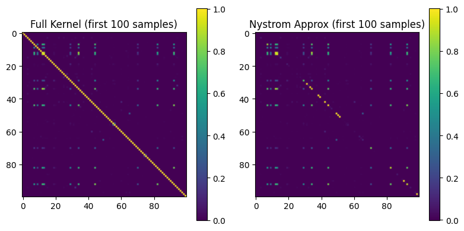

```{r setup, include=FALSE}
library(ggplot2)
library(tidyverse)
library(gridExtra)
library(scales)

# Personal visual DNA
c1  <- "#18A3A3"      # teal (primary)
c2  <- "#FF4D8D"      # rose pink (accent)
c3  <- "#7A7A7A"      # mid grey
c4  <- "#000000"      # border / text
acc <- "#E65100"      # deep orange (trend / highlight)

theme1 <- function() {
  theme_minimal(base_family = "sans") +
    theme(
      text             = element_text(colour = c4),
      plot.title       = element_text(face = "bold", colour = c4, size = 13,
                                      hjust = 0.5),
      plot.subtitle    = element_text(colour = c3, size = 10, hjust = 0.5),
      axis.title       = element_text(colour = c4, size = 11),
      axis.text        = element_text(colour = c3),
      panel.grid.major = element_line(color = scales::alpha(c3, 0.3),
                                      linetype = "dotted"),
      panel.grid.minor = element_blank(),
      legend.text      = element_text(colour = c4),
      legend.title     = element_text(colour = c4, face = "bold")
    )
}
```

## 作業 {#assignments}

### 文獻閱讀 — Nyström 方法

**論文：** *Using the Nystrom Method to Speed Up Kernel Machines*
**作者：** Christopher K. I. Williams & Matthias Seeger（NIPS 2000）

::: {.chart-note .teal}
**論文摘要：** 核方法（如 SVM、高斯過程）的主要瓶頸在於 Gram 矩陣的計算與求逆，時間複雜度為 O(n^3)。本論文提出以 **Nyström 方法**近似 Gram 矩陣 — 只從 n 筆訓練資料中取樣 m 點，計算一個小矩陣，再擴展成完整的近似矩陣，將計算量從 **O(n^3) 降至 O(m^2n)**。
:::

#### 核心概念

```{mermaid}
%%{init: {"theme": "base", "themeVariables": {"fontSize": "18px"}, "flowchart": {"padding": 35}}}%%
flowchart LR
    A["Full Gram Matrix K (n×n)     "] --> B["Sample m points     "]
    B --> C["K_mm (m×m)     "]
    B --> D["K_nm (n×m)     "]
    C --> E["Eigen-decompose K_mm     "]
    D --> F["Nyström Approx:\nK ≈ K_nm K_mm⁻¹ K_nm^T     "]

    style A fill:#FCE4EC,color:#C62828,stroke:#F48FB1,stroke-width:2px
    style B fill:#F5F5F5,color:#424242,stroke:#BDBDBD,stroke-width:2px
    style C fill:#E3F2FD,color:#1565C0,stroke:#90CAF9,stroke-width:2px
    style D fill:#E3F2FD,color:#1565C0,stroke:#90CAF9,stroke-width:2px
    style E fill:#FFF3E0,color:#E65100,stroke:#FFCC80,stroke-width:2px
    style F fill:#E8F5E9,color:#2E7D32,stroke:#A5D6A7,stroke-width:2px
```

::: {.chart-note .grey}
**Nyström 流程：** 從完整的 n x n Gram 矩陣（<span style="color:#C62828;">粉色</span>，計算成本極高）隨機選取 m 個樣本，組成<span style="color:#1565C0;">藍色</span>的子矩陣 K_mm 與 K_nm，再經特徵分解（<span style="color:#E65100;">橘色</span>）重建為<span style="color:#2E7D32;">綠色</span>的近似矩陣。當 m << n 時可獲得顯著加速。
:::

#### 關鍵公式

**Mercer 展開（核展開）：**

$$K(x, y) = \sum_{i=1}^{\infty} \lambda_i \phi_i(x) \phi_i(y)$$

**Nyström 近似：**

$$\tilde{K} = K_{nm} K_{mm}^{-1} K_{nm}^T$$

**複雜度降低：**

$$O(n^3) \rightarrow O(m^2 n), \quad m \ll n$$

---

### 作業 — Nyström 核嶺分類

**任務：** 實作 Nyström 方法，加速 USPS 手寫數字資料集上的 RBF 核嶺分類（二元：數字「4」vs. 其餘）。

**資料集：** USPS — 7,291 張訓練 + 2,007 張測試影像，256 個特徵（16x16 像素）

**方法：** RBF 核（sigma=4）+ 嶺迴歸（lambda=0.001）+ Nyström 近似（m = 128、256、512）

#### 流程總覽

```{mermaid}
%%{init: {"theme": "base", "themeVariables": {"fontSize": "18px"}, "flowchart": {"padding": 35}}}%%
flowchart LR
    A["USPS 7291×256     "] --> B["StandardScaler     "] --> C["RBF Kernel σ=4     "]
    C --> D["Full: K (7291×7291)     "]
    C --> E["Nyström: K_mm + K_nm     "]
    D --> F["Ridge Solve     "]
    E --> F
    F --> G["Predict ±1     "]

    style A fill:#E3F2FD,color:#1565C0,stroke:#90CAF9,stroke-width:2px
    style B fill:#F5F5F5,color:#424242,stroke:#BDBDBD,stroke-width:2px
    style C fill:#FFF3E0,color:#E65100,stroke:#FFCC80,stroke-width:2px
    style D fill:#FCE4EC,color:#C62828,stroke:#F48FB1,stroke-width:2px
    style E fill:#E8F5E9,color:#2E7D32,stroke:#A5D6A7,stroke-width:2px
    style F fill:#E3F2FD,color:#1565C0,stroke:#90CAF9,stroke-width:2px
    style G fill:#E8F5E9,color:#2E7D32,stroke:#A5D6A7,stroke-width:2px
```

::: {.chart-note .teal}
**流程說明：** USPS 資料先標準化，再分成兩條路徑：<span style="color:#C62828;">粉色</span>的 Full Kernel 計算完整的 7291x7291 Gram 矩陣，<span style="color:#2E7D32;">綠色</span>的 Nyström 只計算子矩陣 K_mm + K_nm。兩者都以嶺迴歸求解係數向量 alpha，最終預測 +/-1。
:::

#### 實作

```python
# RBF Kernel function
def rbf_kernel(X1, X2, sigma=4.0):
    sq_dists = (np.sum(X1**2, axis=1)[:, None]
                + np.sum(X2**2, axis=1)[None, :]
                - 2 * X1 @ X2.T)
    return np.exp(-sq_dists / (2 * sigma**2))

# Kernel Ridge: solve (K + λI) α = y
def kernel_ridge_train(K, y, lam=1e-3):
    n = K.shape[0]
    return np.linalg.solve(K + lam * np.eye(n), y)

# Nyström approximation
def nystrom_approximation(X_train, m, sigma=4.0):
    indices = np.random.choice(n, m, replace=False)
    X_sub = X_train[indices]
    K_mm = rbf_kernel(X_sub, X_sub, sigma)
    K_nm = rbf_kernel(X_train, X_sub, sigma)
    K_mm_inv = np.linalg.inv(K_mm + 1e-8 * np.eye(m))
    K_approx = K_nm @ K_mm_inv @ K_nm.T
    return K_approx, indices, K_nm, K_mm_inv
```

#### 結果

| 方法 | 錯誤數 | 準確率 | 訓練時間（秒） |
|--------|--------|----------|-----------------|
| Full Kernel | 9 | 99.55% | 7.52 |
| Nyström m=128 | 10 | 99.50% | 0.38 |
| Nyström m=256 | 10 | 99.50% | 0.63 |
| Nyström m=512 | 9 | 99.55% | 1.83 |

```{r nystrom-results, echo=FALSE, fig.width=9, fig.height=4}
df_ny <- data.frame(
  method = factor(
    c("Full Kernel", "Nyström\nm=128", "Nyström\nm=256", "Nyström\nm=512"),
    levels = c("Full Kernel", "Nyström\nm=128", "Nyström\nm=256", "Nyström\nm=512")
  ),
  accuracy = c(99.55, 99.50, 99.50, 99.55),
  time     = c(7.52, 0.38, 0.63, 1.83)
)

p_acc <- ggplot(df_ny, aes(x = method, y = accuracy, fill = method)) +
  geom_col(colour = c4, width = 0.6) +
  geom_text(aes(label = paste0(accuracy, "%")),
            vjust = -0.4, fontface = "bold", size = 4, colour = c4) +
  geom_hline(yintercept = 99.55, linetype = "dashed",
             colour = c3, linewidth = 0.7) +
  scale_fill_manual(values = c(c2, c1, c1, c1)) +
  scale_y_continuous(expand = expansion(mult = c(0, 0.08))) +
  coord_cartesian(ylim = c(99, 100)) +
  labs(title = "Accuracy Comparison", x = NULL, y = "Accuracy (%)") +
  theme1() +
  theme(legend.position = "none")

p_time <- ggplot(df_ny, aes(x = method, y = time, fill = method)) +
  geom_col(colour = c4, width = 0.6) +
  geom_text(aes(label = paste0(time, "s")),
            vjust = -0.4, fontface = "bold", size = 4, colour = c4) +
  scale_fill_manual(values = c(c2, c1, c1, c1)) +
  scale_y_continuous(expand = expansion(mult = c(0, 0.12))) +
  labs(title = "Training Time Comparison", x = NULL, y = "Time (seconds)") +
  theme1() +
  theme(legend.position = "none")

grid.arrange(p_acc, p_time, ncol = 2,
             top = grid::textGrob("Nyström Method — Full Kernel vs Approximation (USPS Dataset)",
                                  gp = grid::gpar(fontface = "bold", fontsize = 13)))
```

::: {.chart-note .orange}
**效能分析：** <span style="color:#FF4D8D;">**粉色**</span>的 Full Kernel 需要 7.52 秒計算完整的 7291x7291 Gram 矩陣。<span style="color:#18A3A3;">**藍綠色**</span>的 Nyström m=128 只需 **0.38 秒**（約 **20 倍加速**），準確率幾乎不變（99.50% vs 99.55%）。m=512 時準確率與 Full Kernel 完全相同，訓練時間仍減少 **75%**。
:::

#### Gram 矩陣視覺化

{width="75%"}

::: {.chart-note .teal}
**矩陣比較：** 左圖為完整的 Gram 矩陣（前 100 筆樣本），右圖為 Nyström 近似結果。兩者結構高度相似，驗證了 Nyström 方法在大幅降低計算量的同時仍保留核結構。
:::

---

## 期末專案 {#final-project}

### Smoothed & Distributed SVM

**任務：** 實作並比較三種 SVM 變體：(1) 標準 LinearSVC；(2) 以 log-sum-exp 近似 hinge loss 的 Smoothed SVM；(3) 具通訊效率梯度聚合的分散式 Smoothed SVM。

**資料集：** a9a（Adult Income）— 32,561 筆訓練 + 16,281 筆測試樣本，123 個特徵

**方法：** LinearSVC 基線 → Smoothed Hinge Loss（beta=5）+ L-BFGS-B → 分散式 SGD（K=5 個 worker）

#### 三種 SVM 變體

```{mermaid}
%%{init: {"theme": "base", "themeVariables": {"fontSize": "18px"}, "flowchart": {"padding": 35}}}%%
flowchart TD
    DATA["a9a Dataset 32K×123     "] --> S1["LinearSVC (sklearn)     "]
    DATA --> S2["Smoothed SVM (L-BFGS-B)     "]
    DATA --> S3["Distributed Smooth SVM     "]

    S1 --> R1["Baseline Accuracy     "]
    S2 --> R2["Single-node Accuracy     "]
    S3 --> |"K=5 workers"| R3["Distributed Accuracy     "]

    S3 --> W1["Worker 1     "]
    S3 --> W2["Worker 2     "]
    S3 --> W3["...     "]
    S3 --> W4["Worker 5     "]

    style DATA fill:#E3F2FD,color:#1565C0,stroke:#90CAF9,stroke-width:2px
    style S1   fill:#F5F5F5,color:#424242,stroke:#BDBDBD,stroke-width:2px
    style S2   fill:#FFF3E0,color:#E65100,stroke:#FFCC80,stroke-width:2px
    style S3   fill:#E8F5E9,color:#2E7D32,stroke:#A5D6A7,stroke-width:2px
    style R1   fill:#F5F5F5,color:#424242,stroke:#BDBDBD
    style R2   fill:#FFF3E0,color:#E65100,stroke:#FFCC80
    style R3   fill:#E8F5E9,color:#2E7D32,stroke:#A5D6A7
    style W1   fill:#E8F5E9,color:#2E7D32,stroke:#A5D6A7
    style W2   fill:#E8F5E9,color:#2E7D32,stroke:#A5D6A7
    style W3   fill:#E8F5E9,color:#2E7D32,stroke:#A5D6A7
    style W4   fill:#E8F5E9,color:#2E7D32,stroke:#A5D6A7
```

::: {.chart-note .grey}
**架構總覽：** <span style="color:#424242;">灰色</span> = sklearn LinearSVC 基線、<span style="color:#E65100;">**橘色**</span> = 單節點 Smoothed SVM（L-BFGS-B 最佳化）、<span style="color:#2E7D32;">**綠色**</span> = 分散式版本（K=5 個 worker，每回合各自計算區域梯度後再聚合）。
:::

#### Smoothed Hinge Loss

標準 hinge loss 在 u=1 處不可微。平滑版本以 log-sum-exp 建立可微的近似：

$$\ell_\beta(u) = \frac{1}{\beta} \log\left(1 + e^{\beta(1-u)}\right)$$

```{r hinge-loss, echo=FALSE, fig.width=7, fig.height=4}
u <- seq(-2, 3, length.out = 500)
df_hinge <- data.frame(
  u    = rep(u, 3),
  loss = c(pmax(0, 1 - u),
           log1p(exp(5 * (1 - u))) / 5,
           log1p(exp(1 * (1 - u))) / 1),
  type = rep(c("Standard Hinge", "Smoothed (β=5)", "Smoothed (β=1)"), each = 500)
)
df_hinge$type <- factor(df_hinge$type,
  levels = c("Standard Hinge", "Smoothed (β=5)", "Smoothed (β=1)"))

ggplot(df_hinge, aes(x = u, y = loss, colour = type, linetype = type)) +
  geom_line(linewidth = 1.2) +
  scale_colour_manual(values = c(c3, acc, c1)) +
  scale_linetype_manual(values = c("dashed", "solid", "solid")) +
  scale_y_continuous(limits = c(0, 4)) +
  labs(title    = "Hinge Loss vs Smoothed Hinge Loss",
       subtitle = "Smoothed version is differentiable everywhere → enables L-BFGS-B",
       x = "u = y · f(x)", y = "Loss",
       colour = NULL, linetype = NULL) +
  theme1() +
  theme(legend.position = "bottom")
```

::: {.chart-note .teal}
**損失比較：** <span style="color:#7A7A7A;">**灰色虛線**</span>的標準 Hinge Loss 在 u=1 處不可微。<span style="color:#E65100;">**橘色**</span>的平滑版（beta=5）最接近原始 hinge，且處處可微。<span style="color:#18A3A3;">**藍綠色**</span>（beta=1）更平滑，但與原始 hinge 的偏差較大。beta 越大，形狀越接近原始版本。
:::

#### 分散式梯度聚合

```python
# Distributed Smoothed SVM — Communication-efficient gradient
K = 5  # number of workers
B = 5  # communication rounds
beta = np.zeros(X_train.shape[1])

for b in range(B):
    # Pilot gradient (computed on worker 0)
    grad_pilot = compute_gradient(beta, X_pilot, y_pilot, lambda_, beta_smooth)

    # Each worker computes local gradient correction
    grad_total = np.zeros_like(beta)
    for X_k, y_k in zip(split_X, split_y):
        grad_k = compute_gradient(beta, X_k, y_k, lambda_, beta_smooth)
        grad_total += (grad_k - grad_pilot) * (len(X_k) / len(X_train))

    # Aggregate: surrogate gradient = pilot + corrections
    beta -= 0.1 * (grad_pilot + grad_total)
```

::: {.chart-note .orange}
**分散式策略：** 資料切成 K=5 個分割。每回合只有一個 pilot worker 計算完整梯度，其餘 worker 計算「與 pilot 的梯度差」（修正項），再進行聚合。相較於讓每個 worker 都傳輸完整梯度，此方法大幅降低通訊開銷。
:::

#### 結果

| 模型 | 測試準確率 | 訓練時間 |
|-------|--------------|---------------|
| LinearSVC（sklearn 基線） | 84.93% | 1.52s |
| Smoothed SVM（單節點，L-BFGS-B） | 84.88% | 0.78s |
| 分散式 Smoothed SVM（K=5, B=5） | 83.79% | 0.01s |

```{r svm-compare, echo=FALSE, fig.width=9, fig.height=4}
df_svm <- data.frame(
  model = factor(
    c("LinearSVC\n(sklearn)", "Smoothed SVM\n(single-node)", "Distributed SVM\n(K=5, B=5)"),
    levels = c("LinearSVC\n(sklearn)", "Smoothed SVM\n(single-node)", "Distributed SVM\n(K=5, B=5)")
  ),
  accuracy = c(84.93, 84.88, 83.79),
  time     = c(1.52, 0.78, 0.01)
)

p_acc_svm <- ggplot(df_svm, aes(x = model, y = accuracy, fill = model)) +
  geom_col(colour = c4, width = 0.55) +
  geom_text(aes(label = paste0(accuracy, "%")),
            vjust = -0.4, fontface = "bold", size = 4, colour = c4) +
  geom_hline(yintercept = 84.93, linetype = "dashed",
             colour = c3, linewidth = 0.7) +
  scale_fill_manual(values = c(c3, acc, c1)) +
  scale_y_continuous(expand = expansion(mult = c(0, 0.08))) +
  coord_cartesian(ylim = c(80, 88)) +
  labs(title = "Test Accuracy Comparison", x = NULL, y = "Accuracy (%)") +
  theme1() +
  theme(legend.position = "none")

p_time_svm <- ggplot(df_svm, aes(x = model, y = time, fill = model)) +
  geom_col(colour = c4, width = 0.55) +
  geom_text(aes(label = paste0(time, "s")),
            vjust = -0.4, fontface = "bold", size = 4, colour = c4) +
  scale_fill_manual(values = c(c3, acc, c1)) +
  scale_y_continuous(expand = expansion(mult = c(0, 0.12))) +
  labs(title = "Training Time Comparison", x = NULL, y = "Time (seconds)") +
  theme1() +
  theme(legend.position = "none")

grid.arrange(p_acc_svm, p_time_svm, ncol = 2,
             top = grid::textGrob("SVM Variants — Accuracy vs Speed Trade-off (a9a Dataset)",
                                  gp = grid::gpar(fontface = "bold", fontsize = 13)))
```

::: {.chart-note .pink}
**取捨分析：** <span style="color:#7A7A7A;">**灰色**</span>的 LinearSVC 為基線（84.93%）。<span style="color:#E65100;">**橘色**</span>的 Smoothed SVM 準確率幾乎相同（84.88%），但因 L-BFGS-B 最佳化更有效率而更快（0.78s vs 1.52s）。<span style="color:#18A3A3;">**藍綠色**</span>的分散式版本犧牲約 1.1% 準確率，換得 **150 倍加速**（0.01s），展現分散式計算在大規模資料上的潛力。
:::

#### 消融實驗 — Beta 敏感度

| Beta（平滑度） | 測試準確率 |
|----------------|--------------|
| 1 | 83.69% |
| 2 | 83.79% |
| 5 | 83.79% |
| 10 | 83.73% |
| 20 | 81.21% |

```{r beta-ablation, echo=FALSE, fig.width=7, fig.height=3.5}
df_beta <- data.frame(
  beta     = c(1, 2, 5, 10, 20),
  accuracy = c(83.69, 83.79, 83.79, 83.73, 81.21)
)

ggplot(df_beta, aes(x = factor(beta), y = accuracy)) +
  geom_col(fill = c1, colour = c4, width = 0.55) +
  geom_text(aes(label = paste0(accuracy, "%")),
            vjust = -0.4, fontface = "bold", size = 4, colour = c4) +
  geom_hline(yintercept = 83.79, linetype = "dashed",
             colour = c3, linewidth = 0.7) +
  scale_y_continuous(expand = expansion(mult = c(0, 0.08))) +
  coord_cartesian(ylim = c(79, 85)) +
  labs(title    = "Distributed SVM — β Sensitivity Analysis",
       subtitle = "β controls the smoothness of the hinge loss approximation",
       x = "β (smoothness parameter)", y = "Test Accuracy (%)") +
  theme1()
```

::: {.chart-note .orange}
**Beta 選擇建議：** beta=2 與 beta=5 表現最佳且結果相同（83.79%）。beta 過大（=20）反而使準確率降至 81.21%，因為過於貼近原本不可微的 hinge loss 會讓損失函數幾乎失去平滑性，導致梯度估計不穩定。**beta=5 是最佳平衡點**。
:::
