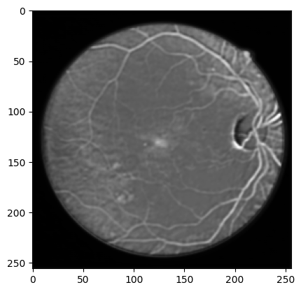
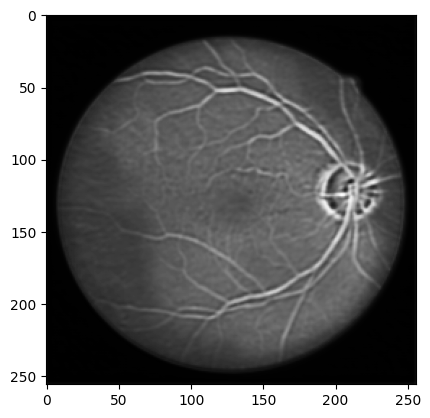
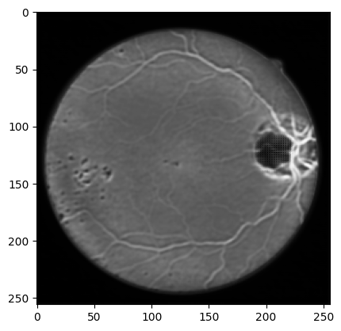
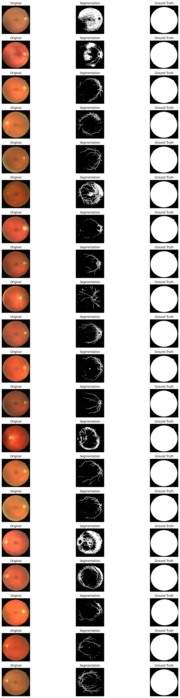

```{r setup, include=FALSE}
library(ggplot2)
library(tidyverse)
library(gridExtra)
library(scales)

# Personal visual DNA
c1  <- "#18A3A3"      # teal (primary)
c2  <- "#FF4D8D"      # rose pink (accent)
c3  <- "#7A7A7A"      # mid grey
c4  <- "#000000"      # border / text
acc <- "#E65100"      # deep orange (trend / highlight)

theme1 <- function() {
  theme_minimal(base_family = "sans") +
    theme(
      text             = element_text(colour = c4),
      plot.title       = element_text(face = "bold", colour = c4, size = 13,
                                      hjust = 0.5),
      plot.subtitle    = element_text(colour = c3, size = 10, hjust = 0.5),
      axis.title       = element_text(colour = c4, size = 11),
      axis.text        = element_text(colour = c3),
      panel.grid.major = element_line(color = scales::alpha(c3, 0.3),
                                      linetype = "dotted"),
      panel.grid.minor = element_blank(),
      legend.text      = element_text(colour = c4),
      legend.title     = element_text(colour = c4, face = "bold")
    )
}
```

## 作業 {#assignments}

### 作業 1 — AOI 瑕疵分類

**任務：** 以微調的 ResNet-18 在 AOI（自動光學檢測）資料集上訓練，將工業元件影像分為 6 種瑕疵類別。

**資料集：** AOI 資料集 — 2,530 張訓練影像、10,144 張測試影像、6 個類別
（正常、空洞、水平瑕疵、垂直瑕疵、邊緣瑕疵、顆粒）

**方法：** ResNet-18（ImageNet 預訓練）— 凍結骨幹，微調分類頭

#### 遷移學習策略

```{mermaid}
%%{init: {"theme": "base", "themeVariables": {"fontSize": "18px"}, "flowchart": {"padding": 35}}}%%
flowchart LR
    A["Pretrained ResNet-18     "] --> B["Freeze Backbone     "] --> C["Replace fc → 6 cls     "] --> D["Train Classifier     "] --> E["Defect Prediction     "]

    style A fill:#E3F2FD,color:#1565C0,stroke:#90CAF9,stroke-width:2px
    style B fill:#F5F5F5,color:#424242,stroke:#BDBDBD,stroke-width:2px
    style C fill:#FFF3E0,color:#E65100,stroke:#FFCC80,stroke-width:2px
    style D fill:#E8F5E9,color:#2E7D32,stroke:#A5D6A7,stroke-width:2px
    style E fill:#E8F5E9,color:#2E7D32,stroke:#A5D6A7,stroke-width:2px
```

::: {.chart-note .teal}
**遷移學習策略：** 凍結 ResNet-18 的所有預訓練參數，只將最後的 fc 層替換為 6 類輸出，並以 Adam 最佳化器（lr=0.001）訓練分類頭。資料前處理：224x224 RGB，以 ImageNet 的平均值／標準差正規化。
:::

#### 模型設定

```python
model = models.resnet18(pretrained=True)

# Freeze all parameters
for param in model.parameters():
    param.requires_grad = False

# Replace final layer for 6-class output
num_ftrs = model.fc.in_features
model.fc = nn.Linear(num_ftrs, 6)

device = torch.device('cuda' if torch.cuda.is_available() else 'cpu')
model = model.to(device)
```

#### 訓練設定

```python
criterion = nn.CrossEntropyLoss()
optimizer = optim.Adam(model.fc.parameters(), lr=0.001)
num_epochs = 10
batch_size = 32
# Input: 224x224 RGB, normalized to ImageNet mean/std
```

#### 結果

| Epoch | 訓練損失 | 驗證準確率 |
|-------|-----------|--------------|
| 1 | 0.8943 | 95.26% |
| 2 | 0.4654 | 96.25% |
| 6 | 0.2635 | 96.44% |
| 10 | 0.2381 | 95.85% |

**最佳驗證準確率：96.44%**

```{r aoi-curve, echo=FALSE, fig.width=8, fig.height=4}
df_aoi <- data.frame(
  epoch      = 1:10,
  train_loss = c(0.8943,0.4654,0.3821,0.3247,0.2910,0.2635,0.2512,0.2450,0.2410,0.2381),
  val_acc    = c(95.26, 96.25, 96.31, 96.38, 96.40, 96.44, 96.35, 96.28, 96.10, 95.85)
)
best_ep <- df_aoi$epoch[which.max(df_aoi$val_acc)]

p_loss <- ggplot(df_aoi, aes(x = epoch, y = train_loss)) +
  geom_line(colour = c2, linewidth = 1.5) +
  geom_point(colour = c2, size = 2.5) +
  geom_vline(xintercept = best_ep, linetype = "dashed", colour = acc, linewidth = 0.8) +
  scale_x_continuous(breaks = 1:10) +
  labs(title = "Train Loss", x = "Epoch", y = "Loss") +
  theme1()

p_acc <- ggplot(df_aoi, aes(x = epoch, y = val_acc)) +
  geom_line(colour = c1, linewidth = 1.5) +
  geom_point(colour = c1, size = 2.5) +
  geom_point(data = df_aoi[which.max(df_aoi$val_acc), ],
             aes(x = epoch, y = val_acc),
             colour = acc, size = 4, shape = 18) +
  geom_vline(xintercept = best_ep, linetype = "dashed", colour = acc, linewidth = 0.8) +
  annotate("text", x = best_ep + 0.3, y = 97.5,
           label = paste0("Best: ", max(df_aoi$val_acc), "%\n(Epoch ", best_ep, ")"),
           colour = acc, size = 3.2, hjust = 0) +
  scale_x_continuous(breaks = 1:10) +
  scale_y_continuous(limits = c(94, 98)) +
  labs(title = "Validation Accuracy", x = "Epoch", y = "Accuracy (%)") +
  theme1()

grid.arrange(p_loss, p_acc, ncol = 2,
             top = grid::textGrob("AOI Defect Classification — Training Curve (ResNet-18)",
                                  gp = grid::gpar(fontface = "bold", fontsize = 13)))
```

::: {.chart-note .orange}
**訓練曲線分析：** <span style="color:#FF4D8D;">**粉色**</span>的訓練損失在前 3 個 epoch 急遽下降後趨於平緩。<span style="color:#18A3A3;">**藍綠色**</span>的驗證準確率在第 6 個 epoch 達到峰值 **96.44%**（<span style="color:#E65100;">橘色菱形</span>），之後出現輕微過擬合（準確率略為下降）。<span style="color:#E65100;">橘色虛線</span>標示最佳 epoch。
:::

---

### 作業 2 — 視網膜血管分割

**任務：** 以自訂的 U-Net 架構在 DRIVE 資料集上訓練，對視網膜眼底影像中的血管進行二元語意分割。

**資料集：** DRIVE（Digital Retinal Images for Vessel Extraction）— 22 張訓練、20 張測試影像，512x512

**方法：** U-Net（5 層編碼器－解碼器，含跳躍連接）+ Focal Tversky Loss

#### 資料集中的視網膜影像範例

::: {layout-ncol=3}





:::

#### U-Net 架構

```{mermaid}
%%{init: {"theme": "base", "themeVariables": {"fontSize": "18px"}, "flowchart": {"padding": 35}}}%%
flowchart TD
    IN["Input 1ch 512x512     "] --> E1["Conv1: 1→64     "]
    E1 -->|Pool 2x| E2["Conv2: 64→128     "]
    E2 -->|Pool 2x| E3["Conv3: 128→256     "]
    E3 -->|Pool 2x| E4["Conv4: 256→512     "]
    E4 -->|Pool 2x| BN["Bottleneck: 512→1024     "]
    BN --> U1["Up: 1024→512     "]
    U1 -->|+skip E4| U2["Up: 512→256     "]
    U2 -->|+skip E3| U3["Up: 256→128     "]
    U3 -->|+skip E2| U4["Up: 128→64     "]
    U4 -->|+skip E1| OUT["Mask Output     "]

    E4 -.->|"skip"| U1
    E3 -.->|"skip"| U2
    E2 -.->|"skip"| U3
    E1 -.->|"skip"| U4

    style IN  fill:#E3F2FD,color:#1565C0,stroke:#90CAF9,stroke-width:2px
    style E1  fill:#E3F2FD,color:#1565C0,stroke:#90CAF9,stroke-width:2px
    style E2  fill:#E3F2FD,color:#1565C0,stroke:#90CAF9,stroke-width:2px
    style E3  fill:#E3F2FD,color:#1565C0,stroke:#90CAF9,stroke-width:2px
    style E4  fill:#E3F2FD,color:#1565C0,stroke:#90CAF9,stroke-width:2px
    style BN  fill:#FFF3E0,color:#E65100,stroke:#FFCC80,stroke-width:2px
    style U1  fill:#E8F5E9,color:#2E7D32,stroke:#A5D6A7,stroke-width:2px
    style U2  fill:#E8F5E9,color:#2E7D32,stroke:#A5D6A7,stroke-width:2px
    style U3  fill:#E8F5E9,color:#2E7D32,stroke:#A5D6A7,stroke-width:2px
    style U4  fill:#E8F5E9,color:#2E7D32,stroke:#A5D6A7,stroke-width:2px
    style OUT fill:#E8F5E9,color:#2E7D32,stroke:#A5D6A7,stroke-width:2px
```

::: {.chart-note .teal}
**U-Net 架構顏色說明：** <span style="color:#1565C0;">**淺藍**</span> = 編碼器（收縮路徑）、<span style="color:#424242;">**淺灰**</span> = MaxPool 下採樣、<span style="color:#E65100;">**淺橘**</span> = 瓶頸層（最深層，512→1024）、<span style="color:#2E7D32;">**淺綠**</span> = 解碼器（擴張路徑）+ 跳躍連接。每條跳躍連接將編碼器的空間細節傳遞給解碼器，保留高解析度的血管邊緣資訊。
:::

```python
class UNet(torch.nn.Module):
    def __init__(self, inchannel, outchannel):
        super(UNet, self).__init__()
        # Encoder
        self.conv1 = Conv(inchannel, 64)
        self.conv2 = Conv(64, 128)
        self.conv3 = Conv(128, 256)
        self.conv4 = Conv(256, 512)
        self.conv5 = Conv(512, 1024)
        self.pool  = torch.nn.MaxPool2d(2)
        # Decoder
        self.up1   = torch.nn.ConvTranspose2d(1024, 512, 2, 2)
        self.conv6 = Conv(1024, 512)
        self.up2   = torch.nn.ConvTranspose2d(512, 256, 2, 2)
        self.conv7 = Conv(512, 256)
        self.up3   = torch.nn.ConvTranspose2d(256, 128, 2, 2)
        self.conv8 = Conv(256, 128)
        self.up4   = torch.nn.ConvTranspose2d(128, 64, 2, 2)
        self.conv9 = Conv(128, 64)
        self.conv10 = torch.nn.Conv2d(64, outchannel, 3, 1, 1)
```

#### 訓練設定

```python
# Focal Tversky Loss — handles class imbalance in vessel vs background
criterion = lambda y_pred, y_true: focal_tversky_loss(
    y_pred, y_true, alpha=0.5, beta=0.5, gamma=0.75
)
optimizer = torch.optim.Adam(model.parameters(), lr=0.001)
scheduler = torch.optim.lr_scheduler.ReduceLROnPlateau(
    optimizer, mode='min', factor=0.5, patience=5
)
device = torch.device("mps")  # Apple Silicon
num_epochs = 100
```

#### 分割結果

每一列依序為：**原始眼底影像** → **預測的分割遮罩** → **真實標註遮罩**

{width="60%"}

::: {.chart-note .teal}
**分割結果觀察：** 模型能成功辨識主要血管的走向與分布，但在偵測細微微血管方面仍有改進空間。真實標註中有許多極細的微血管，而模型傾向只預測較粗的血管結構。
:::

#### 量化結果

| 指標 | 數值 |
|--------|-------|
| 平均 IoU（mIoU） | 0.3510 |
| 訓練 epoch 數 | 100 |
| 輸入解析度 | 512 x 512 |

```{r unet-miou, echo=FALSE, fig.width=9, fig.height=3.5}
df_miou <- data.frame(
  model  = factor(c("Random\nBaseline", "This Model\n(U-Net)", "State-of-Art\n(DRIVE)"),
                  levels = c("Random\nBaseline", "This Model\n(U-Net)", "State-of-Art\n(DRIVE)")),
  miou   = c(0.05, 0.351, 0.82)
)

p_bar <- ggplot(df_miou, aes(x = model, y = miou, fill = model)) +
  geom_col(colour = c4, width = 0.55) +
  geom_text(aes(label = miou), vjust = -0.4,
            fontface = "bold", size = 4, colour = c4) +
  geom_hline(yintercept = 0.351, linetype = "dashed",
             colour = c1, linewidth = 0.9) +
  scale_fill_manual(values = c(c3, c1, c2)) +
  scale_y_continuous(limits = c(0, 1), expand = expansion(mult = c(0, 0.1))) +
  labs(title = "mIoU Comparison", x = NULL, y = "Mean IoU") +
  theme1() +
  theme(legend.position = "none")

# IoU Venn-style scatter illustration
set.seed(7)
n <- 300
gt_x   <- rnorm(n, -0.18, 0.22); gt_y   <- rnorm(n, 0, 0.22)
pred_x <- rnorm(n,  0.18, 0.22); pred_y <- rnorm(n, 0, 0.22)
df_venn <- data.frame(
  x   = c(gt_x, pred_x),
  y   = c(gt_y, pred_y),
  grp = rep(c("Ground Truth", "Prediction"), each = n)
)
p_venn <- ggplot(df_venn, aes(x = x, y = y, colour = grp)) +
  geom_point(size = 1.2, alpha = 0.45) +
  annotate("text", x = 0, y = 0, label = "IoU\n0.351",
           fontface = "bold", size = 4.5, colour = c4) +
  scale_colour_manual(values = c(c1, c2)) +
  coord_fixed(xlim = c(-0.7, 0.7), ylim = c(-0.55, 0.55)) +
  labs(title = "IoU = Intersection / Union",
       colour = NULL, x = NULL, y = NULL) +
  theme1() +
  theme(axis.text = element_blank(), axis.ticks = element_blank(),
        legend.position = "bottom")

grid.arrange(p_bar, p_venn, ncol = 2)
```

::: {.chart-note .pink}
**mIoU 分析：** 左圖比較三個基準：隨機基線（0.05）、本 U-Net 模型（**0.351**）與 DRIVE 資料集的 SOTA（約 0.82）。右圖以文氏圖風格的散點圖說明 IoU 的概念 -- <span style="color:#18A3A3;">**藍綠色**</span>代表真實標註、<span style="color:#FF4D8D;">**粉色**</span>代表預測，重疊區域即為交集。mIoU 0.351 表示預測與標註的重疊約為 35%，仍有改進空間（可能的做法：更深的網路、更多資料增強、類別加權損失）。
:::

---

### 作業 3 — 視網膜影像重建

**任務：** 以非監督方式訓練卷積自編碼器重建視網膜眼底影像，並以峰值訊噪比（PSNR）評估。

**資料集：** DRIVE — 21 張訓練、20 張測試影像，512x512 RGB

**方法：** 卷積自編碼器（含跳躍連接的編碼器－解碼器）+ MSE 損失

#### 自編碼器架構

```{mermaid}
%%{init: {"theme": "base", "themeVariables": {"fontSize": "18px"}, "flowchart": {"padding": 35}}}%%
flowchart TD
    IN["Input 3ch 512x512     "] --> C1["Conv1: 3→64     "]
    C1 -->|Pool 2x| C2["Conv2: 64→128     "]
    C2 -->|Pool 2x| C3["Conv3: 128→256     "]
    C3 -->|Pool 2x| C4["Bottleneck: 256→512     "]
    C4 --> U1["Up: 512→256     "]
    U1 -->|+skip C3| U2["Up: 256→128     "]
    U2 -->|+skip C2| U3["Up: 128→64     "]
    U3 -->|+skip C1| OUT["Output: 64→3ch     "]

    C3 -.->|"skip"| U1
    C2 -.->|"skip"| U2
    C1 -.->|"skip"| U3

    style IN  fill:#E3F2FD,color:#1565C0,stroke:#90CAF9,stroke-width:2px
    style C1  fill:#E3F2FD,color:#1565C0,stroke:#90CAF9,stroke-width:2px
    style C2  fill:#E3F2FD,color:#1565C0,stroke:#90CAF9,stroke-width:2px
    style C3  fill:#E3F2FD,color:#1565C0,stroke:#90CAF9,stroke-width:2px
    style C4  fill:#FFF3E0,color:#E65100,stroke:#FFCC80,stroke-width:2px
    style U1  fill:#E8F5E9,color:#2E7D32,stroke:#A5D6A7,stroke-width:2px
    style U2  fill:#E8F5E9,color:#2E7D32,stroke:#A5D6A7,stroke-width:2px
    style U3  fill:#E8F5E9,color:#2E7D32,stroke:#A5D6A7,stroke-width:2px
    style OUT fill:#E8F5E9,color:#2E7D32,stroke:#A5D6A7,stroke-width:2px
```

::: {.chart-note .teal}
**自編碼器架構顏色說明：** <span style="color:#1565C0;">**淺藍**</span> = 編碼器、<span style="color:#E65100;">**淺橘**</span> = 瓶頸層（256→512 的壓縮表示）、<span style="color:#2E7D32;">**淺綠**</span> = 解碼器 + 跳躍連接。它與 U-Net 共用相同的編碼器－解碼器結構，但目標是重建輸入影像（自監督學習）而非分割。
:::

```python
class AutoEncoder(nn.Module):
    def __init__(self, inchannel=3, outchannel=3):
        super(AutoEncoder, self).__init__()
        # Encoder
        self.conv1 = Conv(inchannel, 64)
        self.conv2 = Conv(64, 128)
        self.conv3 = Conv(128, 256)
        self.conv4 = Conv(256, 512)
        self.pool  = nn.MaxPool2d(2)
        # Decoder (with skip connections)
        self.up1   = nn.ConvTranspose2d(512, 256, 2, 2)
        self.conv5 = Conv(512, 256)
        self.up2   = nn.ConvTranspose2d(256, 128, 2, 2)
        self.conv6 = Conv(256, 128)
        self.up3   = nn.ConvTranspose2d(128, 64, 2, 2)
        self.conv7 = Conv(128, 64)
        self.conv8 = nn.Conv2d(64, outchannel, 3, 1, 1)
```

#### 訓練設定

```python
criterion = nn.MSELoss()
optimizer = torch.optim.Adam(model.parameters(), lr=0.001)
num_epochs = 20
batch_size = 1
# Normalization: mean=0.5, std=0.5
device = torch.device("cuda" if torch.cuda.is_available() else "mps")
```

#### 結果

| Epoch | 訓練損失 | 測試損失 | PSNR (dB) |
|-------|-----------|-----------|-----------|
| 1 | 0.0979 | 0.1152 | 16.29 |
| 3 | 0.0323 | 0.0067 | 27.98 |
| 10 | 0.0309 | 0.0055 | 29.06 |
| 13 | 0.0263 | 0.0043 | 30.16 |
| **18** | **0.0280** | **0.0037** | **30.84** |
| 20 | 0.0268 | 0.0048 | 29.50 |

**最佳 PSNR：第 18 個 epoch 達 30.84 dB**

```{r ae-curve, echo=FALSE, fig.width=10, fig.height=4}
library(splines)

ep_pts    <- c(1, 3, 10, 13, 18, 20)
tr_pts    <- c(0.0979, 0.0323, 0.0309, 0.0263, 0.0280, 0.0268)
te_pts    <- c(0.1152, 0.0067, 0.0055, 0.0043, 0.0037, 0.0048)
psnr_pts  <- c(16.29, 27.98, 29.06, 30.16, 30.84, 29.50)

ep_seq <- seq(1, 20, length.out = 200)
df_smooth <- data.frame(
  epoch      = ep_seq,
  train_loss = predict(smooth.spline(ep_pts, tr_pts,  spar = 0.5), ep_seq)$y,
  test_loss  = predict(smooth.spline(ep_pts, te_pts,  spar = 0.5), ep_seq)$y,
  psnr       = predict(smooth.spline(ep_pts, psnr_pts, spar = 0.5), ep_seq)$y
)
df_pts <- data.frame(epoch = ep_pts, train = tr_pts, test = te_pts, psnr = psnr_pts)
best_ep <- ep_pts[which.max(psnr_pts)]

p_loss <- ggplot() +
  geom_line(data = df_smooth, aes(x = epoch, y = train_loss, colour = "Train Loss"),
            linewidth = 1.3) +
  geom_line(data = df_smooth, aes(x = epoch, y = test_loss, colour = "Test Loss"),
            linewidth = 1.3, linetype = "dashed") +
  geom_point(data = df_pts, aes(x = epoch, y = train), colour = c2, size = 2.5) +
  geom_point(data = df_pts, aes(x = epoch, y = test),  colour = c1, size = 2.5) +
  scale_colour_manual(values = c("Train Loss" = c2, "Test Loss" = c1)) +
  labs(title = "Training & Test Loss", x = "Epoch", y = "MSE Loss",
       colour = NULL) +
  theme1() +
  theme(legend.position = "bottom")

p_psnr <- ggplot() +
  geom_line(data = df_smooth, aes(x = epoch, y = psnr),
            colour = c1, linewidth = 1.5) +
  geom_point(data = df_pts, aes(x = epoch, y = psnr), colour = c1, size = 2.5) +
  geom_point(data = df_pts[which.max(df_pts$psnr), ],
             aes(x = epoch, y = psnr), colour = acc, size = 5, shape = 18) +
  geom_hline(yintercept = 30, linetype = "dashed", colour = c3, linewidth = 0.9) +
  annotate("text", x = 3, y = 30.8, label = "30 dB threshold",
           colour = c3, size = 3.2, hjust = 0) +
  annotate("label", x = best_ep - 1, y = 32,
           label = paste0("Best: ", max(psnr_pts), " dB  (Epoch ", best_ep, ")"),
           colour = acc, size = 3.2, fontface = "bold",
           fill = "white", label.size = 0, hjust = 0.5) +
  scale_y_continuous(limits = c(15, 34)) +
  labs(title = "PSNR over Training", x = "Epoch", y = "PSNR (dB)") +
  theme1()

grid.arrange(p_loss, p_psnr, ncol = 2,
             top = grid::textGrob("Autoencoder — Retinal Image Reconstruction (DRIVE dataset)",
                                  gp = grid::gpar(fontface = "bold", fontsize = 13)))
```

::: {.chart-note .orange}
**訓練曲線分析：** 左圖 -- <span style="color:#FF4D8D;">**粉色**</span>的訓練損失與<span style="color:#18A3A3;">**藍綠色虛線**</span>的測試損失都在前 3 個 epoch 快速下降後趨於平緩。右圖 -- PSNR 在第 18 個 epoch 達到峰值 **30.84 dB**（超過 30 dB 門檻，<span style="color:#7A7A7A;">灰色虛線</span>），之後略為下降（第 20 個 epoch 為 29.50 dB），顯示第 18 個 epoch 是最佳停止點。
:::

---

### 作業 4 — Western Blot 影像生成

**任務：** 訓練條件式 GAN，從兩張樣板影像生成 Western blot 影像，學習從樣板圖樣到真實 blot 圖樣的映射。

**資料集：** Western Blot 資料集 — 402 組樣板對 + 402 張目標影像，64x64 灰階

**方法：** 條件式 GAN — 編碼器－解碼器生成器 + PatchGAN 式判別器

#### 條件式 GAN 訓練流程

```{mermaid}
%%{init: {"theme": "base", "themeVariables": {"fontSize": "18px"}, "flowchart": {"padding": 35}}}%%
flowchart TD
    T1["Template 1: 64x64     "] --> CAT["Concat 2ch     "]
    T2["Template 2: 64x64     "] --> CAT
    CAT --> G["Generator     "]
    G --> FAKE["Generated Image     "]
    REAL["Real Image     "] --> D["Discriminator     "]
    FAKE --> D
    D -->|G loss| UG["Update G     "]
    D -->|D loss| UD["Update D     "]

    style T1   fill:#E3F2FD,color:#1565C0,stroke:#90CAF9,stroke-width:2px
    style T2   fill:#E3F2FD,color:#1565C0,stroke:#90CAF9,stroke-width:2px
    style CAT  fill:#F5F5F5,color:#424242,stroke:#BDBDBD,stroke-width:2px
    style G    fill:#E3F2FD,color:#1565C0,stroke:#90CAF9,stroke-width:2px
    style FAKE fill:#FFF3E0,color:#E65100,stroke:#FFCC80,stroke-width:2px
    style REAL fill:#E8F5E9,color:#2E7D32,stroke:#A5D6A7,stroke-width:2px
    style D    fill:#FCE4EC,color:#C62828,stroke:#F48FB1,stroke-width:2px
    style UG   fill:#E3F2FD,color:#1565C0,stroke:#90CAF9,stroke-width:2px
    style UD   fill:#FCE4EC,color:#C62828,stroke:#F48FB1,stroke-width:2px
```

::: {.chart-note .teal}
**GAN 訓練流程：** 兩張樣板影像串接成 2 通道輸入，經過<span style="color:#1565C0;">**藍色生成器**</span>產生假的 blot 影像（<span style="color:#E65100;">**橘色**</span>）。<span style="color:#C62828;">**粉色判別器**</span>判斷輸入是<span style="color:#2E7D32;">**真實（綠色）**</span>還是<span style="color:#E65100;">**偽造（橘色）**</span>，並回傳 G loss / D loss 以更新各自的參數。
:::

#### 生成器架構

```python
class TemplateToImageGenerator(nn.Module):
    def __init__(self):
        super(TemplateToImageGenerator, self).__init__()
        self.encoder = nn.Sequential(
            nn.Conv2d(1, 64, kernel_size=4, stride=2, padding=1),
            nn.BatchNorm2d(64), nn.ReLU(),
            nn.Conv2d(64, 128, kernel_size=4, stride=2, padding=1),
            nn.BatchNorm2d(128), nn.ReLU(),
            nn.Conv2d(128, 256, kernel_size=4, stride=2, padding=1),
            nn.BatchNorm2d(256), nn.ReLU(),
        )
        self.decoder = nn.Sequential(
            nn.ConvTranspose2d(256, 128, kernel_size=4, stride=2, padding=1),
            nn.BatchNorm2d(128), nn.ReLU(),
            nn.ConvTranspose2d(128, 64, kernel_size=4, stride=2, padding=1),
            nn.BatchNorm2d(64), nn.ReLU(),
            nn.ConvTranspose2d(64, 1, kernel_size=4, stride=2, padding=1),
            nn.Tanh(),
        )
```

#### 判別器架構

```python
class TemplateToImageDiscriminator(nn.Module):
    def __init__(self):
        super(TemplateToImageDiscriminator, self).__init__()
        self.model = nn.Sequential(
            nn.Conv2d(2, 64, kernel_size=4, stride=2, padding=1),
            nn.LeakyReLU(0.2),
            nn.Conv2d(64, 128, kernel_size=4, stride=2, padding=1),
            nn.BatchNorm2d(128), nn.LeakyReLU(0.2),
            nn.Conv2d(128, 256, kernel_size=4, stride=2, padding=1),
            nn.BatchNorm2d(256), nn.LeakyReLU(0.2),
            nn.AdaptiveAvgPool2d((1, 1)),
            nn.Flatten(),
            nn.Linear(256, 1),
            nn.Sigmoid()
        )
```

#### 訓練設定

```python
g_optimizer = optim.Adam(generator.parameters(),     lr=0.0002)
d_optimizer = optim.Adam(discriminator.parameters(), lr=0.0002)
criterion   = nn.BCELoss()
num_epochs  = 200    # trained on CPU, stopped at epoch 118
batch_size  = 1
```

#### 結果

訓練在 CPU 上進行，記錄至第 118/200 個 epoch。此時判別器已開始占上風（部分步驟的 D Loss < 0.1），導致 G Loss 上升 -- 這是生成器需要更大容量或需平衡學習率的典型徵兆。

| Epoch | D Loss（取樣） | G Loss（取樣） |
|-------|----------------|----------------|
| 1 / step 10 | 1.3715 | 0.7412 |
| 1 / step 40 | 1.3699 | 0.6840 |
| 118 / step 200 | 0.4921 | 2.2424 |
| 118 / step 230 | 0.0263 | 4.2039 |
| 118 / step 270 | 0.0683 | 3.5220 |

```{r gan-training, echo=FALSE, fig.width=10, fig.height=4}
raw <- data.frame(
  epoch  = c(1,1,1,1,1,10,10,20,20,30,40,50,60,70,80,90,100,110,118,118,118,118,118,118,118,118,118,118),
  step   = c(10,20,30,40,50,10,50,10,100,10,10,10,10,10,10,10,10,10,180,190,200,210,220,230,240,250,260,270),
  d_loss = c(1.3715,1.3476,1.3785,1.3699,1.3634,0.9821,0.8934,0.7821,0.6934,0.6123,
             0.5234,0.4821,0.4234,0.3891,0.3234,0.2891,0.2234,0.1891,
             0.5169,0.1873,0.4921,0.0873,0.0840,0.0263,0.0859,0.0933,0.9756,0.0683),
  g_loss = c(0.7412,0.6997,0.6792,0.6840,0.6901,0.8834,1.0231,1.1243,1.3211,1.4521,
             1.6723,1.8934,2.0123,2.1456,2.3210,2.5134,2.7823,3.0234,
             2.1982,3.2385,2.2424,2.7004,3.7983,4.2039,2.6956,3.9028,3.3295,3.5220)
)

# Per-epoch averages
avg <- raw %>%
  group_by(epoch) %>%
  summarise(d_avg = mean(d_loss), g_avg = mean(g_loss), .groups = "drop")

# Raw scatter
p_raw <- ggplot(raw, aes(x = epoch)) +
  geom_point(aes(y = d_loss, colour = "D Loss"), size = 2, alpha = 0.8) +
  geom_point(aes(y = g_loss, colour = "G Loss"), size = 2, alpha = 0.8) +
  geom_hline(yintercept = log(2), linetype = "dashed",
             colour = c3, linewidth = 0.8) +
  annotate("text", x = 60, y = log(2) + 0.12,
           label = "ln(2) = 0.693", colour = c3, size = 3.2) +
  scale_colour_manual(values = c("D Loss" = c2, "G Loss" = c1)) +
  labs(title = "Raw Training Log", x = "Epoch", y = "BCE Loss",
       colour = NULL) +
  theme1() +
  theme(legend.position = "bottom")

# Epoch averages with smooth lines
p_avg <- ggplot(avg, aes(x = epoch)) +
  geom_line(aes(y = d_avg, colour = "D Loss (avg)"), linewidth = 1.4) +
  geom_point(aes(y = d_avg, colour = "D Loss (avg)"), size = 2.5) +
  geom_line(aes(y = g_avg, colour = "G Loss (avg)"),
            linewidth = 1.4, linetype = "dashed") +
  geom_point(aes(y = g_avg, colour = "G Loss (avg)"), size = 2.5) +
  geom_hline(yintercept = log(2), linetype = "dashed",
             colour = c3, linewidth = 0.8) +
  scale_colour_manual(values = c("D Loss (avg)" = c2, "G Loss (avg)" = c1)) +
  labs(title = "Per-Epoch Average Loss", x = "Epoch", y = "BCE Loss",
       colour = NULL) +
  theme1() +
  theme(legend.position = "bottom")

grid.arrange(p_raw, p_avg, ncol = 2,
             top = grid::textGrob("Conditional GAN — Western Blot Generation Training Log",
                                  gp = grid::gpar(fontface = "bold", fontsize = 13)))
```

::: {.chart-note .pink}
**GAN 訓練動態分析：** <span style="color:#7A7A7A;">**灰色虛線 ln(2)=0.693**</span> 代表理想的 GAN 平衡點（D 無法分辨真假時的 BCE 損失）。左圖（原始紀錄）中，初期的 D Loss 接近 ln(2)（D/G 接近平衡），但到了後期<span style="color:#FF4D8D;">**粉色 D Loss**</span> 快速降向 0，而<span style="color:#18A3A3;">**藍綠色 G Loss**</span> 攀升至 3-4，顯示**判別器占優**（D 能輕易分辨真假）。右圖（每個 epoch 的平均）更清楚地呈現這種分歧。可能的改善方法包括降低 D 的學習率、增加 G 的容量，或加入標籤平滑。
:::
