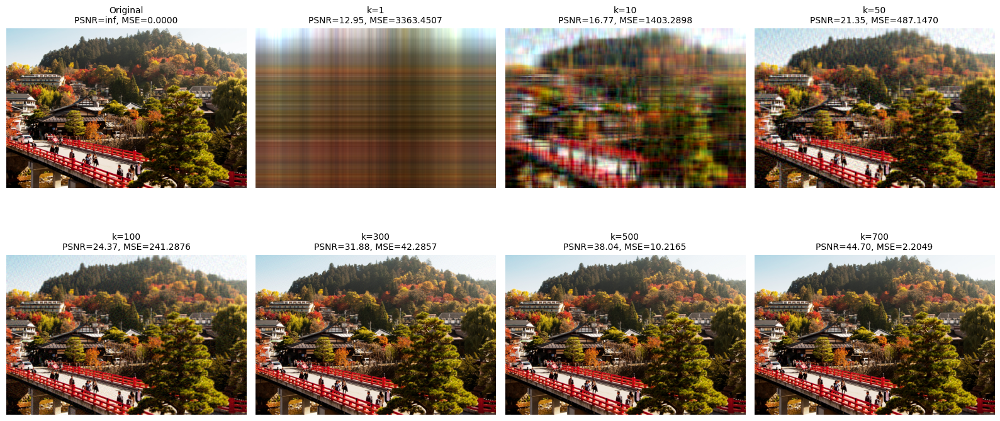
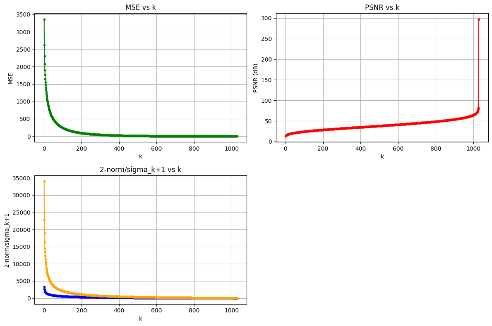
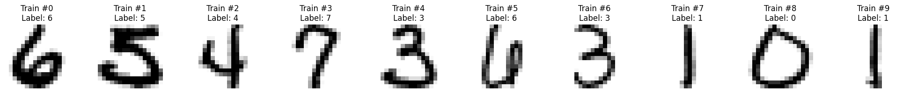
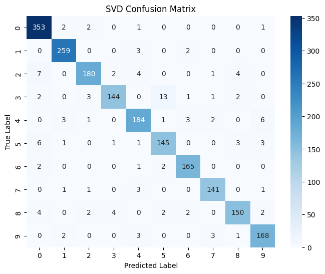
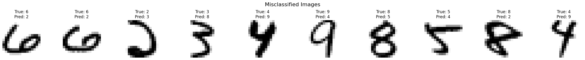
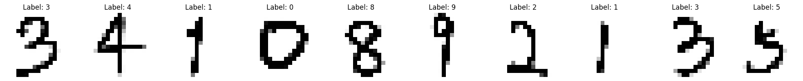
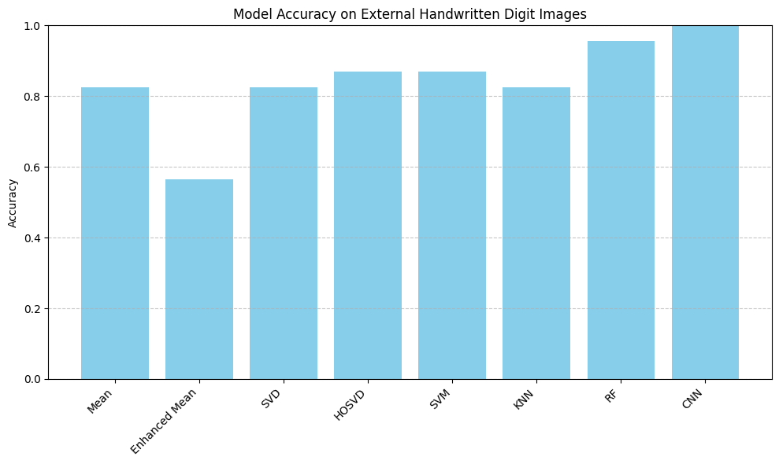

```{r setup, include=FALSE}
library(ggplot2)
library(tidyverse)
library(gridExtra)
library(scales)

# Personal visual DNA
c1  <- "#18A3A3"      # teal (primary)
c2  <- "#FF4D8D"      # rose pink (accent)
c3  <- "#7A7A7A"      # mid grey
c4  <- "#000000"      # border / text
acc <- "#E65100"      # deep orange (trend / highlight)

theme1 <- function() {
  theme_minimal(base_family = "sans") +
    theme(
      text             = element_text(colour = c4),
      plot.title       = element_text(face = "bold", size = 14),
      plot.subtitle    = element_text(size = 10, colour = c3),
      axis.title       = element_text(size = 11),
      panel.grid.minor = element_blank(),
      panel.grid.major = element_line(colour = "#E0E0E0", linetype = "dotted")
    )
}
```

## 作業 {#assignments}

---

## HW1 — SVD 影像壓縮

**主題：** 以 SVD 分解驗證 Eckart-Young 定理：$\|A - A_k\|_2 = \sigma_{k+1}$

**資料集：** 1546×1029 像素的彩色照片（RGB 三通道）

### 流程總覽

```{mermaid}
%%{init: {"theme": "base", "themeVariables": {"fontSize": "18px"}, "flowchart": {"padding": 35}}}%%
flowchart TD
    A["Load Image 1546×1029×3     "] --> B["Split R, G, B     "]
    B --> C["np.linalg.svd per channel     "]
    C --> D["Reconstruct A_k for k = 1..1029     "]
    D --> E["Compute MSE, PSNR, 2-norm     "]
    E --> F["Compare 2-norm vs σ_k+1     "]

    style A fill:#E3F2FD,color:#1565C0,stroke:#90CAF9,stroke-width:2px
    style B fill:#F5F5F5,color:#424242,stroke:#BDBDBD,stroke-width:2px
    style C fill:#FFF3E0,color:#E65100,stroke:#FFCC80,stroke-width:2px
    style D fill:#F3E5F5,color:#6A1B9A,stroke:#CE93D8,stroke-width:2px
    style E fill:#E3F2FD,color:#1565C0,stroke:#90CAF9,stroke-width:2px
    style F fill:#E8F5E9,color:#2E7D32,stroke:#A5D6A7,stroke-width:2px
```

::: {.chart-note .teal}
**方法說明：** 將照片視為矩陣 A，對 RGB 各通道分別進行 SVD。我們刻意避免使用 `np.linalg.norm(ord=2)`（其內部實作依賴 SVD，會造成循環論證），改以 **Monte Carlo 隨機向量法**近似算子 2-norm，再與 σ_{k+1} 的趨勢比較。
:::

### 關鍵公式

**SVD 分解：**

$$A = U \Sigma V^T, \quad A_k = \sum_{i=1}^{k} \sigma_i u_i v_i^T$$

**Eckart-Young 定理：**

$$\|A - A_k\|_2 = \sigma_{k+1}$$

### 結果

| k | 2-norm（近似） | σ_{k+1} | MSE | PSNR (dB) |
|--:|:---:|:---:|:---:|:---:|
| 1 | 3,310 | 34,072 | 3,363 | 12.95 |
| 10 | 1,556 | 10,116 | 1,403 | 16.77 |
| 50 | 837 | 3,645 | 487 | 21.35 |
| 100 | 577 | 2,108 | 241 | 24.37 |
| 300 | 234 | 699 | 42 | 31.88 |
| 500 | 116 | 340 | 10 | 38.04 |
| 700 | 54 | 172 | 2.2 | 44.70 |

### 重建品質



::: {.chart-note .grey}
**視覺化：** k=1 時幾乎無法辨認原圖；k=50 時主要輪廓已可分辨；k=300 以上的結果與原圖非常接近。k=507（右下）時 PSNR 達 38 dB，肉眼幾乎無法察覺與原圖的差異。
:::

### MSE / PSNR / 2-norm 分析



::: {.chart-note .orange}
**結論：** 隨 k 增加，MSE 下降、PSNR 上升，且 2-norm 與 σ_{k+1} 呈現相同的遞減趨勢，間接驗證了 Eckart-Young 定理。Monte Carlo 方法因隨機取樣而低估了真實的 2-norm，但整體趨勢一致。
:::

---

## HW2 — 手寫數字辨識

**主題：** 在 USPS 手寫數字資料集上比較 8 種分類方法

**資料集：** USPS 手寫數字（16×16 灰階，數字 0-9 共 10 類）

### 資料集範例



::: {.chart-note .grey}
**資料特性：** 每張影像只有 16×16 = 256 個像素，解析度極低但仍保留數字的基本結構，因此矩陣分解方法（SVD / HOSVD）能有效擷取低維特徵。
:::

### 方法總覽

| 類別 | 方法 | 說明 |
|----------|--------|-------------|
| **基線** | Mean 法 | 計算各類別的平均影像，以歐氏距離分類 |
| | Enhanced Mean | 考慮類別間混淆模式的迭代修正 |
| **矩陣分解** | SVD（k=20） | 為各類別建立 SVD 基底，以投影殘差分類 |
| | HOSVD | Tucker 分解（tensorly），秩 (10,10,20) |
| **傳統機器學習** | SVM | sklearn SVC |
| | KNN | sklearn KNeighborsClassifier |
| | Random Forest | sklearn RandomForestClassifier |
| **深度學習** | CNN（PyTorch） | Conv2D → MaxPool → Dense，50 個 epoch |

### 準確率比較

```{r hw2-accuracy, echo=FALSE, fig.width=8, fig.height=5}
df_acc <- data.frame(
  model = factor(
    c("Mean", "Enhanced\nMean", "SVD\n(k=20)", "HOSVD", "SVM", "KNN", "Random\nForest", "CNN"),
    levels = c("Mean", "Enhanced\nMean", "SVD\n(k=20)", "HOSVD", "SVM", "KNN", "Random\nForest", "CNN")
  ),
  accuracy = c(81.42, 84.85, 94.12, 94.32, 94.92, 94.47, 93.97, 95.76),
  category = c("Baseline", "Baseline", "SVD", "SVD", "ML", "ML", "ML", "DL")
)

ggplot(df_acc, aes(x = model, y = accuracy, fill = category)) +
  geom_col(colour = c4, width = 0.65) +
  geom_text(aes(label = paste0(accuracy, "%")),
            vjust = -0.5, fontface = "bold", size = 3.8, colour = c4) +
  geom_hline(yintercept = 81.42, linetype = "dashed",
             colour = c3, linewidth = 0.7) +
  scale_fill_manual(values = c("Baseline" = "#F5F5F5", "SVD" = "#FFF3E0",
                                "ML" = "#F3E5F5", "DL" = "#E8F5E9")) +
  scale_y_continuous(expand = expansion(mult = c(0, 0.08))) +
  coord_cartesian(ylim = c(75, 100)) +
  labs(title = "USPS Handwritten Digit Classification — 8 Models Comparison",
       subtitle = "USPS dataset · 16×16 grayscale · 10 classes",
       x = NULL, y = "Accuracy (%)", fill = "Category") +
  theme1() +
  theme(legend.position = "bottom")
```

::: {.chart-note .teal}
**結果分析：** Mean 法作為基線只有 81.42%。SVD（k=20）躍升至 94.12%，證明低秩近似能有效捕捉數字結構。傳統機器學習（SVM 94.92%）與 SVD 家族表現相近。**CNN 以 95.76% 勝出**，但訓練時間為 98 秒，遠高於 KNN 的 0.45 秒。
:::

### 訓練時間比較

```{r hw2-time, echo=FALSE, fig.width=8, fig.height=4}
df_time <- data.frame(
  model = factor(
    c("Mean", "KNN", "SVD\n(k=20)", "Enhanced\nMean", "SVM", "Random\nForest", "HOSVD", "CNN"),
    levels = c("Mean", "KNN", "SVD\n(k=20)", "Enhanced\nMean", "SVM", "Random\nForest", "HOSVD", "CNN")
  ),
  time = c(0.05, 0.45, 1.00, 1.55, 4.26, 5.79, 30.57, 98.43),
  category = c("Baseline", "ML", "SVD", "Baseline", "ML", "ML", "SVD", "DL")
)

ggplot(df_time, aes(x = model, y = time, fill = category)) +
  geom_col(colour = c4, width = 0.65) +
  geom_text(aes(label = paste0(round(time, 1), "s")),
            vjust = -0.5, fontface = "bold", size = 3.5, colour = c4) +
  scale_fill_manual(values = c("Baseline" = "#F5F5F5", "SVD" = "#FFF3E0",
                                "ML" = "#F3E5F5", "DL" = "#E8F5E9")) +
  scale_y_continuous(expand = expansion(mult = c(0, 0.1))) +
  labs(title = "Model Training + Testing Time",
       subtitle = "Lower is better · sorted by time ascending",
       x = NULL, y = "Time (seconds)", fill = "Category") +
  theme1() +
  theme(legend.position = "bottom")
```

::: {.chart-note .orange}
**速度 vs 準確率：** KNN 只需 0.45 秒即達 94.47%，是**最具性價比**的模型。CNN 最準確（95.76%）但需 98 秒。HOSVD（Tucker 分解）準確率與 SVD 相近，但慢了 30 倍。
:::

### SVD 混淆矩陣



::: {.chart-note .grey}
**混淆矩陣分析：** SVD 法在數字 0 與 1 上表現最佳（分別答對 353 與 264 筆），而數字 3 與 7 的混淆較多（有 13 筆 3 被誤判為 5）。對一個不需訓練的矩陣分解方法而言，整體 94.12% 的準確率相當出色。
:::

### 誤分類樣本



::: {.chart-note .orange}
**誤分類分析：** 這些樣本連肉眼都難以辨認。例如真實為 6 卻被預測為 2（相似的彎曲筆畫），真實為 3 卻被預測為 8（形狀相似）。在 16×16 的低解析度下，部分數字之間的結構差異極小。
:::

### 真實手寫測試





::: {.chart-note .pink}
**外部驗證：** 所有模型都以手機拍攝的手寫數字照片測試。**CNN 達到 100%** 的準確率，Random Forest 95%，而 Enhanced Mean 只有 56%。這顯示深度學習對真實手寫變化的泛化能力最強。
:::
