## 作業

### 作業 1

#### 問題 1

**請列舉並描述三個你使用過的、透過資料庫系統來儲存與存取持久性資料的應用程式。**（例如：航空公司、線上交易、銀行、大學系統）

第一個例子是電子遊戲。在遊戲中，玩家的等級和經驗值，以及獲得的道具和裝備都會被記錄下來，這樣玩家下次登入時仍然可以存取這些資料。另一個例子是線上購物。例如 Amazon 會記錄每件商品的價格、所屬目錄、是否符合免運資格，以及是否有庫存等資訊。第三個例子是串流平台，如 Netflix，會記錄使用者的地區和訂閱等級。所有這些資料都被持久性地儲存，並可在之後隨時存取。

#### 問題 2

**請針對領域專案提出三個應用程式**（例如：犯罪學、經濟學、腦科學等）。請確保包含：i. 目的 ii. 功能 iii. 簡易介面設計

##### 衣櫥管理資料庫

###### i. 目的

這個衣櫥管理資料庫的主要目的是減少出門前選擇穿搭所花費的時間。

對許多人來說，每日穿搭的困難不在於缺少衣物，而在於需要同時考慮顏色、風格、場合與整體搭配，這導致了很高的決策成本。

因此，我將衣櫥建模為關聯式資料庫，不僅記錄個別衣物，還描述衣物之間的關係，讓穿搭選擇能以系統化的方式處理。

透過結構化衣物資料，此系統旨在將「每天重新思考要穿什麼」轉變為「從資料庫中快速選擇最佳組合」。

###### ii. 功能

在此系統中，每件衣物被視為一個資料實體，並以一組屬性來描述，例如：

-   類別（T恤、牛仔褲、外套、鞋子）
-   顏色（包含各顏色的比例）
-   風格（簡約風、正式、復古、運動等）
-   材質（牛仔、亞麻、棉質）

這些屬性被正規化為多個資料表，並使用多對多關係來表示一件衣物可以屬於多種風格或適合不同場合。

此資料庫的核心功能不僅在於儲存衣物，更在於描述衣物之間的搭配性。

系統使用搭配規則來定義：

-   視覺美學限制，例如單套穿搭不超過三種顏色，並限制風格標籤數量以維持整體一致性
-   氣候適應性，根據保暖相關變數評估組合，確保上下半身的保暖度平衡，且隨溫度降低偏好更高的整體保暖度

當使用者選擇特定衣物（例如一件粉紅色 T 恤）時，系統可以根據資料庫中的關係和規則，立即推薦其他高度搭配的衣物（如淺藍色牛仔褲和白色運動鞋），並按搭配分數排列這些組合，幫助使用者更有效率地做出決策。

此外，隨著資料累積，系統可以分析衣櫥的整體結構，例如：

-   某些風格或衣物類別是否欠缺
-   顏色或衣物類型是否過度集中
-   新購買的衣物是否與現有衣物功能重疊
-   哪些舊衣物長期未使用，可考慮淘汰

這使得衣櫥不僅僅是一個物品清單，而是一個可以查詢、分析和優化的系統，並可延伸至穿搭推薦和購買決策支援等日常生活應用。

此問題特別適合使用關聯式資料庫，因為穿搭選擇本質上涉及結構化資料和多對多關係（如衣物、風格和搭配規則），這些可以透過關聯式查詢進行高效的組合與分析。

###### iii. 簡易介面設計

使用者進入系統時，首頁顯示衣櫥中所有衣物的表格視圖，包含類別、顏色、風格、材質和季節性等基本資訊。介面支援多選功能。

使用者可以選擇一件或多件計畫穿著的衣物，並提交選擇以產生穿搭結果。

根據所選衣物和資料庫中儲存的搭配規則，系統會產生多個候選穿搭。

穿搭結果頁面提供不同的排序選項，例如按舒適度分數、美觀分數或氣候適合度分數排序。

每套穿搭都顯示對應的數值分數，讓使用者可以快速比較選項並選擇最合適的組合，無需反覆試穿或過度思考。

介面支援快速決策：選擇衣物 → 產生穿搭 → 按分數排序 → 挑選最佳搭配。

##### 3D 列印農場訂單與排程資料庫

###### i. 目的

此 3D 列印農場資料庫的目的是將整個工作流程系統化——從客戶下單到自動估算、機器排程和進度追蹤——使農場能在訂單量增長時高效運作。目標是縮短交貨時間、減少人工排程錯誤、提高機器利用率並最大化收益。

在實務中，3D 列印訂單差異很大（模型大小、材料、解析度、多色需求，以及後處理如上色等）。如果定價和排程依賴人工判斷，很容易低估時間/成本、分配錯誤的機器，或在訂單佇列中造成瓶頸。因此，此系統使用關聯式資料庫以結構化方式儲存訂單、機器能力、材料用量和排程狀態，透過規則和查詢實現快速且一致的決策。

###### ii. 功能

**訂單接收與需求標記**

當客戶提交訂單時，系統將其儲存為具有結構化屬性的訂單記錄，例如：

-   模型大小與體積（包圍盒 / 體積）
-   列印類型（FDM / SLA）
-   解析度設定（層高 / 解析度）
-   多色需求
-   材料類型
-   後處理需求（例如上色/打磨）
-   其他客製化需求（以標籤儲存）

這些欄位可正規化為多個資料表，使用多對多關係來表示一張訂單可以有多個需求標籤。

**逐機估算**

關鍵不僅在於計算訂單的整體價格，而是估算同一訂單在不同機器上的表現，因為時間、成本和完成時間可能因機器而異。這有助於更好的機器分配和排程決策。

對於每台候選機器，系統套用定價規則或估算模型進行逐機估算，包括：

-   預估列印時間
-   預估材料用量
-   機器專屬的預估成本與報價
-   預估完成時間（考慮當前工作負載）

系統儲存這些「訂單 × 機器」的估算結果，以便使用不同目標函數進行查詢和排名，例如最低成本、最早完成或在期限內最穩定的選項。

**訂單佇列與狀態追蹤**

所有訂單自動加入訂單佇列，每張訂單維護清楚的狀態，例如：

-   pending（待處理）
-   queued（已排入佇列）
-   printing（列印中）
-   post-processing（後處理中）
-   completed（已完成）
-   failed（失敗）

管理者可以查詢：

-   目前佇列中有什麼及其優先順序
-   哪些訂單正在列印 vs. 等待機器
-   哪些失敗的訂單需要重印或人工介入

**機器能力建模與分配建議**

資料庫儲存每台機器的能力和限制，例如：
- 機器類型：多色 / 單色 / SLA / FDM
- 最大建構體積
- 支援的材料
- 速度/品質特性
- 當前工作負載與可用性

當新訂單到達時，系統先進行限制過濾（例如大小、材料、多色需求）以識別可行的機器，然後使用逐機估算產生推薦分配，例如：

-   最早完成時間
-   最低預估成本
-   平衡選項（期限 + 穩定性）

這將排程轉變為決策支援流程，而非人工猜測。

###### iii. 簡易介面設計

在客戶端，系統提供客戶訂單頁面，使用者可上傳 3D 模型或指定列印需求，如大小、材料、解析度、多色選項和後處理需求。根據這些資訊，系統自動回傳預估價格和預估交貨時間。

在管理端，系統提供訂單儀表板，顯示當前訂單佇列和訂單狀態。管理者可按期限、優先順序或處理狀態排序或篩選訂單，以更有效率地管理工作流程。

系統還包含機器儀表板，列出所有可用機器及其機器類型、最大建構體積、支援的材料、當前工作負載和預估可用性。這讓操作人員可以快速了解機器容量和限制。

當選擇一張訂單時，排程視圖呈現可完成該訂單的候選機器清單。對於每台候選機器，系統顯示預估列印時間、預估材料用量、機器專屬成本與報價，以及預估完成時間。介面支援一鍵排序選項，例如最快、最便宜或最穩定，以協助管理者做出分配決策。

介面支援高效操作：提交訂單 → 逐機估算 → 排入佇列 → 推薦機器 → 排程與追蹤進度。

##### 農場灌溉管理資料庫

###### i. 目的

此系統的目的是使用關聯式資料庫管理農場的核心資訊——如田地、作物類型、生長階段和灌溉設備。

同時，系統透過天氣預報服務提供的 API 擷取並儲存天氣資料，並結合這些資訊與一組灌溉規則，自動產生每日灌溉排程。

目標是降低人工決策成本，同時提高用水效率和作物管理的一致性。

###### ii. 功能

在此系統中，資料庫不僅用於資料儲存。其核心功能是整合農場內部資訊與外部天氣資料，並根據預定義的規則自動產生灌溉決策。

**核心資料管理**

系統使用關聯式架構管理農場的主要實體，包括：

-   田地：田地 ID、位置、面積，以及目前種植的作物
-   作物：作物類型及其基本用水需求
-   生長階段：如發芽、生長、開花和結果等階段，每個階段有不同的用水需求
-   灌溉設備：設備類型（如滴灌、噴灌）、流量或效率係數，以及可用狀態

這些實體透過關係連接。例如，每塊田地關聯到特定作物和當前生長階段，並可分配可用的灌溉設備。

**天氣資料整合**

系統透過外部天氣預報 API 擷取天氣資訊，例如：

-   預測降雨量
-   降水機率
-   溫度範圍

此天氣資料儲存在資料庫中，作為每日灌溉決策的重要輸入，無需使用者手動輸入。

**灌溉規則與排程產生**

系統維護一組灌溉規則，描述不同條件下的灌溉需求，例如：

-   作物類型 × 生長階段 → 建議基準灌溉量
-   若預測降雨量超過某一門檻 → 自動減少或取消當日灌溉
-   灌溉設備效率差異 → 調整實際灌溉時間

當每日排程流程執行時，系統結合：

-   每塊田地的作物類型和生長階段
-   當日天氣預報
-   灌溉設備的可用性和效率

根據這些資訊，系統自動產生每日灌溉排程，指示每塊田地是否需要灌溉以及建議的用水量或灌溉時間。

###### iii. 簡易介面設計

使用者進入系統時，首頁顯示農場所有田地的表格視圖，包含當前作物類型、生長階段，以及系統當日的灌溉建議。

使用者可以透過單一操作產生每日灌溉排程。根據田地資訊、天氣預報和灌溉規則，系統列出哪些田地需要灌溉，並提供建議的用水量或灌溉時間。

排程以簡單的清單格式呈現，讓使用者可以快速檢閱並執行灌溉任務。完成後，使用者可標記灌溉狀態以供記錄和日後參考。

#### 問題 5

**當前資料庫系統無法做到的事情有哪些？**

當前資料庫系統無法理解資料背後的語義。因此，在更複雜的應用中，它們通常依賴人工定義的規則或持續調整的權重來產生合理的輸出。此外，資料庫在處理跨情境決策方面能力有限，即需要同時平衡多個相互競爭的目標。

例如，在衣櫥管理資料庫中，系統可以根據結構化標準（如色彩組合、風格標籤、材質屬性和天氣條件）評估穿搭。它可以為美觀度、舒適度和氣候適合度等因素評分，並產生多個符合預定義規則的候選穿搭。然而，資料庫無法判斷哪套穿搭在視覺吸引力、舒適度和天氣適合度之間達到最佳平衡。

這個限制源於「好看」或「舒適」等偏好本質上是主觀且依情境而定的，不存在適用於所有使用者或所有情境的單一最佳解。因此，資料庫的角色不是做出最終決策，而是透過過濾不可行的選項、結構化相關資訊，以及呈現具有透明評估指標的可比較替代方案來支援決策。

最終，最終選擇必須由使用者做出，他們可以在特定情境中決定優先考慮舒適度、美觀度還是氣候適合度。這突顯了當前資料庫系統的根本限制：它們在決策支援方面很有效，但無法在複雜的、價值驅動的決策中取代人類判斷。

#### 問題 6

**描述至少三個可能用於儲存社交網路/社群媒體系統（如 Twitter 或 Reddit）資訊的資料表。**

社交網路或社群媒體系統（如 Twitter 或 Reddit）至少可能由以下三個核心資料表支撐：

**1. 使用者資料表（User Table）**

使用者資料表儲存使用者的基本資訊，例如：
- user_id
- username
- 帳號建立時間
- 個人檔案元資料（如自我介紹或狀態）

此資料表代表使用者的身分，並作為系統中其他資料表的參照。

**2. 貼文資料表（Post Table）**

貼文資料表儲存使用者建立的內容，例如：

-   post_id
-   author_id（外鍵，參照 User 資料表）
-   content
-   timestamp

每篇貼文關聯到特定使用者，形成使用者與貼文之間的一對多關係。

**3. 留言資料表（Comment Table）**

留言資料表儲存對貼文（或其他留言）的回覆，例如：

-   comment_id
-   post_id（外鍵，參照 Post 資料表）
-   author_id
-   content
-   timestamp

此資料表支援串連式討論，允許多位使用者參與同一貼文下的對話。

這些資料表被分開以支援關聯式查詢、維護資料一致性，並實現使用者、貼文和討論串的高效檢索。

### 作業 2

#### 問題 1

**關聯式綱要（relation schema）、關聯（relation）和實例（instance）之間有什麼區別？請以大學資料庫為例說明。**

-   **關聯式綱要（Relation Schema）** = 關聯的邏輯結構：一組屬性名稱及其定義域的列表。它不隨時間改變。\
    *範例：* `instructor(ID, name, dept_name, salary)`

-   **關聯（Relation）** = 非正式地用來同時指綱要和實例。\
    *範例：* 「department 關聯」可以指綱要
    `department(dept_name, building, budget)` 或其目前持有的實際資料。

-   **實例（Instance）** = 關聯在特定時間點的實際資料快照。它隨著元組的插入、更新或刪除而改變。\
    *範例：* 圖 2.5 中的 department 關聯實例包含 7 個元組。如果大學新增一個「Data Science」學系，實例會增長到 8 個元組，但綱要仍為
    `department(dept_name, building, budget)`。

#### 問題 2 & 3

**請繪製以下銀行資料庫的綱要圖。標示主鍵（底線）和外鍵。**

此銀行資料庫由以下關聯組成：

-   `branch(branch_name, branch_city, assets)`
-   `customer(ID, customer_name, customer_street, customer_city)`
-   `loan(loan_number, branch_name, amount)`
-   `borrower(ID, loan_number)`
-   `account(account_number, branch_name, balance)`
-   `depositor(ID, account_number)`

{width="80%"}

#### 問題 4

**描述人工智慧或 LLM 可以如何協助管理或查詢資料庫的兩種方式。在回答中，簡要說明每種方式相比傳統（非 AI）方法如何提升效率或準確度。（3-5 句）**

1.  **自然語言轉 SQL（查詢）：** LLM 可以將自然語言問題直接翻譯為可執行的 SQL 查詢，降低非技術使用者的門檻，並減少手寫 SQL 時的語法錯誤。

2.  **AI 驅動的資料庫調優（管理）：** LLM 可以自動分析慢速查詢並建議索引優化，取代 DBA 手動檢查查詢日誌和執行計畫這一傳統耗時的過程。

整體而言，這兩種方法都減少了對專業知識的需求，並相比傳統手動方法實現更快、更準確的資料庫操作。

### 作業 3

#### 問題 1

開啟線上 SQL 直譯器並載入大學資料庫。

#### 問題 2

**撰寫 SQL 程式碼以取得以下清單：i. 學生 ID、ii. 教師、iii. 系所**

{width="80%"}

#### 問題 3

**撰寫 SQL 程式碼執行以下查詢：**

**i. 找出修過至少一門資訊科學課程的每位學生的 ID 和姓名；確保結果中沒有重複姓名。**

{width="80%"}

**ii. 將成績加入清單**

{width="80%"}

**iii. 找出未修過任何 2017 年之前開設課程的每位學生的 ID 和姓名。**

{width="80%"}

**iv. 對每個系所，找出該系教師的最高薪資。**

{width="80%"}

**v. 找出前一題計算的各系最高薪資中的最低值。**

{width="80%"}

**vi. 將教師姓名加入清單**

{width="80%"}

#### 問題 4

**找出從未在其教授的任何課程中給過 A 等成績的教師（含姓名和 ID）。（從未教過課程的教師自然滿足此條件。）**

{width="80%"}

### 作業 4

#### 問題 1

**解釋弱實體集（weak entity set）與強實體集（strong entity set）的差異，並以第 6 章以外的例子說明。**（參考 Ch. 6, 6.5.3）

**強實體集**是擁有自己的主鍵、可以獨立存在的實體集。例如以 `order_id` 為主鍵的 `Order` 實體，不需依賴其他實體就能唯一識別每筆訂單。

**弱實體集**是本身沒有足夠的屬性可構成主鍵的實體集。它必須依賴一個相關的強實體集（稱為**識別實體集**）來完成識別。弱實體集使用**鑑別子（discriminator）**（也稱為部分鍵），與識別實體的主鍵組合後，才能唯一識別弱實體集中的每個實體。

**範例：訂單與訂單明細**

以電子商務系統為例：

-   `Order` 是**強實體集**，主鍵為 `order_id`。
-   `Order_Item` 是**弱實體集**，鑑別子為 `item_number`。

`Order_Item` 無法僅靠 `item_number` 唯一識別，因為不知道屬於哪張訂單的「第 3 項」沒有意義。完整的識別需要：`order_id`（來自識別實體 `Order`）+ `item_number`（鑑別子）。

`Order` 與 `Order_Item` 之間的關係是**識別關係**，意即 `Order_Item` 的存在完全取決於其所屬的 `Order` 是否存在。

**E-R 圖表示法：**

-   弱實體集：以**雙框矩形**表示
-   鑑別子：以**虛線底線**標示
-   識別關係：以**雙框菱形**表示
-   弱實體到識別關係的連線使用**雙線**（全參與），因為每個弱實體都必須對應一個識別實體

#### 問題 2

**設計一張 E-R 圖，用來追蹤你最喜愛的運動隊伍的得分統計。** 需儲存進行過的比賽、每場比賽的比分、每場比賽的球員，以及每位球員在各場比賽的個人得分統計。彙總統計應建模為衍生屬性，並說明其計算方式。

**a) 單一隊伍的 E-R 圖（利物浦足球俱樂部）**

此圖包含兩個實體：`match` 與 `player`，以多對多關係 `played` 連接。關係屬性 `points_scored`、`minutes_played` 與 `starter_flag` 記錄每位球員在各場比賽的個人統計。`player` 的衍生屬性包含 `total_points()` 與 `avg_points_per_match()`。

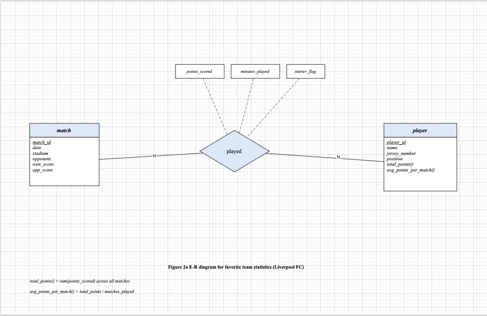{width="80%"}

**衍生屬性定義：**

-   `total_points()` = 所有比賽的 points_scored 總和
-   `avg_points_per_match()` = total_points / matches_played

**b) 擴展至聯盟所有隊伍**

新增 `team` 實體，屬性包含 `team_id`、`team_name`、`city` 與衍生屬性 `win_count()`。兩個新關係 `home_team` 與 `away_team` 將 `team` 連接至 `match`。`belongs_to` 關係將 `player` 連接至 `team`（N:1）。`match` 實體新增 `home_team_score`、`away_team_score` 與衍生屬性 `winner()`。

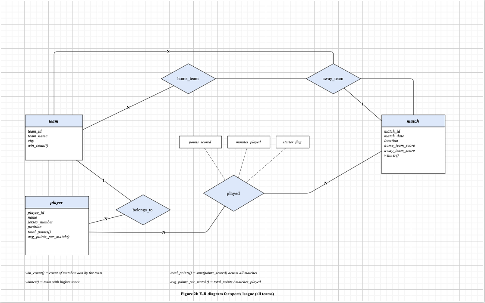{width="80%"}

**新增的衍生屬性定義：**

-   `win_count()` = 該隊伍獲勝的比賽場數
-   `winner()` = 得分較高的隊伍

#### 問題 3

##### 3a

**考慮以下查詢：**

```sql
select course_id, semester, year, sec_id, avg (tot_cred)
from takes natural join student
where year = 2017
group by course_id, semester, year, sec_id
having count (ID) >= 2;
```

**i. 解釋為什麼在 `from` 子句中加入 `natural join section` 不會改變結果。**

`takes` 關聯已包含屬性 `(course_id, sec_id, semester, year)`，這些屬性合起來正是 `section` 關聯的主鍵。由於 `takes` 對 `section` 有外鍵限制，`takes` 中的每個 tuple 都保證在 `section` 中有對應的 tuple。

因此，在 `from` 子句加入 `natural join section` 是一個**無損失的 join**：

-   **不會增加任何列**，因為 `takes` 的每個 tuple 最多只對應 `section` 的一個 tuple（join 的欄位是 `section` 的主鍵）。
-   **不會移除任何列**，因為 `takes` 的每個 tuple 在 `section` 中都有對應的 tuple（外鍵限制）。

額外 join 的唯一效果是把 `section` 的其他屬性（如 `building`、`room_number`、`time_slot_id`）附加到每個 tuple 上。但這些屬性沒有出現在 `select`、`where`、`group by` 或 `having` 子句中，因此對查詢結果沒有影響，輸出完全相同。

**ii. 使用線上 SQL 直譯器測試結果。**

不加 `natural join section`：

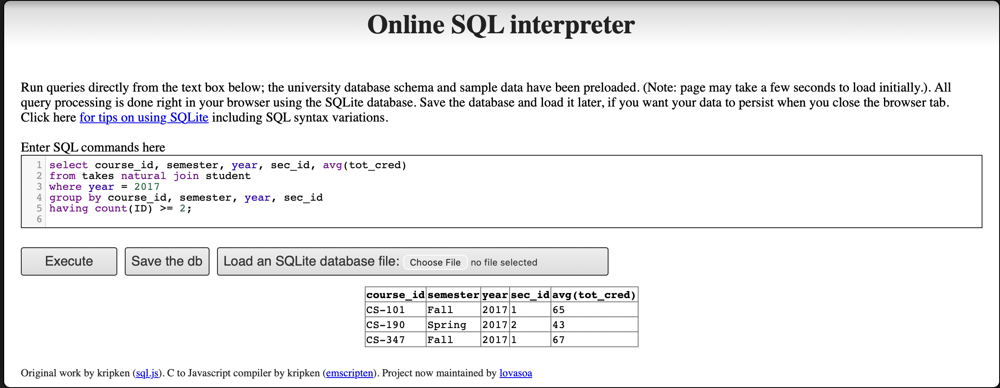{width="80%"}

加上 `natural join section`：

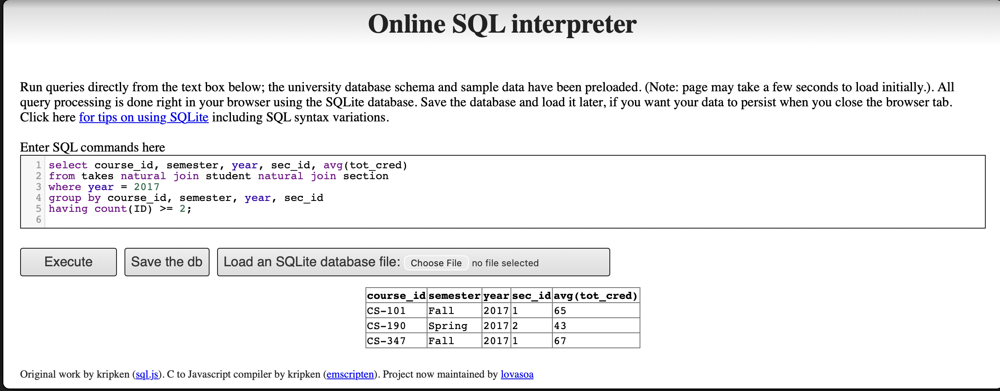{width="80%"}

兩個查詢回傳完全相同的結果（CS-101、CS-190、CS-347），證實加入 `natural join section` 不會改變輸出。

##### 3b

**使用大學資料庫綱要撰寫 SQL 查詢，找出從未在大學修過任何課程的學生 ID。不可使用子查詢與集合運算（使用 outer join）。**（參考 Ch. 4, 4.1.3）

```sql
select s.ID
from student s
left outer join takes t on s.ID = t.ID
where t.ID is null;
```

`left outer join` 會保留 `student` 關聯中的每個 tuple。對於在 `takes` 中沒有對應紀錄的學生（即從未修過任何課程），`takes` 的所有屬性都會填入 `null`。`where t.ID is null` 條件將結果篩選為只包含 `ID` 在 `takes` 中沒有對應的學生，也就是從未修課的學生。

此做法利用 outer join 的特性避免了子查詢與集合運算：被保留（左）側沒有配對到的列，會在非保留（右）側產生 `null` 值，再以 `is null` 檢測即可。

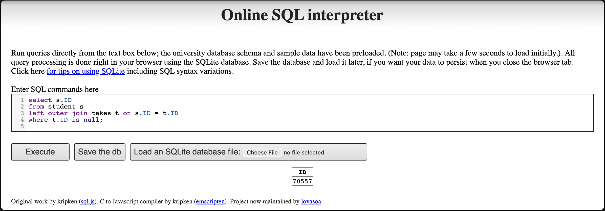{width="80%"}

### 作業 5

#### 問題 1

**E-R 圖可視為一張圖（graph）。以下情況對企業綱要的結構而言各代表什麼意義？**

##### a) 圖不連通

在圖論中，不連通的圖表示圖至少有兩個連通分量——也就是存在某些節點之間沒有任何路徑。在企業 E-R 綱要的脈絡下，這表示圖中至少有兩組**彼此完全獨立**的實體集與關係集，它們之間沒有任何關係、外鍵參照或共同屬性。實務上，這意味著綱要建模了兩個以上完全分離、互不往來的業務領域。

##### b) 圖有迴圈

在圖論中，迴圈表示圖中存在兩個節點之間有兩條以上完全不同的路徑。在企業 E-R 綱要的脈絡下，這表示**有多條關係路徑連接同一組實體集**。

然而，迴圈不一定代表冗餘。迴圈中的每條路徑可能承載語意上獨立的資訊——例如一條路徑記錄 x 維度的關係屬性，另一條記錄 y 維度的，兩者無法互相推導。迴圈是否真的代表冗餘，完全取決於該領域的語意限制：只有當某個關係的資訊可以完全由迴圈中的其他路徑推導出來時，它才是真正的冗餘。因此，迴圈代表綱要中存在需要仔細分析的複雜相依關係，但不自動等於冗餘。

#### 問題 3

**我們可以透過加入適當的屬性，把任何弱實體集轉換為強實體集。那麼為什麼還需要弱實體集？**

雖然技術上可以透過加入唯一識別屬性（例如代理鍵）把任何弱實體集轉換為強實體集，弱實體集仍然有用且更受偏好，原因如下：

1.  **語意清晰與建模忠實度。** 弱實體集反映真實世界中確實存在的相依關係。例如，建築物內的房間只有相對於它所屬的建築物才有意義。若指定一個全域唯一的 `room_id` 將它轉為強實體集，技術上可行，但會掩蓋這種固有的相依性，使綱要更難理解。

2.  **避免無意義的代理鍵。** 為沒有獨立身分的實體——例如訂單內的訂單明細，或醫院內某位病患的紀錄——建立唯一鍵，等於強行引入沒有現實意義的人工鍵。這只會增加複雜度，而不會提升資料模型的品質。

3.  **強制參照完整性與存在相依性。** 弱實體集讓存在相依性在綱要中變得明確。因為弱實體集只有在其識別（擁有者）實體存在時才能存在，這個限制被內建於模型中。若擁有者實體被刪除，其相依的弱實體自動視為無效。這在概念層次強制了資料完整性，而帶有外鍵限制的強實體集無法如此清楚地傳達這一點。

4.  **減少冗餘。** 若弱實體的自然識別碼只在其擁有者的範圍內唯一（例如課程內的班次編號），使用複合識別碼（擁有者鍵 + 鑑別子）比引入全新的全域鍵更精簡、更有意義，也避免不必要地重複擁有者的鍵資訊。

總結來說，弱實體集提升了 E-R 模型的表達力與清晰度。它讓設計者能準確表示那些存在與身分本質上繫於另一個實體的實體，使綱要更容易理解、維護與推理。

#### 問題 4

##### 4a

**考慮以下員工資料庫：**

```
employee (ID, person_name, street, city)
works (ID, company_name, salary)
company (company_name, city)
manages (ID, manager_id)
```

**其中主鍵以底線標示。請為下列每個查詢寫出 SQL 運算式。**

**i. 找出居住城市與其任職公司所在城市相同的每位員工的 ID 與姓名。**

```sql
SELECT e.ID, e.person_name
FROM employee AS e, works AS w, company AS c
WHERE e.ID = w.ID
  AND w.company_name = c.company_name
  AND e.city = c.city;
```

此查詢先將 `employee` 與 `works` join 以連結每位員工與其公司，再與 `company` join 取得公司所在城市。`WHERE` 子句接著篩選出居住城市與雇主所在城市相同的員工。

**ii. 找出與其主管住在同一城市、同一條街的每位員工的 ID 與姓名。**

```sql
SELECT e.ID, e.person_name
FROM employee AS e, manages AS m, employee AS mgr
WHERE e.ID = m.ID
  AND m.manager_id = mgr.ID
  AND e.city = mgr.city
  AND e.street = mgr.street;
```

此查詢使用 `manages` 資料表找出每位員工的主管，再將 `employee` join 兩次——一次代表員工（別名 `e`），一次代表主管（別名 `mgr`）。`WHERE` 子句要求員工與其主管的城市與街道都相同。

**iii. 找出薪資高於其公司所有員工平均薪資的每位員工的 ID 與姓名。**

```sql
SELECT e.ID, e.person_name
FROM employee AS e, works AS w
WHERE e.ID = w.ID
  AND w.salary > (
    SELECT AVG(w2.salary)
    FROM works AS w2
    WHERE w2.company_name = w.company_name
  );
```

此查詢使用相關子查詢，為每位員工計算其公司所有員工的平均薪資。外層查詢接著篩選出薪資高於該公司平均的員工。相關性透過 `w2.company_name = w.company_name` 建立。

##### 4b

**考慮以下 SQL 查詢，其目的是列出 2017 年春季開設的所有課程名稱及其授課教師姓名。**

```sql
SELECT name, title
FROM instructor NATURAL JOIN teaches
     NATURAL JOIN section NATURAL JOIN course
WHERE semester = 'Spring' AND year = 2017
```

**這個查詢有什麼問題？**

問題出在 `NATURAL JOIN` 的運作方式：它會對所有在被 join 的關聯之間同名的欄位進行 join。在標準的大學綱要中，各關聯的屬性如下：

-   `instructor`(`ID`, `name`, `dept_name`, `salary`)
-   `teaches`(`ID`, `course_id`, `sec_id`, `semester`, `year`)
-   `section`(`course_id`, `sec_id`, `semester`, `year`, `building`,
    `room_number`, `time_slot_id`)
-   `course`(`course_id`, `title`, `dept_name`, `credits`)

查詢執行 `instructor NATURAL JOIN teaches` 時，正確地以 `ID` 進行 join。接著與 `section` join 時，正確地以 `course_id`、`sec_id`、`semester`、`year` 進行 join。然而，最後與 `course` join 時，目前的結果（來自 `instructor`）與 `course` 都含有 `dept_name` 屬性。`NATURAL JOIN` 因此額外強制了 `instructor.dept_name = course.dept_name` 的條件，錯誤地把結果限制在教師所屬系所與課程開課系所相同的情況。

這是錯誤的，因為教師可以——而且經常——教授其他系所開設的課程。這些跨系授課的情況會被錯誤地排除在查詢結果之外。

修正方法是只把最後的 `NATURAL JOIN course` 改為明確的 `JOIN course USING (course_id)`。這確保與 `course` 的 join 只以 `course_id` 進行，避免 `dept_name` 被悄悄納入 join 條件：

```sql
SELECT name, title
FROM instructor NATURAL JOIN teaches
     NATURAL JOIN section
     JOIN course USING (course_id)
WHERE semester = 'Spring' AND year = 2017;
```

這個版本精確地控制了 join 的屬性，避免 `dept_name` 意外地把跨系授課的情況過濾掉。

### 作業 6

#### 問題 1 — 使用 JSON 和 XML 的網站

**查找包含以下資料表示方式的網站：a) 使用 JSON、b) 使用 XML。分析這些網站的結構與組成，並說明用於建立網頁資料庫的技術/方法。**

##### a) JSON 範例 — GitHub API 使用者資料

**URL：** `https://api.github.com/users/octocat`

此頁面以 JSON 格式顯示公開的 GitHub 使用者資料。資料以 JSON 物件回傳，包含許多鍵值對，例如 `login`、`id`、`html_url`、`followers` 和 `created_at`。

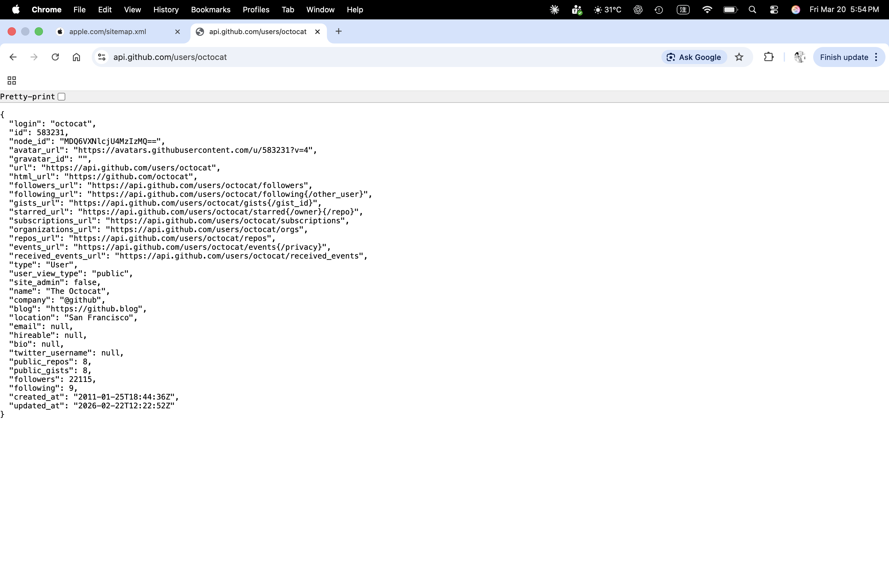{width="80%"}

**結構與組成：**

-   外層結構是由 `{ }` 標記的 JSON 物件。
-   每個欄位以鍵值對儲存，例如 `"login": "octocat"`。
-   回應包含字串、數字、URL、布林值和 null 值。
-   此格式輕量且便於網站和應用程式交換資料。

**可能使用的技術/方法：**

-   REST API
-   後端網路服務
-   資料庫支援，如 PostgreSQL、MySQL 或 NoSQL 系統
-   JSON 回應用於網頁和應用程式資料交換

##### b) XML 範例 — Apple 網站地圖

**URL：** `https://www.apple.com/sitemap.xml`

此頁面以 XML 格式顯示 Apple 的網站地圖。它列出網頁連結，以便搜尋引擎發現和索引該網站。

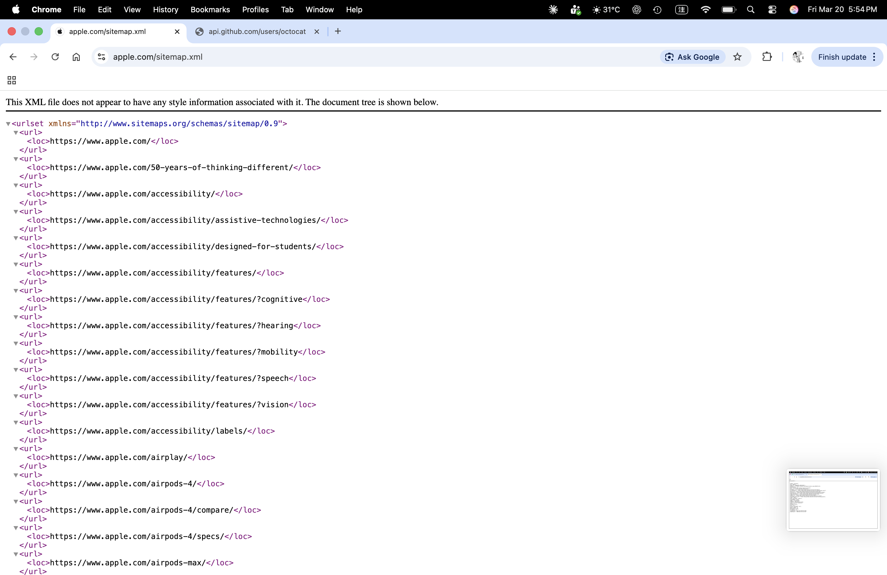{width="80%"}

**結構與組成：**

-   根元素為 `<urlset>`。
-   每個網頁條目儲存在重複的 `<url>` 元素中。
-   實際頁面地址儲存在 `<loc>` 標籤內。
-   資料以階層式標籤結構組織，這是 XML 的關鍵特徵。

**可能使用的技術/方法：**

-   XML 網站地圖標準
-   網站內容發布系統或 CMS
-   從網站資料庫產生的後端資料
-   搜尋引擎索引支援

##### 快速比較

-   JSON 較為簡短，適合網頁 API 和應用程式。
-   XML 使用標籤和階層結構，適合結構化文件和網站地圖。
-   兩種格式都有助於網站以有組織的方式儲存或交換資料。

#### 問題 2 — SQL 練習

##### i. 沒有指導教授的學生（左外連接）

**用不包含子查詢和集合操作的 SQL 表達以下查詢。（提示：左外連接）**

```sql
select ID
from student
except
select s_id
from advisor
where i_ID is not null
```

**思路：** 使用 `LEFT OUTER JOIN` 保留 `student` 的所有列。將 `student.ID` 與 `advisor.s_id` 匹配。若學生沒有匹配的指導教授列，則 advisor 欄位變為 `NULL`。因此，`where a.s_id is null` 回傳沒有指導教授的學生。

**SQL 答案：**

```sql
select s.ID
from student s
left outer join advisor a
  on s.ID = a.s_id
where a.s_id is null;
```

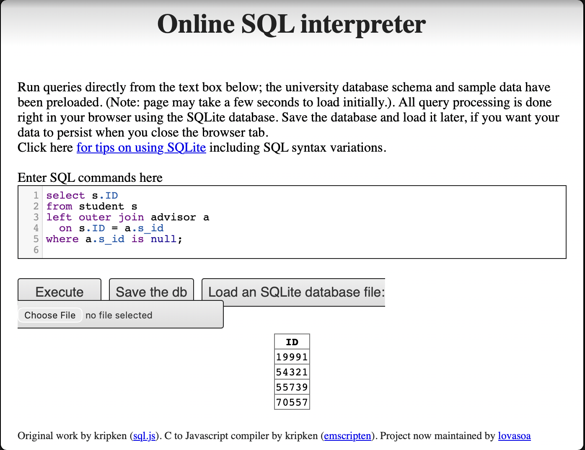{width="80%"}

##### ii. 教授其系所所有課程的教師

**使用大學綱要，撰寫 SQL 查詢以找出那些教授其系所每門課程的教師姓名和 ID（即在 *course* 關聯中與該教師系所名稱相同的每門課程）。按姓名排序結果。**

**思路：** 對每位教師，先限定範圍為同系所的課程。然後檢查是否存在該教師未教授的系所課程。若不存在這樣的課程，則該教師教授了系所中的每門課程。這就是查詢使用 `NOT EXISTS` 嵌套另一個 `NOT EXISTS` 的原因。

**SQL 答案：**

```sql
select i.name, i.ID
from instructor i
where not exists (
    select *
    from course c
    where c.dept_name = i.dept_name
      and not exists (
          select *
          from teaches t
          where t.ID = i.ID
            and t.course_id = c.course_id
      )
)
order by i.name;
```

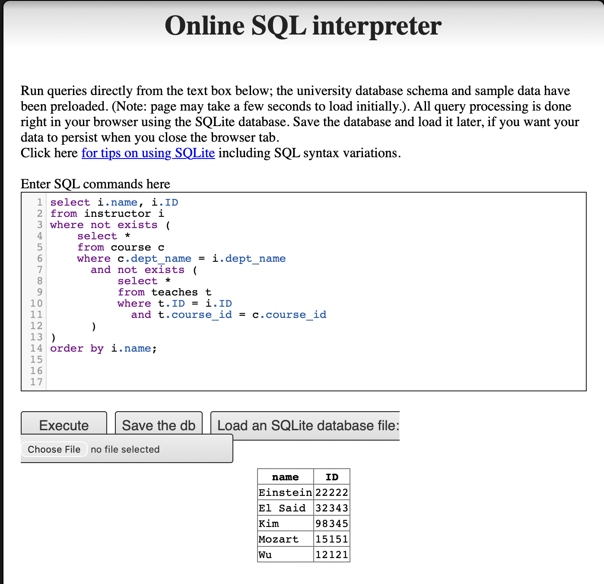{width="80%"}

#### 問題 3 — R 與 PostgreSQL

##### a) 匯入完整資料庫

使用教科書網站提供的 DDL（資料定義語言）綱要和大型關聯插入檔案建立大學資料庫。

**DDL 綱要（`DDL.sql`）：**

```sql
create table classroom
    (building       varchar(15),
     room_number    varchar(7),
     capacity       numeric(4,0),
     primary key (building, room_number)
    );

create table department
    (dept_name      varchar(20),
     building       varchar(15),
     budget         numeric(12,2) check (budget > 0),
     primary key (dept_name)
    );

create table course
    (course_id      varchar(8),
     title          varchar(50),
     dept_name      varchar(20),
     credits        numeric(2,0) check (credits > 0),
     primary key (course_id),
     foreign key (dept_name) references department (dept_name)
        on delete set null
    );

create table instructor
    (ID             varchar(5),
     name           varchar(20) not null,
     dept_name      varchar(20),
     salary         numeric(8,2) check (salary > 29000),
     primary key (ID),
     foreign key (dept_name) references department (dept_name)
        on delete set null
    );

create table section
    (course_id      varchar(8),
     sec_id         varchar(8),
     semester       varchar(6)
        check (semester in ('Fall', 'Winter', 'Spring', 'Summer')),
     year           numeric(4,0) check (year > 1701 and year < 2100),
     building       varchar(15),
     room_number    varchar(7),
     time_slot_id   varchar(4),
     primary key (course_id, sec_id, semester, year),
     foreign key (course_id) references course (course_id)
        on delete cascade,
     foreign key (building, room_number) references classroom
        on delete set null
    );

create table teaches
    (ID             varchar(5),
     course_id      varchar(8),
     sec_id         varchar(8),
     semester       varchar(6),
     year           numeric(4,0),
     primary key (ID, course_id, sec_id, semester, year),
     foreign key (course_id, sec_id, semester, year)
        references section on delete cascade,
     foreign key (ID) references instructor (ID)
        on delete cascade
    );

create table student
    (ID             varchar(5),
     name           varchar(20) not null,
     dept_name      varchar(20),
     tot_cred       numeric(3,0) check (tot_cred >= 0),
     primary key (ID),
     foreign key (dept_name) references department (dept_name)
        on delete set null
    );

create table takes
    (ID             varchar(5),
     course_id      varchar(8),
     sec_id         varchar(8),
     semester       varchar(6),
     year           numeric(4,0),
     grade          varchar(2),
     primary key (ID, course_id, sec_id, semester, year),
     foreign key (course_id, sec_id, semester, year)
        references section on delete cascade,
     foreign key (ID) references student (ID)
        on delete cascade
    );

create table advisor
    (s_ID           varchar(5),
     i_ID           varchar(5),
     primary key (s_ID),
     foreign key (i_ID) references instructor (ID)
        on delete set null,
     foreign key (s_ID) references student (ID)
        on delete cascade
    );

create table time_slot
    (time_slot_id   varchar(4),
     day            varchar(1),
     start_hr       numeric(2) check (start_hr >= 0 and start_hr < 24),
     start_min      numeric(2) check (start_min >= 0 and start_min < 60),
     end_hr         numeric(2) check (end_hr >= 0 and end_hr < 24),
     end_min        numeric(2) check (end_min >= 0 and end_min < 60),
     primary key (time_slot_id, day, start_hr, start_min)
    );

create table prereq
    (course_id      varchar(8),
     prereq_id      varchar(8),
     primary key (course_id, prereq_id),
     foreign key (course_id) references course (course_id)
        on delete cascade,
     foreign key (prereq_id) references course (course_id)
    );
```

##### b) 執行 RPostgres01.R

R 腳本使用 `RPostgres` 和 `DBI` 連接本機 PostgreSQL 資料庫，執行三個查詢，匯出 CSV，然後中斷連線。

**載入套件並連線：**

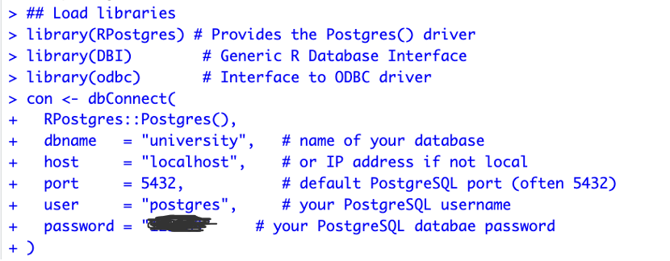{width="80%"}

**查詢 (a) — 取得所有教師：**

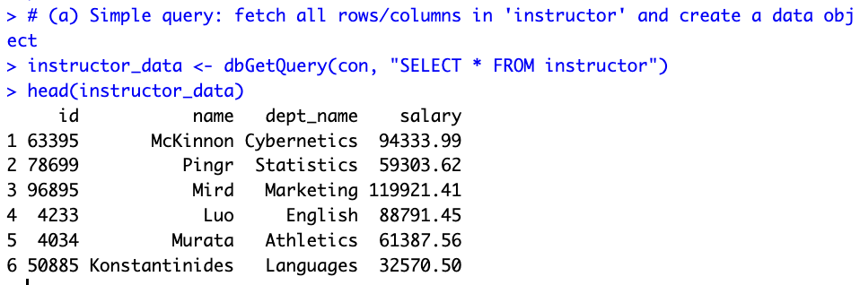{width="80%"}

**查詢 (b) — 薪資 > 60000 的資訊科學系教師：**

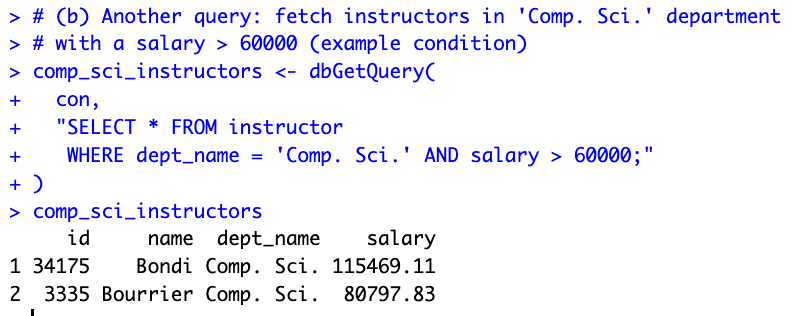{width="80%"}

**查詢 (c) — 總學分 >= 50 的學生：**

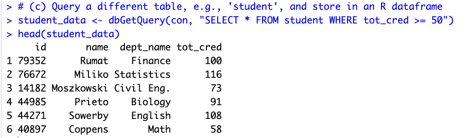{width="80%"}

**匯出 CSV 並中斷連線：**

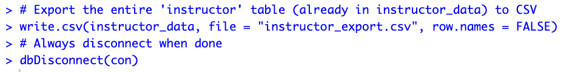{width="80%"}

##### c) 結果

**R 腳本（`RPostgres01.R`）：**

```r
# Connect PostgreSQL database using R
# Packages: DBI, odbc, RPostgres
# Documentation:
## DBI: https://dbi.r-dbi.org
## RPostgres https://github.com/r-dbi/RPostgres
## R https://solutions.posit.co/connections/db/
## odbc: https://solutions.posit.co/connections/db/best-practices/drivers/

install.packages(c("RPostgres", "DBI", "odbc"))

## Load libraries
library(RPostgres)
library(DBI)
library(odbc)

## Connect to PostgreSQL and database
con <- dbConnect(
  RPostgres::Postgres(),
  dbname   = "university",
  host     = "localhost",
  port     = 5432,
  user     = "postgres",
  password = "123489"
)

## Perform queries

# (a) Simple query: fetch all rows/columns in 'instructor'
instructor_data <- dbGetQuery(con, "SELECT * FROM instructor")
head(instructor_data)

# (b) Fetch instructors in 'Comp. Sci.' department with salary > 60000
comp_sci_instructors <- dbGetQuery(
  con,
  "SELECT * FROM instructor
   WHERE dept_name = 'Comp. Sci.' AND salary > 60000;"
)
comp_sci_instructors

# (c) Query 'student' table: students with tot_cred >= 50
student_data <- dbGetQuery(con, "SELECT * FROM student WHERE tot_cred >= 50")
head(student_data)

## Export to CSV
write.csv(instructor_data, file = "instructor_export.csv", row.names = FALSE)

## Clean up
dbDisconnect(con)
```

### 作業 7 — AI 練習（Shiny）

製作並修改兩個 Shiny app，並部署到 **shinyapps.io** 上線執行。
App 1 將原本連接本機 PostgreSQL 的設定改為內嵌 **SQLite** 資料庫，讓
它能完全在雲端運作，不需要老師的電腦架設伺服器。

#### App 1 — 大學資料庫（SQLite + ggplot2）

**修改內容：**

-   **(a) 密碼 / 連線。** 原本連到 `localhost:5432` 的 `RPostgres`
    連線改成檔案式 SQLite：
    `dbConnect(RSQLite::SQLite(), "university.db")`。`university.db`
    由教科書的 `DDL.sql` 與 `largeRelationsInsertFile.sql`
    建立，隨 app 一起打包上傳。
-   **(b) 薪資排序改由高到低。** 將 `reorder(dept_name, y_value)`
    改為 `reorder(dept_name, -y_value)`，讓最高的長條排在最左邊。
-   **(c) 換另一個變數與另一張表。** 加了一個 `selectInput`
    下拉選單，可切換兩個查詢：教師平均薪資（`instructor`
    表）與學生平均總學分（`student` 表）。

**線上 app：** <https://chentzuyuan.shinyapps.io/epps6354-hw7-1/>

<iframe src="https://chentzuyuan.shinyapps.io/epps6354-hw7-1/" width="100%" height="650" style="border:1px solid #ccc; border-radius:8px;" loading="lazy"></iframe>

#### App 2 — Old Faithful 間歇泉直方圖

**修改內容：**

-   **(a) 長條圖顏色。** 將 `col = "blue"` 改為專案的統一配色 —
    填色 `#18A3A380`（青綠，`color1`）、邊框 `#FF4D8DCC`（粉紅，`color2`），與 App 1 保持一致。

**線上 app：** <https://chentzuyuan.shinyapps.io/epps6354-hw7-2/>

<iframe src="https://chentzuyuan.shinyapps.io/epps6354-hw7-2/" width="100%" height="550" style="border:1px solid #ccc; border-radius:8px;" loading="lazy"></iframe>

### 作業 8 — NBA 資料庫 Shiny App

依照 workshop
[datageneration/informationmanagement — workshop/Shiny](https://github.com/datageneration/informationmanagement/tree/master/workshop/Shiny)
的流程，從 PostgreSQL 建表 → 轉 SQLite → 寫 Shiny → 部署到
**shinyapps.io**，整條 pipeline 跑完並上線。

#### a) 在本機 PostgreSQL 建 NBA database

把課程提供的 `NBAPlayers.sql` 載入新建的 PostgreSQL 18 資料庫
`NBAplayers`：

```bash
createdb -U postgres NBAplayers
psql -U postgres -d NBAplayers -f NBAPlayers.sql
```

成功建立三張表：`player`（4,501 筆）、`player_salary`（1,292 筆）、
`player_photos`（4,593 筆）。

#### b) Export 成 SQLite

由於 SQL 檔的 `CREATE TABLE` 語法本身就相容 SQLite，可以直接把
同一個檔案匯入 SQLite 資料庫檔 `nba.db`，不需要做語法轉換：

```bash
sqlite3 nba.db < NBAPlayers.sql
```

`nba.db` 三張表的筆數與 PostgreSQL 完全一致（4,501 / 1,292 /
4,593），確認 export 乾淨。

#### c) 嵌入 Shiny

App 採用老師提供的模板結構：一個 slider 控制要顯示幾位現役球員，
資料以 `DT` DataTable 呈現，每筆紀錄的頭像直接以 `` 標籤嵌在
表格中。

Query 用 `idPlayer` 將 `Player` 與 `Player_Photos` 做 inner
join，並過濾 `is_active = 1`：

```sql
SELECT p.id, p.first_name, p.last_name, p.full_name,
       pp.urlPlayerHeadshot
FROM Player p
INNER JOIN Player_Photos pp ON pp.idPlayer = p.id
WHERE p.is_active = 1
LIMIT <slider_value>;
```

頭像欄位以 `escape = FALSE` 渲染，讓 URL 直接變成圖片：

```r
table_df$headshot <- paste0(
  '</img>'
)
```

採用與作業 7 相同的配色（`#18A3A380` 表頭、`#FF4D8DCC`
邊框），透過自訂 CSS 套用，與整個網站風格一致。

#### d) 部署到 Shinyapps.io

```r
rsconnect::deployApp(
  appDir   = "nba-shiny",
  appName  = "epps6354-hw8-nba",
  appFiles = c("app.R", "nba.db")
)
```

`nba.db` 隨 app 一起打包上傳，部署的執行環境完全 self-contained，
不需要連外部資料庫。

**線上 app：** <https://chentzuyuan.shinyapps.io/epps6354-hw8-nba/>

<iframe src="https://chentzuyuan.shinyapps.io/epps6354-hw8-nba/" width="100%" height="700" style="border:1px solid #ccc; border-radius:8px;" loading="lazy"></iframe>

## 期末報告

```{=html}
<!-- Wake the Render demo as soon as the user lands on this anchor.
     Render's free tier sleeps after 15 min idle and takes ~50 s to
     spin up; firing /healthz now means the container is usually ready
     by the time the visitor clicks the Live demo button. -->
<link rel="preconnect" href="https://outfitdb.onrender.com">
<link rel="dns-prefetch" href="https://outfitdb.onrender.com">
<script>
  if (typeof fetch === "function") {
    try { fetch("https://outfitdb.onrender.com/healthz", {mode: "no-cors", cache: "no-store"}); } catch (_) {}
  }
</script>
<style>
.fr-dl-row { display: flex; flex-wrap: wrap; gap: 12px; margin: 14px 0 6px; }
.fr-dl-btn {
  display: inline-flex; align-items: center; justify-content: center;
  flex: 1 1 240px; min-height: 56px;
  padding: 14px 22px; border-radius: 10px;
  font-weight: 600; font-size: 1rem; line-height: 1.2;
  text-decoration: none !important;
  transition: transform 0.1s, box-shadow 0.15s;
}
.fr-dl-btn:hover { transform: translateY(-2px); box-shadow: 0 6px 16px rgba(0,0,0,0.12); }
.fr-dl-btn.primary   { background: #111;    color: #fff !important; }
.fr-dl-btn.secondary { background: #f6f6f4; color: #111 !important; border: 1px solid #ddd; }
.fr-fig { margin: 18px 0 24px; text-align: center; }
.fr-fig img { max-width: 100%; height: auto; border-radius: 6px; }
.fr-fig-cap { font-size: 0.85rem; color: #888; margin-top: 6px; }
</style>

<div class="fr-dl-row">
  <a class="fr-dl-btn primary" href="chen_finalreport.pdf" target="_blank" rel="noopener">
    期末報告論文（PDF）&rarr;
  </a>
  <a class="fr-dl-btn secondary" href="https://outfitdb.onrender.com/" target="_blank" rel="noopener">
    線上展示 &rarr;
  </a>
</div>
```

### 1. 專案概述

OutfitDB 是一個個人化的穿搭推薦系統。它將使用者的衣櫥資料、實際穿著紀錄，以及三個獨立軸向（溫度、美感、場合）的偏好評分，儲存在一個 13 張資料表的關聯式資料庫中。在這個資料庫之上訓練三個 XGBoost 分類器，並將其輸出相乘，產生每日的 Top-K 穿搭推薦。

與依賴 dress code 範本或固定風格規則的一般穿搭 app 不同，OutfitDB 的推薦會隨使用者的評分與穿著回饋演進——系統不是告訴使用者什麼好看，而是學習使用者認為什麼好看。

產品以兩種形式發佈：以 PyInstaller 打包的 macOS / Windows 桌面應用程式（主要產品），以及架設在 Render 上的公開網頁試用版。在本機優先的設計下，每位使用者對應一個獨立的 SQLite 檔案——資料永遠不會離開使用者的電腦。

目前版本：**v0.3.1**（2026 年 5 月）。架構：13 張資料表、3 個 XGBoost 分類器、四階段乘法評分。規模：後端約 2,000 行 Python；前端約 3,000 行 vanilla JS / HTML / CSS。

### 2. 技術堆疊

| 層級         | 技術                       | 用途                                      |
|---------------|----------------------------------|----------------------------------------------|
| 後端       | FastAPI（Python 3.12）            | HTTP 路由、非同步支援、Pydantic        |
| ORM           | SQLAlchemy 2.x                   | 物件關聯對應                    |
| 資料庫      | SQLite                           | 嵌入式關聯式資料庫；每位使用者一個檔案    |
| 前端      | Vanilla HTML / CSS / JS          | 無建置步驟（不用 React）                     |
| 圖表        | Chart.js 4.4（CDN）               | 統計儀表板 + 單品 modal             |
| ML            | XGBoost                          | 三個獨立的梯度提升分類器|
| 遷移    | create_all + 冪等 ALTER    | 不用 Alembic                                   |
| 網頁託管 | Render.com                       | uvicorn + 供 SQLite 使用的持久磁碟         |
| 打包     | PyInstaller                      | 跨平台 .dmg / .exe                   |
| 風格分享 | .odstyle JSON                    | 將訓練好的模型匯出為可攜式檔案    |

技術堆疊並非一開始就完整規劃，而是透過反覆調整逐步成形。

#### 2.1 後端：Shiny → FastAPI

第一次部署使用 R Shiny——原始的公開網址仍保留於[原始 Shiny 版本](https://biubiubuttegg.shinyapps.io/wardrobe/)（當時名為 *ClosetMind*；保留下來以說明原型階段，當時有數個功能無法在 Shiny 上穩定運作）。

正式運作時出現三個具體的痛點：

- 檔案上傳很彆扭——多張照片的驗證、縮放、寫入磁碟、連結到資料庫列，這整個生命週期超出 Shiny 的設計範疇。
- 跨頁狀態管理困難——Shiny 的反應式模型不適合「上傳 → 標記 → 穿著 → 訓練 → 推薦」這類多頁工作流程。
- ML 推論會阻塞 R session——XGBoost 呼叫會占住 R worker。

後端因此以 FastAPI + uvicorn 重寫，並部署到 Render。

#### 2.2 資料庫：PostgreSQL → SQLite

資料庫的第一個版本建立在 PostgreSQL 上。綱要是針對我個人的衣櫥設計；後來手動加入更多衣物以擴充展示資料集，部分衣物照片因拍攝條件受限而以 DALL-E 生成。

部署時，PostgreSQL 需要獨立資料庫伺服器的要求與本機優先的產品定位相衝突。因此將資料從 PostgreSQL 匯出並遷移至 SQLite，每位使用者對應一個獨立檔案。

#### 2.3 ML：XGBoost（一開始就選定）

訓練資料是小型表格資料（每位使用者通常少於 5,000 筆評分）。在這個規模下梯度提升優於神經網路（Grinsztajn et al., NeurIPS 2022）。推論延遲低，且模型可解釋（特徵重要性、SHAP）。

#### 2.4 前端：HTML/CSS → Vanilla JS

前端最初只以 HTML 與 CSS 撰寫。隨著功能增加（動態清單、即時更新、與後端的 AJAX、推薦互動），純 HTML 與 CSS 已不敷使用。經研究後選擇加入 vanilla JavaScript 而非 React——應用程式規模小（5–10 頁）、避免建置步驟的複雜度（Vite / webpack / npm 相依）、初始載入更快、學習曲線也較平緩。

### 3. 整體架構

OutfitDB 的資料流由三個寫入來源餵入中央資料庫、三個分類器從資料庫讀取，以及一個推薦引擎組成。

```{=html}
<div class="fr-fig">
  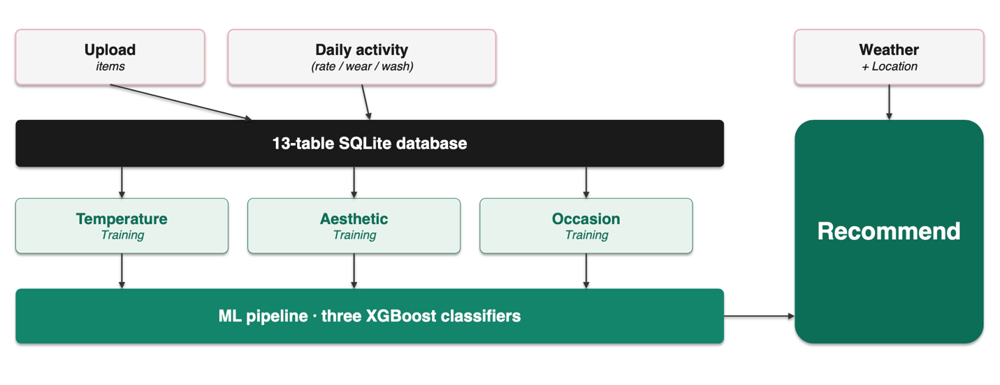
</div>
```

**三個寫入來源**

- *上傳*——一次性的衣櫥登錄（上傳衣物照片與屬性）。
- *日常活動*——持續的寫入（評分、標記已穿、標記已洗）。
- *天氣 + 位置*——即時擷取，不寫入資料庫；直接餵給推薦引擎。

**三條訓練流程**

從資料庫讀取的訓練資料分別餵給三個分類器——第一階段溫度、第二階段美感、第三階段場合。

### 4. 資料庫綱要（13 張資料表、5 個群組）

綱要正規化至 BCNF，只在兩處有記錄的位置刻意反正規化（見 §5）。

#### 4.1 群組 A — 衣櫥身分（3 張表）

描述使用者擁有什麼的靜態身分資料。

- **`users`**——一個 SQLite 檔案 ↔ 一位使用者，但保留 `user_id` 作為未來 N:M 風格分享的前瞻欄位。主要欄位：`id, display_name, lat, lon, temp_offset, training_complete, has_thermal_insoles, created_at`。
- **`items`**——每件衣物一列，約 30 個欄位，分為識別、結構、視覺、材質、類別專屬與營運等群組。以 `is_active` 軟刪除。
- **`item_tags`**——開放式鍵值中繼資料，用於事先未預期的屬性（如 brand、purchase_date）。`UniqueConstraint(item_id, key, value)` 防止重複。

#### 4.2 群組 B — 生命週期分割（2 張表）

體現依存取頻率分割的原則（見 §5.1）。單件衣物的欄位依寫入頻率拆成兩張 1:1 關聯的小表。

- **`item_states`**——熱寫入區；每次穿著／清洗事件都會觸發 UPDATE。欄位：`state, worn_count, wear_count_since_wash, last_worn`。
- **`item_stats`**——彙總快取區；在評分事件後延遲重新計算。欄位：`coverage_count, total_ratings, average_rating, last_worn_date, days_since_worn`。

#### 4.3 群組 C — 穿搭與情境（3 張表）

- **`outfits`**——一套穿搭，由多件衣物組成。欄位：`warmth_score, coverage_curve, aesthetic_curve, optimal_layer_count, overkill_layers, aesthetic_stop_layers, underfit_flag`。
- **`outfit_items`**——多對多連接表（穿搭 ↔ 衣物）。
- **`daily_contexts`**——每日穿著情境，獨立成表以避免「穿搭 → 情境 → 日期 → 天氣」的遞移相依。欄位：`date, temperature, weather, humidity, wind, occasion, calendar_event`。

#### 4.4 群組 D — 三個偏好軸（3 張表）

每個 ML 分類器都有自己專屬的評分表（見 §5.2）。

- **`ratings`**——第二階段美感評分，整數值 −1 / 0 / 1 / 2。`UniqueConstraint(user_id, outfit_id)` 加上額外的 `ideal_temp_zone`。
- **`temperature_ratings`**——第一階段，穿搭適合的溫區 JSON 清單。
- **`occasion_ratings`**——第三階段，穿搭適合的活動 JSON 清單。

#### 4.5 群組 E — 歷史與 ML 來源追蹤（2 張表）

- **`outfit_logs`**——實際穿著 vs. 系統推薦。欄位：`recommended_outfit_id, final_worn_outfit_id, user_action (accepted / modified / rejected / skipped), scheduled_for, is_scheduled, logged_at`。這張表是 OutfitDB 學習能力的來源。
- **`model_runs`**——每次模型訓練的稽核紀錄。`feature_version` 欄位決定 `.odstyle` 匯入的相容性。

### 5. 三個關鍵設計決策

#### 5.1 決策 1 — 冷／熱垂直分割

**問題。** 把衣物的所有欄位放在同一張表，表示每次穿著事件都要把整列約 1 KB 重寫到磁碟，包括 95% 情況下根本沒變的 `colors`、`composition` 等欄位。

**解法。** 垂直分割——`items`（冷資料，每月編輯）/ `item_states`（熱資料，每日編輯）/ `item_stats`（快取）。正規化處理的是邏輯相依；分割處理的是實體存取——兩者在設計的不同層次運作。

#### 5.2 決策 2 — 每個分類器一張評分表

**問題。** 用一張多型的超級表涵蓋不同形狀的訊號（整數 vs. JSON 清單），會引入大量 NULL 欄位，並迫使每個 ML SELECT 都要以 `rating_kind` 過濾。

**解法。** 三張具體的表，每個分類器一張——乾淨的型別契約、沒有 NULL 污染、不需 kind 過濾的 SELECT。單一表內的多型是技術債；具體的表更容易推理。

#### 5.3 決策 3 — 兩處刻意的反正規化

綱要中有兩處刻意的反正規化，動機都是效能：

- **鏡射 JSON。** `items.composition` 是 JSON 清單（混紡比例）；`items.material` 另外以有索引的 VARCHAR 儲存占比最高的布料。鏡射欄位在寫入時由 `composition` 自動設定，不會發生漂移。
- **快取 join。** `item_stats.average_rating` 與 `coverage_count` 原則上可以透過 join `ratings × outfit_items` 計算；但這個 join 每次載入頁面都要執行，效能會嚴重劣化。快取把成本移到寫入時，在評分事件時延遲更新。

綱要的其餘部分符合 BCNF。

### 6. ML 流程

三個獨立的 XGBoost 分類器，透過乘法評分整合，並由學習使用者個人風格的回饋迴圈持續精煉。

| 階段 | 名稱                  | 輸入特徵                       | 訓練來源        |
|-------|-----------------------|--------------------------------------|------------------------|
| 1     | 溫度分類器| 衣物特徵 + 當前溫區    | `temperature_ratings`  |
| 2     | 美感分類器  | 衣物特徵 + 穿搭結構     | `ratings`              |
| 3     | 場合分類器   | 衣物特徵 + 當前場合     | `occasion_ratings`     |

#### 乘法評分

```
total = ctx_fit × stage1_pass × stage3_pass × aesthetic_blend
```

採用乘法（而非加法）強制每個維度都必須通過——只要任何一個分類器不確定，總分就會被拉低。「很好看但會凍死」的穿搭無法通過這條規則。

#### 回饋迴圈——模型追蹤個人風格

```{=html}
<div class="fr-fig">
  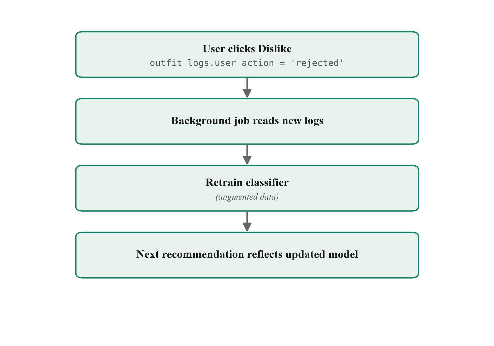
</div>
```

`outfit_logs` 表是這個迴圈的核心：它不只記錄系統推薦了什麼，也記錄使用者實際選擇或拒絕了什麼。隨著使用累積，模型逐漸內化使用者的個人風格——在同樣的 casual rock dress code 下，兩位不同的使用者會得到不同的穿搭，因為每個模型都學到了各自的偏好。

這是 OutfitDB 與靜態 dress code 範本的核心差異：系統不是告訴使用者什麼好看——而是學習使用者認為什麼好看。

### 7. 使用者介面

- **[衣櫥頁](https://outfitdb.onrender.com/closet)**——格狀檢視，具類別／顏色／材質／狀態篩選與六種排序模式。點選任何衣物卡片會開啟統計 modal：4 個 KPI 方塊、穿著時間軸（13 週折線圖）、最常一起穿的前 5 件衣物，以及成分甜甜圈圖。
- **[統計儀表板](https://outfitdb.onrender.com/stats)**——全衣櫥的 KPI 方塊與六張圖表：各類別衣物數（甜甜圈圖）、前 10 名顏色／材質（橫向長條圖）、美感評分分布，以及最常穿／最常被推薦的前 10 名（直向長條圖）。頁面層級的 `.odstyle` 匯出按鈕。
- **訓練介面**——三個 ML 軸各有專屬頁面：[`/training/temperature`](https://outfitdb.onrender.com/training/temperature)、[`/training/aesthetic`](https://outfitdb.onrender.com/training/aesthetic)、[`/training/occasion`](https://outfitdb.onrender.com/training/occasion)。每個軸必須累積 ≥6 批評分後才會解鎖推薦。
- **[推薦頁](https://outfitdb.onrender.com/recommend)**——Top-K 穿搭，每張卡片有六個分數。粗體的三個（美感、天氣、場合）是相乘的 ML 軸；淺灰的三個（保暖、新鮮度、多樣性）是軟性訊號。提供四種排序模式；排序在用戶端進行，不需重新查詢伺服器。
- **[設定](https://outfitdb.onrender.com/settings)**——個人偏好、已匯入的 `.odstyle` 套件，以及手動的*檢查更新*按鈕（不自動輪詢）。
- **國際化（i18n）**——透過 `data-i18n` 屬性提供雙語介面；右上角的語言切換可在中英文之間即時切換，不需重新載入頁面。

### 8. 部署架構

#### 8.1 網頁展示（Render）

- 平台：Render.com。透過 Render 磁碟卷持久化；SQLite 檔案在多次部署間保留。
- 免費方案冷啟動約 50 秒。
- CI/CD：`git push origin main` → Render 自動部署。
- 公開網址：<https://outfitdb.onrender.com>。

#### 8.2 桌面套件（PyInstaller）

- 目標：macOS `.dmg` / Windows `.exe`。
- 內容：完整的 Python 執行環境 + uvicorn + 所有相依（單一執行檔）。
- 資料位置：macOS 為 `~/Library/Application Support/OutfitDB/profiles/<name>/`。
- 更新檢查：手動——設定頁的*檢查更新*按鈕會從公開的 GitHub raw URL 取得 `latest.json`。

#### 8.3 更新清單格式

```json
{
  "version":    "0.3.2",
  "url":        "https://github.com/.../OutfitDB-0.3.2.dmg",
  "update_url": "https://.../OutfitDB-0.3.2-update.zip",
  "full_url":   "https://.../OutfitDB-0.3.2-full.dmg",
  "notes":      "Adds X / fixes Y"
}
```

`update_url`（增量更新）與 `full_url`（完整安裝檔）皆為選填；`url` 是向下相容的備援。

### 9. 未來規劃

#### 9.1 綱要清理（償還技術債）

- **JSON 陣列 → 多對多表。** `items.colors` 與 `items.style_tags` 目前是 JSON 清單（違反 1NF）；既然 `FEATURE_VERSION = 1` 已鎖定，可以把它們重構回正規的連接表。
- **移除 `last_worn` 重複。** 以 `item_states.last_worn` 為唯一真實來源；`item_stats.last_worn_date` 與 `days_since_worn` 改在讀取時以 Python `@property` 計算。
- **移除 `composition` / `material` 雙寫。** 把 `material` 重構為由 `composition` 衍生的 `@property`，消除漂移風險。
- **衣物表繼承。** 當類別超過十種時觸發重構（`items_base + items_top + items_bottom + ...`）。

#### 9.2 完成風格分享

`.odstyle` 的匯出與匯入 API 已經存在；UI 層尚未完成——匯入介面、多模型切換、已匯入模型的視覺標示，以及兩位使用者交換風格套件並互相產生推薦的端對端展示情境。

敘事上的價值：dress code 變成可分享的訓練模型。派對主人訓練一個個人的 *casual rock* 模型，匯出後寄給所有賓客，每位賓客最終穿的衣服不同（都來自自己的衣櫥），卻都收斂到主人定義的風格。

#### 9.3 長期——公開風格藝廊

把 `.odstyle` 分享延伸為公開平台：使用者發佈自己的 `.odstyle` 檔案；其他人可以瀏覽、預覽，並在自己的衣櫥上試用別人的模型。OutfitDB 不賣衣服；它讓美感品味成為交換的單位——可衡量、可攜帶、可分享。

### 10. AI 使用聲明

OutfitDB 的開發過程使用了 AI 協助（Claude / Anthropic）：

- **程式碼**——由作者撰寫，Claude Code 作為結對程式設計夥伴。
- **文件、簡報與本報告**——在 Claude 協助下起草；所有綱要設計決策、ML 架構選擇與最終內容皆由作者決定。

**翻譯說明。** 期末論文的英文版係以 AI 協助（Claude / Anthropic）自中文原稿翻譯，並經作者審閱修訂。若仍有翻譯錯誤，責任由作者承擔。
