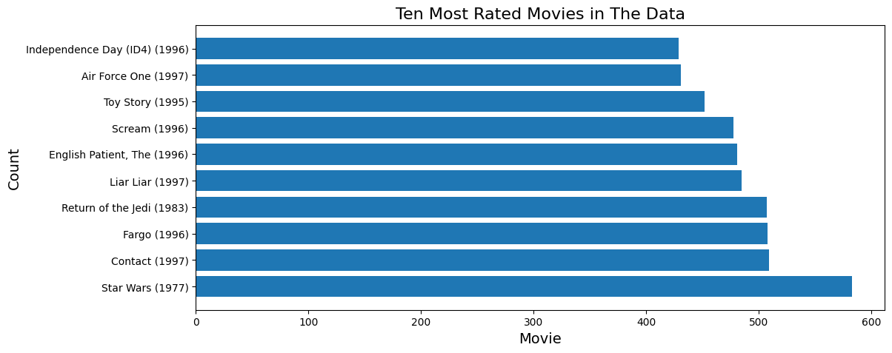
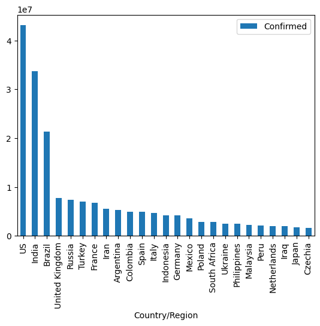
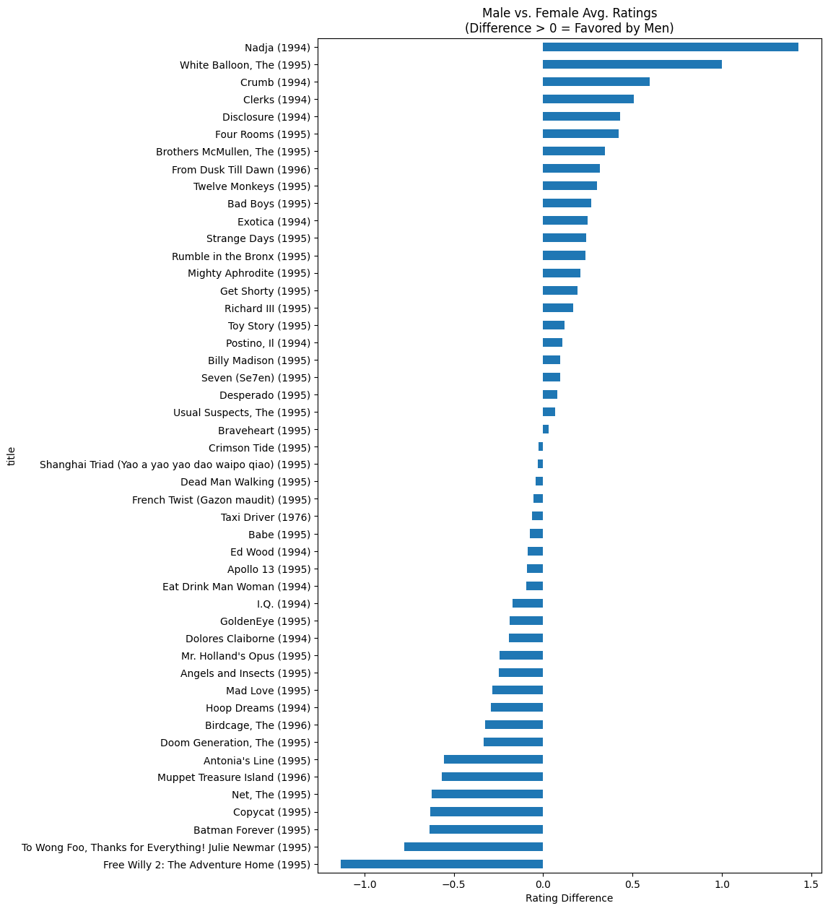
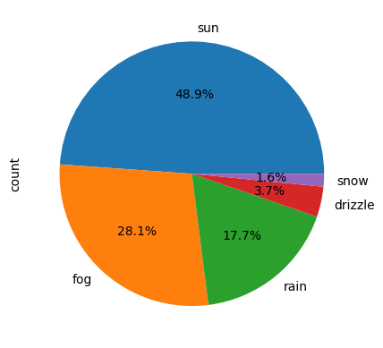
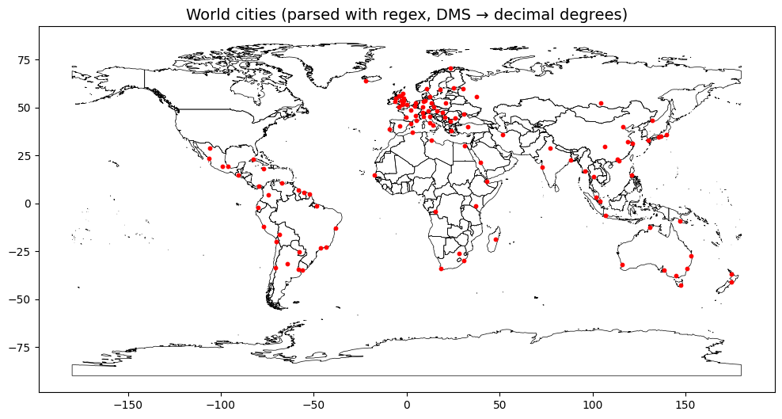
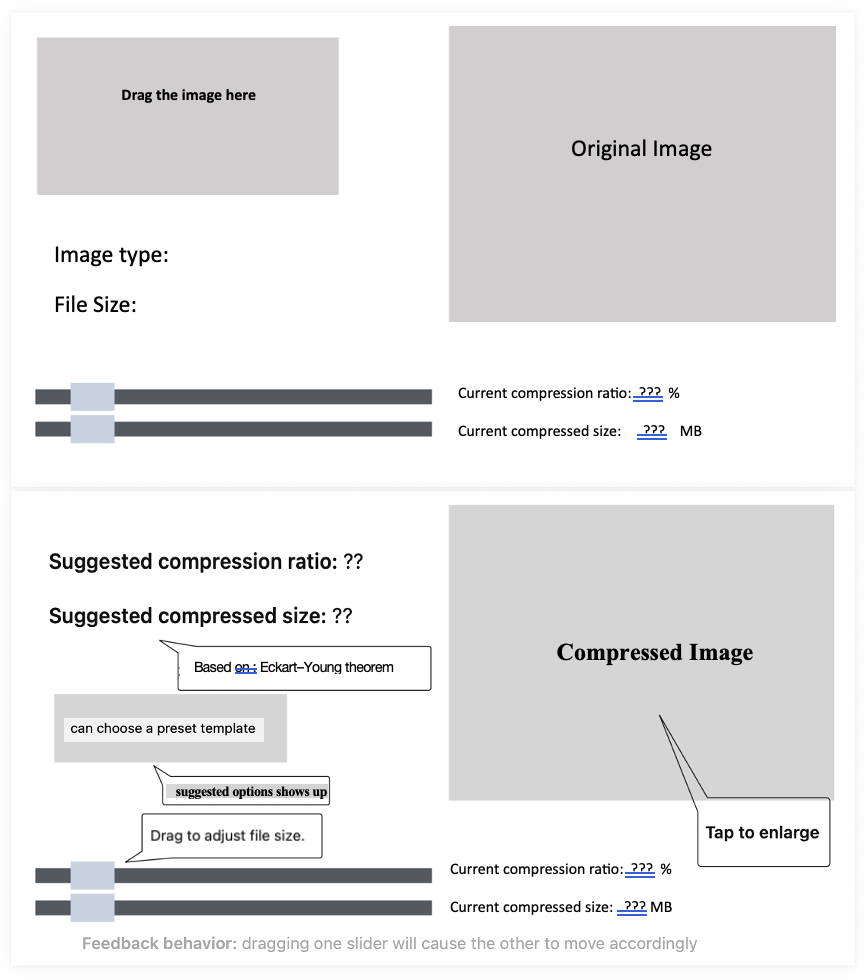
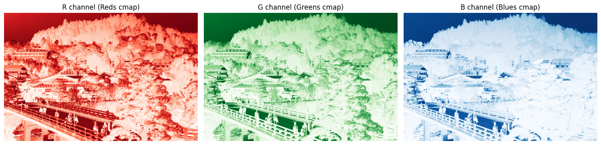

```{r setup, include=FALSE}
library(ggplot2)
library(tidyverse)
library(gridExtra)
library(scales)

# Personal visual DNA
c1  <- "#18A3A3"      # teal (primary)
c2  <- "#FF4D8D"      # rose pink (accent)
c3  <- "#7A7A7A"      # mid grey
c4  <- "#000000"      # border / text
acc <- "#E65100"      # deep orange (trend / highlight)

theme1 <- function() {
  theme_minimal(base_family = "sans") +
    theme(
      text             = element_text(colour = c4),
      plot.title       = element_text(face = "bold", colour = c4, size = 13,
                                      hjust = 0.5),
      plot.subtitle    = element_text(colour = c3, size = 10, hjust = 0.5),
      axis.title       = element_text(colour = c4, size = 11),
      axis.text        = element_text(colour = c3),
      panel.grid.major = element_line(color = scales::alpha(c3, 0.3),
                                      linetype = "dotted"),
      panel.grid.minor = element_blank(),
      legend.text      = element_text(colour = c4),
      legend.title     = element_text(colour = c4, face = "bold")
    )
}
```

## 作業 {#assignments}

### Lab 2 — 退休金計算機

**主題：** 以複利計算為基礎的理財規劃工具。

**核心概念：** 函式、迴圈、格式化輸出、複利

```{mermaid}
%%{init: {"theme": "base", "themeVariables": {"fontSize": "18px"}, "flowchart": {"padding": 35}}}%%
flowchart LR
    A["User Input     "] --> B["Monthly Contribution     "] --> C["Compound Interest     "] --> D["Year-by-Year Projection     "] --> E["Millionaire Calculator     "]

    style A fill:#E3F2FD,color:#1565C0,stroke:#90CAF9,stroke-width:2px
    style B fill:#F5F5F5,color:#424242,stroke:#BDBDBD,stroke-width:2px
    style C fill:#FFF3E0,color:#E65100,stroke:#FFCC80,stroke-width:2px
    style D fill:#E8F5E9,color:#2E7D32,stroke:#A5D6A7,stroke-width:2px
    style E fill:#E8F5E9,color:#2E7D32,stroke:#A5D6A7,stroke-width:2px
```

::: {.chart-note .teal}
**三種模式：** (1) 逐年資金預測（按月複利）；(2) 百萬富翁計算機（達到 \$100 萬所需年數）；(3) 利率比較表（年利率 1–30%）。範例：每月 \$500、年報酬 10%、投資 30 年 → **\$114 萬**。
:::

```python
# Year-by-year retirement fund projection
def calculate_fund(monthly, rate, years):
    balance = 0
    monthly_rate = rate / 12
    for year in range(1, years + 1):
        for month in range(12):
            balance += monthly
            balance *= (1 + monthly_rate)
        print(f"Year {year:3d}: ${balance:>12,.2f}")
    return balance

# Millionaire Calculator
def years_to_million(monthly, rate):
    balance, months = 0, 0
    monthly_rate = rate / 12
    while balance < 1_000_000:
        balance += monthly
        balance *= (1 + monthly_rate)
        months += 1
    return months // 12, months % 12
```

```{r lab2-compound, echo=FALSE, fig.width=7, fig.height=4}
years <- 1:30
balance <- numeric(30)
monthly <- 500
rate <- 0.10
bal <- 0
for (y in years) {
  for (m in 1:12) {
    bal <- (bal + monthly) * (1 + rate / 12)
  }
  balance[y] <- bal
}

df_ret <- data.frame(year = years, balance = balance / 1000)

ggplot(df_ret, aes(x = year, y = balance)) +
  geom_area(fill = c1, alpha = 0.3) +
  geom_line(colour = c1, linewidth = 1.5) +
  geom_hline(yintercept = 1000, linetype = "dashed", colour = acc, linewidth = 0.8) +
  annotate("text", x = 5, y = 1050, label = "$1M milestone",
           colour = acc, size = 3.5, hjust = 0, fontface = "bold") +
  geom_point(data = df_ret[which.min(abs(df_ret$balance - 1000)), ],
             aes(x = year, y = balance), colour = acc, size = 4, shape = 18) +
  scale_y_continuous(labels = function(x) paste0("$", x, "K")) +
  labs(title = "Retirement Fund Growth ($500/mo, 10% annual return)",
       x = "Year", y = "Balance") +
  theme1()
```

::: {.chart-note .orange}
**複利效應：** 前 15 年成長緩慢，後 15 年呈指數加速。每月 \$500、年報酬 10%，約 **21 年**可達 \$100 萬（<span style="color:#E65100;">橘色菱形</span>）。複利是長期投資的核心驅動力。
:::

---

### Lab 3 — 成績簿管理程式

**主題：** 具完整 CRUD 操作的互動式學生成績管理。

**核心概念：** 串列、巢狀資料結構、選單驅動程式、輸入驗證

```python
# Menu-driven gradebook
def main_menu():
    while True:
        print("\n1. Add student")
        print("2. Remove student")
        print("3. Modify grade")
        print("4. Display gradebook")
        print("5. Find highest/lowest")
        print("6. Exit")
        choice = input("Select: ")
        # ... handle each option
```

::: {.chart-note .grey}
**設計重點：** 以巢狀串列 `[name, grade]` 儲存學生紀錄，並以 `while` 迴圈驅動持續運作的互動選單。包含輸入驗證（成績 0–100）與錯誤處理。
:::

---

### Lab 4 — 模組、函式與物件導向

**主題：** 模組化程式設計、可重用模組與物件導向設計。

**核心概念：** 模組匯入、物件導向（類別）、CSV 讀寫、距離計算

```{mermaid}
%%{init: {"theme": "base", "themeVariables": {"fontSize": "18px"}, "flowchart": {"padding": 35}}}%%
flowchart TD
    A["Lab 4 Modules     "] --> B["(a) CSV Field Counter     "]
    A --> C["(b) Parcel Tax Calculator     "]
    A --> D["(c) Distance Calculator     "]

    B --> B1["mycount.py + callingscript.py     "]
    C --> C1["parcelclass.py → OOP     "]
    D --> D1["Euclidean + Great Circle     "]

    style A fill:#E3F2FD,color:#1565C0,stroke:#90CAF9,stroke-width:2px
    style B fill:#FFF3E0,color:#E65100,stroke:#FFCC80,stroke-width:2px
    style C fill:#E8F5E9,color:#2E7D32,stroke:#A5D6A7,stroke-width:2px
    style D fill:#F3E5F5,color:#6A1B9A,stroke:#CE93D8,stroke-width:2px
    style B1 fill:#F5F5F5,color:#424242,stroke:#BDBDBD,stroke-width:2px
    style C1 fill:#F5F5F5,color:#424242,stroke:#BDBDBD,stroke-width:2px
    style D1 fill:#F5F5F5,color:#424242,stroke:#BDBDBD,stroke-width:2px
```

```python
# (b) Parcel class with tax assessment
class Parcel:
    def __init__(self, parcel_id, land_use, market_value):
        self.parcel_id = parcel_id
        self.land_use = land_use
        self.market_value = market_value

    def assess_tax(self):
        rates = {"SFR": 0.05, "MFR": 0.04}
        rate = rates.get(self.land_use, 0.02)
        return self.market_value * rate

# (c) Great Circle Distance (Haversine formula)
import math
def great_circle(lat1, lon1, lat2, lon2):
    R = 6371  # Earth radius in km
    dlat = math.radians(lat2 - lat1)
    dlon = math.radians(lon2 - lon1)
    a = (math.sin(dlat/2)**2 +
         math.cos(math.radians(lat1)) *
         math.cos(math.radians(lat2)) *
         math.sin(dlon/2)**2)
    return R * 2 * math.asin(math.sqrt(a))
```

::: {.chart-note .teal}
**三個子任務：** (a) 計算 CSV 檔案中每欄的空值數量；(b) 以物件導向建立 `Parcel` 類別來評估房產稅（SFR 5%、MFR 4%、其他 2%）；(c) 以 Haversine 公式計算地球上兩點間的大圓距離。
:::

---

### Lab 5 — Pandas 資料分析

**主題：** DataFrame 操作、分組、樞紐分析與多資料集合併。

**資料集：** MovieLens（10 萬筆評分）、COVID-19 全球時間序列

**核心概念：** pandas Series/DataFrame、布林索引、GroupBy、樞紐表、merge/join

```python
# COVID-19 fatality rate analysis
fatality = (deaths_total / confirmed_total * 100).sort_values(ascending=False)
# Peru: 9.17%, Mexico: 7.58%, South Africa: 2.68%

# MovieLens: most rated movies
top_movies = ratings.groupby('movieId').size().sort_values(ascending=False).head(10)

# Multi-DataFrame merge
merged = pd.merge(users, ratings, on='userId')
merged = pd.merge(merged, movies, on='movieId')
```

::: {.chart-note .orange}
**分析重點：** (1) MovieLens — 找出評分數最多的電影，以及男女評分差距最大的影片；(2) COVID-19 — 確診數前 25 名國家、致死率排名（秘魯最高，9.17%），以及每月增量分析（美國在 2021 年 9 月新增 430 萬例）。
:::

---

### Lab 6 — 資料視覺化

**主題：** 以 matplotlib 繪製出版等級的圖表，並以 Altair 製作互動式圖表。

**資料集：** MovieLens、COVID-19、西雅圖天氣（Vega）

::: {layout-ncol=2}



:::

::: {layout-ncol=2}



:::

::: {.chart-note .teal}
**視覺化技巧：** 以橫向長條圖比較評論數、散點圖呈現男女評分差異、圓餅圖顯示天氣類型分布、折線圖追蹤 COVID-19 趨勢。Altair 部分也製作了互動連動圖表（點選國家 → 顯示其死亡趨勢曲線）。
:::

---

### Lab 7 — PyQt5 GUI 開發

**主題：** 建立具圖形介面的桌面猜數字遊戲。

**核心概念：** PyQt5 元件、事件驅動程式設計、signal/slot、Qt Designer

```{mermaid}
%%{init: {"theme": "base", "themeVariables": {"fontSize": "18px"}, "flowchart": {"padding": 35}}}%%
flowchart LR
    A["Qt Designer     "] --> B["frmGuess.py     "] --> C["lab7.py     "] --> D["Number Game GUI     "]

    style A fill:#F5F5F5,color:#424242,stroke:#BDBDBD,stroke-width:2px
    style B fill:#E3F2FD,color:#1565C0,stroke:#90CAF9,stroke-width:2px
    style C fill:#FFF3E0,color:#E65100,stroke:#FFCC80,stroke-width:2px
    style D fill:#E8F5E9,color:#2E7D32,stroke:#A5D6A7,stroke-width:2px
```

```python
# Number guessing game with hint system
class GuessGame:
    def __init__(self):
        self.target = random.randint(1, 100)
        self.guesses = 0

    def make_guess(self, n):
        self.guesses += 1
        if n == self.target:
            return "Correct!"
        return "Higher!" if n < self.target else "Lower!"

    def use_hint(self):
        """Costs 5 guesses, reveals number within ±5"""
        self.guesses += 5
        return (self.target - 5, self.target + 5)
```

::: {.chart-note .grey}
**GUI 功能：** 1–100 的隨機猜數字遊戲，具備 (1) 猜測次數追蹤；(2) 提示系統，消耗 5 次猜測機會，將目標範圍縮小至 ±5；(3) 勝利判定與重設。介面以 Qt Designer 排版；`frmGuess.py` 為自動產生的 UI 程式碼。
:::

---

### Lab 8 — ArcGIS API for Python

**主題：** 以程式建立 ArcGIS Online 地圖並查詢空間資料。

**核心概念：** ArcGIS 驗證、WebMap、FeatureLayer 查詢、底圖切換

```python
from arcgis.gis import GIS
from arcgis.mapping import WebMap

gis = GIS("https://www.arcgis.com", username, password)
m = gis.map("University of Texas at Dallas", zoomlevel=15)

# Search and add feature layers
items = gis.content.search("UTD Buildings", item_type="Feature Layer")
m.add_layer(items[0])

# Query building attributes
fl = items[0].layers[0]
fl.properties.fields  # Inspect field schema
```

::: {.chart-note .teal}
**GIS 操作：** 透過 Python API 連線 ArcGIS Online，建立以 UTD 校園為中心的互動地圖，搜尋並疊加建築物圖層，檢視屬性欄位綱要，並切換不同的底圖樣式。
:::

---

### Lab 10 — 網路爬蟲與 API

**主題：** 以 API 與爬蟲工具從網路來源擷取資料。

**核心概念：** requests、JSON 解析、BeautifulSoup（HTML）、Selenium（動態內容）

```{mermaid}
%%{init: {"theme": "base", "themeVariables": {"fontSize": "18px"}, "flowchart": {"padding": 35}}}%%
flowchart LR
    A["requests GET     "] --> B["JSON / HTML     "]
    B --> C["BeautifulSoup     "]
    B --> D["json.loads()     "]
    C --> E["Structured Data     "]
    D --> E

    style A fill:#E3F2FD,color:#1565C0,stroke:#90CAF9,stroke-width:2px
    style B fill:#F5F5F5,color:#424242,stroke:#BDBDBD,stroke-width:2px
    style C fill:#FFF3E0,color:#E65100,stroke:#FFCC80,stroke-width:2px
    style D fill:#E8F5E9,color:#2E7D32,stroke:#A5D6A7,stroke-width:2px
    style E fill:#E8F5E9,color:#2E7D32,stroke:#A5D6A7,stroke-width:2px
```

```python
import requests
from bs4 import BeautifulSoup

# RESTful API request
response = requests.get("https://api.example.com/data")
data = response.json()

# HTML scraping
page = requests.get("https://example.com")
soup = BeautifulSoup(page.content, "html.parser")
elements = soup.find_all("div", class_="target")
```

::: {.chart-note .grey}
**兩種做法：** (1) RESTful API — 送出 GET/POST 請求並解析 JSON 回應；(2) HTML 爬蟲 — 以 BeautifulSoup 走訪 DOM，並以 Selenium 處理動態載入的內容。
:::

---

### Lab 11 — 正規表達式與 GeoPandas

**主題：** 以正規表達式解析結構化文字檔，並以 GeoPandas 建立空間視覺化。

**資料集：** `worldcities.txt` — 以度–分格式記錄的城市座標。

```python
import re
import geopandas as gpd
from shapely.geometry import Point

# Parse DMS coordinates with regex
pattern = r"^(.*)\t(\d+)\t(\d+) ([NS])\t(\d+)\t(\d+) ([EW])\t(.*)$"

for line in open("worldcities.txt"):
    match = re.match(pattern, line.strip())
    if match:
        city, lat_d, lat_m, ns, lon_d, lon_m, ew, country = match.groups()
        lat = (int(lat_d) + int(lat_m)/60) * (-1 if ns == 'S' else 1)
        lon = (int(lon_d) + int(lon_m)/60) * (-1 if ew == 'W' else 1)
```

{width="80%"}

::: {.chart-note .teal}
**流程：** 以正規表達式從 `worldcities.txt` 擷取城市名稱、經緯度（度–分格式）與國家 → 將度分秒轉為十進位度 → 建立 Shapely `Point` 幾何 → 載入 GeoPandas `GeoDataFrame` → 疊加在 Natural Earth 底圖上繪製全球城市分布。
:::

---

## 期中 {#midterm}

### 期中專案 — 資料分析套件

三個獨立的 Python 程式，展示檔案操作、資料分析與房地產查詢功能。

```{mermaid}
%%{init: {"theme": "base", "themeVariables": {"fontSize": "18px"}, "flowchart": {"padding": 35}}}%%
flowchart TD
    A["Midterm Project     "] --> B["Alumni Research     "]
    A --> C["File Manipulation     "]
    A --> D["Real Estate Search     "]

    B --> B1["Income & Debt by Major     "]
    C --> C1["Recursive CSV Processing     "]
    D --> D1["Multi-criteria Property Filter     "]

    style A fill:#E3F2FD,color:#1565C0,stroke:#90CAF9,stroke-width:2px
    style B fill:#FFF3E0,color:#E65100,stroke:#FFCC80,stroke-width:2px
    style C fill:#E8F5E9,color:#2E7D32,stroke:#A5D6A7,stroke-width:2px
    style D fill:#F3E5F5,color:#6A1B9A,stroke:#CE93D8,stroke-width:2px
    style B1 fill:#F5F5F5,color:#424242,stroke:#BDBDBD,stroke-width:2px
    style C1 fill:#F5F5F5,color:#424242,stroke:#BDBDBD,stroke-width:2px
    style D1 fill:#F5F5F5,color:#424242,stroke:#BDBDBD,stroke-width:2px
```

#### 1. 校友研究

分析校友收入與學生貸款：各科系的平均年齡與性別組成、收入排名，以及貸款償還計算機（以年收入的 5% 作為每月還款額）。

```python
# Loan payoff calculator: 5% annual income as monthly payment
def loan_payoff(debt, annual_income, interest_rate=0.05):
    monthly_payment = annual_income * 0.05 / 12
    balance, months = debt, 0
    while balance > 0:
        balance *= (1 + interest_rate / 12)
        balance -= monthly_payment
        months += 1
    return months // 12, months % 12
```

#### 2. 檔案操作

遞迴走訪目錄樹，偵測 CSV 檔案，並以 tab 分隔格式整齊印出。

```python
import os
def process_directory(path):
    if os.path.isfile(path) and path.endswith('.csv'):
        pretty_print_csv(path)
    elif os.path.isdir(path):
        for root, dirs, files in os.walk(path):
            for f in files:
                if f.endswith('.csv'):
                    pretty_print_csv(os.path.join(root, f))
```

#### 3. 房地產搜尋

多條件房產篩選：州代碼、最小居住面積、市價區間與目標學區。

::: {.chart-note .orange}
**期中總結：** 三個程式分別練習 (1) pandas 資料分析與合併（`merge on ID`）；(2) 以 `os.walk()` 遞迴處理檔案；(3) 多條件邏輯篩選。三者合起來涵蓋資料科學、系統操作與實務應用。
:::

---

## 期末專案 {#final-project}

### SVD 影像壓縮應用程式

**任務：** 建立以奇異值分解（SVD）進行影像壓縮的互動式桌面應用程式，具即時預覽與品質指標。

**方法：** PyQt6 GUI + NumPy SVD + PIL 影像處理

**數學基礎：** Eckart–Young 定理 — A_k = sum(sigma_i · u_i · v_iᵀ)，i = 1 … k

#### 應用程式架構

```{mermaid}
%%{init: {"theme": "base", "themeVariables": {"fontSize": "18px"}, "flowchart": {"padding": 35}}}%%
flowchart TD
    A["Image Input (drag & drop)     "] --> B["RGB Channel Split     "]
    B --> C["np.linalg.svd per channel     "]
    C --> D["Low-rank Approximation A_k     "]
    D --> E["Reconstruct RGB     "]
    E --> F["PSNR + File Size     "]
    F --> G["Preview & Export     "]

    style A fill:#E3F2FD,color:#1565C0,stroke:#90CAF9,stroke-width:2px
    style B fill:#E3F2FD,color:#1565C0,stroke:#90CAF9,stroke-width:2px
    style C fill:#FFF3E0,color:#E65100,stroke:#FFCC80,stroke-width:2px
    style D fill:#FFF3E0,color:#E65100,stroke:#FFCC80,stroke-width:2px
    style E fill:#E8F5E9,color:#2E7D32,stroke:#A5D6A7,stroke-width:2px
    style F fill:#F3E5F5,color:#6A1B9A,stroke:#CE93D8,stroke-width:2px
    style G fill:#E8F5E9,color:#2E7D32,stroke:#A5D6A7,stroke-width:2px
```

::: {.chart-note .teal}
**SVD 基礎：** 任何矩陣 `A` 都可分解為 `A = U Σ Vᵀ`。取前 `k` 個奇異值重建 `A_k`，即可得到最佳的秩 `k` 近似（Eckart–Young 定理）。`k` 越小壓縮率越高，但品質越低。
:::

#### 核心演算法

```python
import numpy as np
from PIL import Image

def perform_svd(image_array):
    """SVD on each RGB channel separately"""
    channels = {}
    for i, name in enumerate(['R', 'G', 'B']):
        U, S, Vt = np.linalg.svd(image_array[:, :, i], full_matrices=False)
        channels[name] = (U, S, Vt)
    return channels

def reconstruct(channels, k):
    """Low-rank approximation with k singular values"""
    reconstructed = np.zeros_like(original)
    for i, name in enumerate(['R', 'G', 'B']):
        U, S, Vt = channels[name]
        reconstructed[:, :, i] = np.clip(
            U[:, :k] @ np.diag(S[:k]) @ Vt[:k, :], 0, 255
        )
    return reconstructed.astype(np.uint8)

def calculate_psnr(original, compressed):
    mse = np.mean((original.astype(float) - compressed.astype(float)) ** 2)
    return 10 * np.log10(255**2 / mse) if mse > 0 else float('inf')
```

#### GUI 功能

```python
# PyQt6 GUI with dual slider control
class SVDCompressor(QMainWindow):
    def __init__(self):
        # Drag-and-drop image upload
        # Dual slider: compression ratio ↔ target file size (linked)
        # Smart presets:
        #   Social media: 2 MB, ~35 dB PSNR
        #   Email:        5 MB, ~40 dB PSNR
        #   High quality: 80% compression, ~45 dB PSNR
        pass
```

#### 應用程式展示

{width="80%"}

::: {.chart-note .orange}
**應用程式功能重點：**

- **拖放上傳** — 將影像拖入視窗即可載入
- **連動雙滑桿** — 壓縮率 ↔ 目標檔案大小（移動其中一個會自動更新另一個）
- **智慧預設** — 三種範本：社群媒體（2 MB）、電子郵件附件（5 MB）、高品質封存（PSNR > 40 dB）
- **即時預覽** — 原圖與壓縮圖並排顯示，下方顯示 PSNR / 檔案大小 / 壓縮率
- **品質警示** — PSNR 低於 40 dB 時自動提醒
- **Eckart–Young 保證** — 理論上最佳的低秩近似
:::

📎 **下載：** [SVD_app.py（原始碼）](SVD_app.py)

#### SVD 品質分析

::: {layout-ncol=2}



:::

```{r svd-psnr, echo=FALSE, fig.width=8, fig.height=4}
k_vals <- c(1, 10, 50, 100, 200, 300, 500, 700)
psnr_vals <- c(12.5, 20.3, 27.1, 29.5, 31.0, 31.88, 38.2, 44.70)
mse_vals  <- c(3650, 605, 127, 73, 51.6, 42.29, 9.8, 2.2)

df_svd <- data.frame(k = k_vals, psnr = psnr_vals, mse = mse_vals)

p1 <- ggplot(df_svd, aes(x = k, y = psnr)) +
  geom_line(colour = c1, linewidth = 1.5) +
  geom_point(colour = c1, size = 3) +
  geom_hline(yintercept = 30, linetype = "dashed", colour = c3, linewidth = 0.8) +
  annotate("text", x = 50, y = 31, label = "30 dB (good quality)",
           colour = c3, size = 3.2, hjust = 0) +
  geom_point(data = df_svd[df_svd$k == 300, ], colour = acc, size = 5, shape = 18) +
  annotate("label", x = 300, y = 34,
           label = "k=300: 31.88 dB", colour = acc, size = 3,
           fontface = "bold", fill = "white", label.size = 0) +
  labs(title = "PSNR vs Singular Values (k)", x = "k", y = "PSNR (dB)") +
  theme1()

p2 <- ggplot(df_svd, aes(x = k, y = mse)) +
  geom_line(colour = c2, linewidth = 1.5) +
  geom_point(colour = c2, size = 3) +
  scale_y_log10() +
  labs(title = "MSE vs Singular Values (k)", x = "k", y = "MSE (log scale)") +
  theme1()

grid.arrange(p1, p2, ncol = 2,
             top = grid::textGrob("SVD Image Compression — Quality vs Compression Level",
                                  gp = grid::gpar(fontface = "bold", fontsize = 13)))
```

::: {.chart-note .pink}
**品質分析：** 左圖 — PSNR 隨 `k` 上升，`k = 300` 時達 **31.88 dB**（超過<span style="color:#7A7A7A;">灰色虛線</span>標示的 30 dB 門檻），`k = 700` 時接近原圖（44.70 dB）。右圖 — MSE 呈指數下降，`k = 300` 之後的邊際效益遞減。**實務建議：** `k = 200–400` 是壓縮與品質之間的最佳平衡區間。
:::

| k | PSNR (dB) | MSE | 壓縮率 |
|---|-----------|-----|-------------------|
| 1 | 12.50 | 3650 | 99.9% |
| 50 | 27.10 | 127 | 95.1% |
| 100 | 29.50 | 73 | 90.3% |
| **300** | **31.88** | **42.29** | **70.9%** |
| 700 | 44.70 | 2.2 | 32.0% |

::: {.chart-note .orange}
**Eckart–Young 驗證：** 實驗確認 ‖A − A_k‖₂ ≈ σ_{k+1} — 低秩近似的誤差等於第 (k+1) 個奇異值。這提供了選擇 `k` 的原則性規則：當 σ_{k+1} 降到所需的品質門檻以下時即可停止。
:::

---

## 課程技能總結

```{r skills-summary, echo=FALSE, fig.width=8, fig.height=4.5}
df_skills <- data.frame(
  category = factor(
    c("Core Python", "Data Science", "GIS & Spatial", "GUI Dev", "Web & APIs", "Math & Algorithms"),
    levels = c("Math & Algorithms", "Web & APIs", "GUI Dev", "GIS & Spatial", "Data Science", "Core Python")
  ),
  labs = c(6, 4, 3, 2, 2, 2),
  tools = c(
    "Functions, OOP\nFile I/O, Regex",
    "pandas, NumPy\nmatplotlib, Altair",
    "ArcGIS API\nGeoPandas, Shapely",
    "PyQt5/6\nQt Designer",
    "requests, BS4\nSelenium, JSON",
    "SVD, Haversine\nPSNR, MSE"
  )
)

ggplot(df_skills, aes(x = labs, y = category, fill = category)) +
  geom_col(colour = c4, width = 0.6) +
  geom_text(aes(label = tools), hjust = -0.05, size = 2.8, colour = c4, lineheight = 0.9) +
  scale_fill_manual(values = c(c1, c2, "#FF9800", "#9C27B0", "#4CAF50", c3)) +
  scale_x_continuous(limits = c(0, 12), expand = c(0, 0)) +
  labs(title = "GIS & Python — Skills Coverage Across Labs",
       x = "Number of Labs", y = NULL) +
  theme1() +
  theme(legend.position = "none")
```

::: {.chart-note .teal}
**課程總結：** 從核心 Python（函式、物件導向、檔案讀寫），經資料科學（pandas、視覺化）、GIS 與空間分析（ArcGIS、GeoPandas）、GUI 開發（PyQt5/6）、網路爬蟲（requests、BeautifulSoup），到最後融合數學理論與軟體工程實務的 SVD 影像壓縮期末專案。
:::
