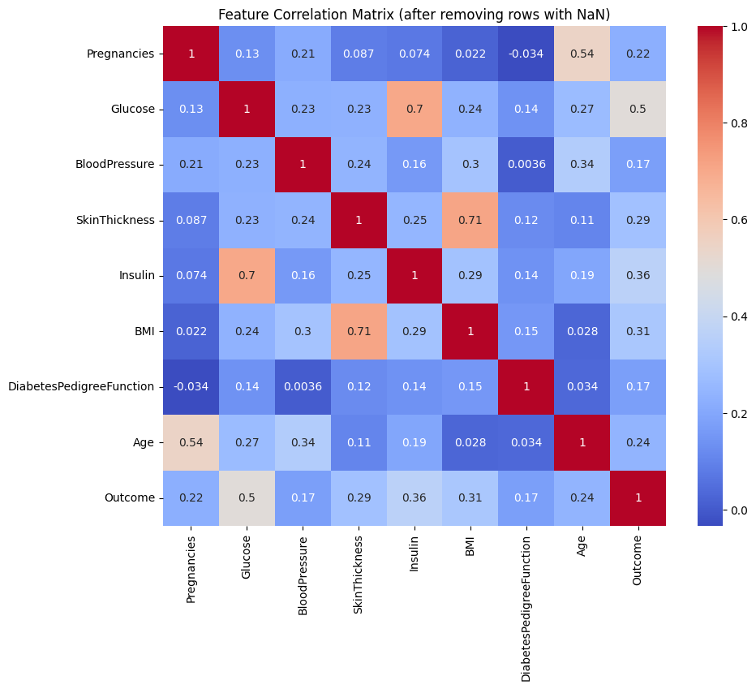

```{r setup, include=FALSE}
library(ggplot2)
library(tidyverse)
library(gridExtra)
library(scales)

# Personal visual DNA
c1  <- "#18A3A3"      # teal (primary)
c2  <- "#FF4D8D"      # rose pink (accent)
c3  <- "#7A7A7A"      # mid grey
c4  <- "#000000"      # border / text
acc <- "#E65100"      # deep orange (trend / highlight)

theme1 <- function() {
  theme_minimal(base_family = "sans") +
    theme(
      text             = element_text(colour = c4),
      plot.title       = element_text(face = "bold", colour = c4, size = 13,
                                      hjust = 0.5),
      plot.subtitle    = element_text(colour = c3, size = 10, hjust = 0.5),
      axis.title       = element_text(colour = c4, size = 11),
      axis.text        = element_text(colour = c3),
      panel.grid.major = element_line(color = scales::alpha(c3, 0.3),
                                      linetype = "dotted"),
      panel.grid.minor = element_blank(),
      legend.text      = element_text(colour = c4),
      legend.title     = element_text(colour = c4, face = "bold")
    )
}
```

## 作業 {#assignments}

### 作業 1 — 糖尿病預測

**任務：** 使用 Pima Indians 糖尿病資料集預測糖尿病的發生，重點在於以迴歸填補處理缺失值、特徵工程與重新取樣，再訓練深度神經網路。

**資料集：** Pima Indians 糖尿病資料集 — 768 筆樣本、8 個特徵

**方法：** 迴歸填補 → 特徵工程 → 重新取樣 → DNN

#### 流程總覽

```{mermaid}
%%{init: {"theme": "base", "themeVariables": {"fontSize": "18px"}, "flowchart": {"padding": 35, "nodeSpacing": 25, "rankSpacing": 40}}}%%
flowchart TD
    A["Raw Data 768×8     "] --> B["Mark Zeros as Missing     "]
    B --> C["Regression Imputation     "]
    C --> D["Feature Eng. + Resample     "]
    D --> E["Train / Val Split     "]
    E --> F["DNN 64→32→16→1     "]
    F --> G["90.04% acc     "]

    style A fill:#E3F2FD,color:#1565C0,stroke:#90CAF9,stroke-width:2px
    style B fill:#F5F5F5,color:#424242,stroke:#BDBDBD,stroke-width:2px
    style C fill:#FFF3E0,color:#E65100,stroke:#FFCC80,stroke-width:2px
    style D fill:#F3E5F5,color:#6A1B9A,stroke:#CE93D8,stroke-width:2px
    style E fill:#F5F5F5,color:#424242,stroke:#BDBDBD,stroke-width:2px
    style F fill:#E3F2FD,color:#1565C0,stroke:#90CAF9,stroke-width:2px
    style G fill:#E8F5E9,color:#2E7D32,stroke:#A5D6A7,stroke-width:2px
```

::: {.chart-note .teal}
**流程說明：** 原始資料在 Glucose、BMI 等欄位中含有「零值」，實際上代表缺失資料。我們以線性迴歸依序填補各欄位，接著進行特徵工程與重新取樣以平衡正負樣本。最後以 4 層 DNN 進行二元分類，準確率從基線 74% 提升至 **90.04%**。
:::

#### 探索性資料分析

`Glucose`、`BMI`、`BloodPressure`、`SkinThickness` 與 `Insulin` 中的零值視為缺失。移除含缺失值的列後，剩下 336 筆乾淨資料可用於擬合填補模型。

{width="70%"}

::: {.chart-note .orange}
**主要觀察：** **Glucose → Outcome** 的相關係數為 0.50，是糖尿病最強的預測因子；**SkinThickness ↔ BMI** 達 0.71，因此可用 BMI 填補 SkinThickness；**Insulin ↔ Glucose** 達 0.70，因此可用 Glucose 填補 Insulin；**Age ↔ Pregnancies** 為 0.54，符合生理上的預期。
:::

#### 缺失值填補

```{mermaid}
%%{init: {"theme": "base", "themeVariables": {"fontSize": "18px"}, "flowchart": {"padding": 35}}}%%
flowchart TD
    A["Outcome     "]
    B["Glucose     "]
    C["BMI     "]
    D["Insulin     "]
    E["SkinThickness     "]
    F["Age     "]
    G["BloodPressure     "]

    A -->|"predicts"| B
    B -->|"predicts"| C
    B -->|"predicts"| D
    C -->|"predicts"| E
    B -->|"predicts"| E
    F -->|"predicts"| G
    C -->|"predicts"| G

    style A fill:#FFF3E0,color:#E65100,stroke:#FFCC80,stroke-width:2px
    style B fill:#E3F2FD,color:#1565C0,stroke:#90CAF9,stroke-width:2px
    style C fill:#E8F5E9,color:#2E7D32,stroke:#A5D6A7,stroke-width:2px
    style D fill:#FCE4EC,color:#C62828,stroke:#F48FB1,stroke-width:2px
    style E fill:#F3E5F5,color:#6A1B9A,stroke:#CE93D8,stroke-width:2px
    style F fill:#FFF3E0,color:#E65100,stroke:#FFCC80,stroke-width:2px
    style G fill:#E0F2F1,color:#00695C,stroke:#80CBC4,stroke-width:2px
```

::: {.chart-note .teal}
**填補順序：** 以相關性最高的已知欄位作為自變數，依序套用線性迴歸：Outcome → Glucose → BMI → Insulin / SkinThickness → BloodPressure。每一步只使用原本就存在或已完成填補的欄位作為預測變數。
:::

``` python
# Fill Glucose using Outcome
X_train = df_non_missing[['Outcome']]
y_train = df_non_missing['Glucose']
model = LinearRegression()
model.fit(X_train, y_train)

# Fill BMI using Glucose
X_train = df_non_missing[['Glucose']]
y_train = df_non_missing['BMI']

# Fill Insulin using BMI + Glucose
X_train = df_non_missing[['BMI', 'Glucose']]
y_train = df_non_missing['Insulin']

# Fill BloodPressure using Age + BMI
X_train = df_non_missing[['Age', 'BMI']]
y_train = df_non_missing['BloodPressure']
```

#### 模型架構

```{mermaid}
%%{init: {"theme": "base", "themeVariables": {"fontSize": "18px"}, "flowchart": {"padding": 35}}}%%
flowchart LR
    I["Input 8+ feat     "] --> L1["Dense 64 ReLU     "] --> L2["Dense 32 ReLU     "] --> L3["Dense 16 ReLU     "] --> O["Dense 1 Sigmoid     "]

    style I  fill:#E3F2FD,color:#1565C0,stroke:#90CAF9,stroke-width:2px
    style L1 fill:#E3F2FD,color:#1565C0,stroke:#90CAF9,stroke-width:2px
    style L2 fill:#E3F2FD,color:#1565C0,stroke:#90CAF9,stroke-width:2px
    style L3 fill:#E3F2FD,color:#1565C0,stroke:#90CAF9,stroke-width:2px
    style O  fill:#E8F5E9,color:#2E7D32,stroke:#A5D6A7,stroke-width:2px
```

``` python
model = Sequential()
model.add(Dense(64, input_dim=X_train.shape[1], activation='relu'))
model.add(Dense(32, activation='relu'))
model.add(Dense(16, activation='relu'))
model.add(Dense(1, activation='sigmoid'))
```

#### 訓練設定

``` python
model.compile(
    loss='binary_crossentropy',
    optimizer='adam',
    metrics=['accuracy']
)
model.fit(X_train, y_train, epochs=10, batch_size=32, validation_split=0.2)
```

#### 結果

| 指標 | 數值 |
|----|----|
| 基線準確率（未填補） | 74.03% |
| **最終準確率（填補 + 特徵工程 + 重新取樣）** | **90.04%** |
| 提升幅度 | +16.01 pp |

```{r hw1-accuracy, echo=FALSE, fig.width=7, fig.height=4}
df_acc <- data.frame(
  stage    = factor(
    c("Baseline\n(no imputation)", "After\nImputation",
      "After Feature\nEngineering", "After Resampling\n+ Final DNN"),
    levels = c("Baseline\n(no imputation)", "After\nImputation",
               "After Feature\nEngineering", "After Resampling\n+ Final DNN")
  ),
  accuracy = c(74.03, 77.92, 82.50, 90.04)
)

ggplot(df_acc, aes(x = stage, y = accuracy, fill = stage)) +
  geom_col(color = c4, width = 0.6) +
  geom_text(aes(label = paste0(accuracy, "%")),
            vjust = -0.5, fontface = "bold", size = 3.8, colour = c4) +
  geom_hline(yintercept = 74.03, linetype = "dashed",
             colour = c3, linewidth = 0.7) +
  annotate("segment",
           x = 3.7, xend = 3.7, y = 74.03, yend = 90.04,
           colour = acc, linewidth = 1.2,
           arrow = arrow(ends = "both", length = unit(0.15, "cm"))) +
  annotate("text", x = 3.95, y = 82, label = "+16 pp",
           colour = acc, fontface = "bold", size = 4) +
  scale_fill_manual(values = c("#FCE4EC", "#E8F5E9", "#F3E5F5", "#E3F2FD")) +
  scale_y_continuous(expand = expansion(mult = c(0, 0.08))) +
  coord_cartesian(ylim = c(60, 100)) +
  labs(title = "Diabetes Prediction — Accuracy Improvement by Pipeline Stage",
       x = NULL, y = "Accuracy (%)") +
  theme1() +
  theme(legend.position = "none")
```

::: {.chart-note .orange}
**準確率分析：** 基線（直接丟棄缺失值）只有 74.03%。經迴歸填補後提升至 77.92%，特徵工程再增加約 5 pp，最後重新取樣 + DNN 達到 **90.04%**，總共提升 **+16 pp**。灰色虛線標示基線參考值，橘色箭頭表示整體增益。
:::

------------------------------------------------------------------------

### 作業 2 — 美國野火分析

**任務：** 分析 188 萬筆美國野火紀錄，以 Poisson 迴歸建模年度發生頻率的趨勢，並以多層感知器（MLP）預測野火起因。

**資料集：** 美國野火（1992–2015）— 1,880,465 筆紀錄，Kaggle

**方法：** Poisson 迴歸（趨勢分析）+ MLP（起因分類）

#### Poisson 迴歸

將每年的野火數量建模為年份的函數，以估計長期趨勢。

``` python
import statsmodels.api as sm
import statsmodels.formula.api as smf

poisson_model = smf.glm(
    formula='Count ~ FIRE_YEAR',
    data=fire_counts,
    family=sm.families.Poisson()
).fit()

print(poisson_model.summary())
```

```{r hw2-poisson, echo=FALSE, fig.width=7, fig.height=4}
set.seed(42)
years   <- 1992:2015
trend   <- 80000 * exp(0.0044 * (years - 1992))
counts  <- trend + rnorm(length(years), 0, 3000)

df_fire <- data.frame(year = years, count = counts / 1000, trend = trend / 1000)

ggplot(df_fire) +
  geom_col(aes(x = year, y = count), fill = c1, colour = "white", alpha = 0.8) +
  geom_line(aes(x = year, y = trend), colour = acc,
            linewidth = 1.5, linetype = "dashed") +
  scale_x_continuous(breaks = seq(1992, 2014, 2)) +
  labs(title    = "US Annual Wildfire Frequency 1992-2015",
       subtitle = "Dashed line: Poisson regression fit (+0.44%/yr)",
       x = "Year", y = "Wildfire Count (thousands)") +
  theme1() +
  theme(axis.text.x = element_text(angle = 45, hjust = 1))
```

::: {.chart-note .teal}
**Poisson 趨勢：** 以年份為自變數擬合的 Poisson 迴歸估計，年度野火頻率每年增加 **+0.44%**。[**橘色虛線**]{style="color:#E65100;"}為迴歸擬合線，[**藍綠色長條**]{style="color:#18A3A3;"}為各年的實際數量。
:::

#### MLP 模型架構

特徵：`FIRE_SIZE`、`LATITUDE`、`LONGITUDE`、`FIRE_YEAR`、`MONTH`

```{mermaid}
%%{init: {"theme": "base", "themeVariables": {"fontSize": "18px"}, "flowchart": {"padding": 35}}}%%
flowchart LR
    F["5 Features     "] --> D1["Dense 64 ReLU     "] --> DR1["Dropout 0.3     "] --> D2["Dense 64 ReLU     "] --> DR2["Dropout 0.3     "] --> O["Softmax → N cls     "]

    style F   fill:#E3F2FD,color:#1565C0,stroke:#90CAF9,stroke-width:2px
    style D1  fill:#E3F2FD,color:#1565C0,stroke:#90CAF9,stroke-width:2px
    style DR1 fill:#FFF3E0,color:#E65100,stroke:#FFCC80,stroke-width:2px
    style D2  fill:#E3F2FD,color:#1565C0,stroke:#90CAF9,stroke-width:2px
    style DR2 fill:#FFF3E0,color:#E65100,stroke:#FFCC80,stroke-width:2px
    style O   fill:#E8F5E9,color:#2E7D32,stroke:#A5D6A7,stroke-width:2px
```

::: {.chart-note .grey}
**架構說明：** 簡單的 MLP，由兩層 Dense 64 + Dropout 0.3 組成。[**藍色**]{style="color:#1976D2;"} = Dense 層、[**橘色**]{style="color:#E65100;"} = Dropout 正則化、[**綠色**]{style="color:#2E7D32;"} = Softmax 輸出（10 種野火起因類別）。
:::

``` python
model = Sequential()
model.add(Dense(64, input_dim=X_train.shape[1], activation='relu'))
model.add(Dropout(0.3))
model.add(Dense(64, activation='relu'))
model.add(Dropout(0.3))
model.add(Dense(num_classes, activation='softmax'))

model.compile(
    loss='categorical_crossentropy',
    optimizer='adam',
    metrics=['accuracy']
)
```

#### 訓練設定

``` python
model.fit(X_train, y_train, epochs=20, batch_size=32, validation_split=0.2)
# Train/Test Split: 70/30
```

#### 結果

| 指標                             | 數值                  |
|------------------------------------|------------------------|
| 野火起因預測準確率 | \~45.6%                |
| Poisson 迴歸趨勢           | 每年 +0.44% |
| 處理的總紀錄數            | 1,880,465              |

```{r hw2-mlp, echo=FALSE, fig.width=6, fig.height=3.5}
df_mlp <- data.frame(
  category = factor(
    c("Random Baseline\n(10 classes)", "MLP Classifier"),
    levels = c("Random Baseline\n(10 classes)", "MLP Classifier")
  ),
  acc = c(10, 45.6)
)

ggplot(df_mlp, aes(x = acc, y = category, fill = category)) +
  geom_col(colour = c4, width = 0.5) +
  geom_text(aes(label = paste0(acc, "%")),
            hjust = -0.15, fontface = "bold", size = 4, colour = c4) +
  geom_vline(xintercept = 45.6, linetype = "dashed",
             colour = acc, linewidth = 0.9) +
  scale_fill_manual(values = c(c3, c1)) +
  scale_x_continuous(limits = c(0, 60), expand = expansion(mult = c(0, 0.05))) +
  labs(title = "MLP Wildfire Cause Prediction vs. Baseline",
       x = "Accuracy (%)", y = NULL) +
  theme1() +
  theme(legend.position = "none")
```

::: {.chart-note .pink}
**結果分析：** 10 類隨機猜測的基線為 10%，而 MLP 達到約 45.6%，遠優於隨機，但仍有改進空間。分類準確率偏低反映了僅憑地理位置（經緯度）與時間（年、月）判斷野火起因的先天困難 -- 許多起因（人為 vs. 閃電）在空間分布上高度重疊。
:::

------------------------------------------------------------------------

### 期末專案 — 子宮頸癌篩檢

**任務：** 將子宮頸影像依轉化區（transformation zone）的可見程度分為三型（Type 1、2、3），使用 EfficientNet-B7 遷移學習，並以 Focal Loss 處理類別不平衡。

**資料集：** Intel & MobileODT Cervical Cancer Screening（Kaggle）— 三類別影像分類

**方法：** EfficientNet-B7（ImageNet 預訓練、微調）+ Focal Loss + 資料增強

#### 遷移學習策略

```{mermaid}
%%{init: {"theme": "base", "themeVariables": {"fontSize": "18px"}, "flowchart": {"padding": 35}}}%%
flowchart LR
    A["Pretrained EfficientNet-B7     "] --> B["Freeze Backbone     "] --> C["Classifier → 3 cls     "] --> D["Focal Loss γ=2     "] --> E["Type 1/2/3     "]

    style A fill:#E3F2FD,color:#1565C0,stroke:#90CAF9,stroke-width:2px
    style B fill:#F5F5F5,color:#424242,stroke:#BDBDBD,stroke-width:2px
    style C fill:#FFF3E0,color:#E65100,stroke:#FFCC80,stroke-width:2px
    style D fill:#F3E5F5,color:#6A1B9A,stroke:#CE93D8,stroke-width:2px
    style E fill:#E8F5E9,color:#2E7D32,stroke:#A5D6A7,stroke-width:2px
```

::: {.chart-note .teal}
**遷移學習策略：** 先凍結 ImageNet 預訓練的 EfficientNet-B7 骨幹作為特徵萃取器，只訓練新加入的分類頭。以 Focal Loss 處理 Type 1/2/3 之間的樣本不平衡。
:::

#### 模型架構

``` python
from torchvision.models import efficientnet_b7, EfficientNet_B7_Weights

model = efficientnet_b7(weights=EfficientNet_B7_Weights.IMAGENET1K_V1)
num_features = model.classifier[1].in_features
model.classifier[1] = nn.Linear(num_features, num_classes)  # num_classes = 3
model = model.to(device)
```

#### Focal Loss 實作

Focal Loss 降低簡單樣本的權重，讓訓練聚焦於困難、被誤分類的樣本 -- 對類別分布不平衡的情況特別有用。

```{r focal-loss, echo=FALSE, fig.width=6, fig.height=4}
pt <- seq(0.01, 0.99, length.out = 300)
df_fl <- data.frame(
  pt      = rep(pt, 4),
  loss    = c(-log(pt),
              (1 - pt)^1 * (-log(pt)),
              (1 - pt)^2 * (-log(pt)),
              (1 - pt)^5 * (-log(pt))),
  gamma   = rep(c("Cross-Entropy (gamma=0)", "Focal Loss gamma=1",
                  "Focal Loss gamma=2", "Focal Loss gamma=5"), each = 300)
)
df_fl$gamma <- factor(df_fl$gamma,
  levels = c("Cross-Entropy (gamma=0)", "Focal Loss gamma=1",
             "Focal Loss gamma=2", "Focal Loss gamma=5"))

ggplot(df_fl, aes(x = pt, y = loss, colour = gamma, linetype = gamma)) +
  geom_line(linewidth = 1.1) +
  annotate("rect", xmin = 0.7, xmax = 0.99, ymin = 0, ymax = 5,
           fill = "green", alpha = 0.06) +
  annotate("text", x = 0.83, y = 4.3, label = "Easy\nexamples",
           colour = "darkgreen", size = 3.5) +
  scale_colour_manual(values = c(c3, c1, acc, c2)) +
  scale_linetype_manual(values = c("solid","solid","dashed","solid")) +
  scale_y_continuous(limits = c(0, 5)) +
  labs(title   = "Focal Loss: Down-weighting Easy Examples",
       x = "Predicted Probability pt (correct class)",
       y = "Loss", colour = NULL, linetype = NULL) +
  theme1() +
  theme(legend.position = "bottom")
```

::: {.chart-note .orange}
**Focal Loss 原理：** gamma=0 時等同於標準交叉熵。gamma 越大，對「已正確分類的簡單樣本」（右側[**綠色區域**]{style="color:darkgreen;"}）的懲罰越小，讓模型專注於學習困難樣本。本專案使用 [**gamma=2**]{style="color:#E65100;"}（[橘色虛線]{style="color:#E65100;"}）。
:::

``` python
class FocalLoss(nn.Module):
    def __init__(self, alpha=1, gamma=2, reduction="mean"):
        super(FocalLoss, self).__init__()
        self.alpha = alpha
        self.gamma = gamma
        self.reduction = reduction

    def forward(self, inputs, targets):
        ce_loss = nn.CrossEntropyLoss(reduction="none")(inputs, targets)
        pt = torch.exp(-ce_loss)
        focal_loss = self.alpha * (1 - pt) ** self.gamma * ce_loss
        if self.reduction == "mean":
            return focal_loss.mean()
        elif self.reduction == "sum":
            return focal_loss.sum()
        return focal_loss

criterion = FocalLoss(alpha=1, gamma=2)
```

#### 訓練設定

``` python
optimizer = optim.Adam(model.parameters(), lr=0.001)
num_epochs = 20
batch_size = 32

for epoch in range(num_epochs):
    model.train()
    for inputs, labels in train_loader:
        inputs, labels = inputs.to(device), labels.to(device)
        optimizer.zero_grad()
        outputs = model(inputs)
        loss = criterion(outputs, labels)
        loss.backward()
        optimizer.step()
```

#### 結果

| 類別  | 說明                                    | 準確率 |
|--------|------------------------------------------------|----------|
| Type 1 | 子宮頸外口（轉化區完全可見） | 87.5%    |
| Type 2 | 轉化區部分可見          | 92.3%    |
| Type 3 | 子宮頸內口（轉化區不可見）   | 78.5%    |

```{r final-accuracy, echo=FALSE, fig.width=6, fig.height=3.5}
df_cervical <- data.frame(
  class    = factor(c("Type 1\n(Ectocervix)", "Type 2\n(Transform. Zone)",
                      "Type 3\n(Endocervix)"),
                    levels = c("Type 3\n(Endocervix)", "Type 2\n(Transform. Zone)",
                               "Type 1\n(Ectocervix)")),
  accuracy = c(87.5, 92.3, 78.5)
)
mean_acc <- mean(df_cervical$accuracy)

ggplot(df_cervical, aes(x = accuracy, y = class, fill = class)) +
  geom_col(colour = c4, width = 0.5) +
  geom_text(aes(label = paste0(accuracy, "%")),
            hjust = -0.15, fontface = "bold", size = 4, colour = c4) +
  geom_vline(xintercept = mean_acc, linetype = "dashed",
             colour = c3, linewidth = 1) +
  annotate("text", x = mean_acc + 1, y = 3.45,
           label = paste0("Mean: ", round(mean_acc, 1), "%"),
           colour = c3, size = 3.5, hjust = 0) +
  scale_fill_manual(values = c(c1, c2, "#FF9800")) +
  scale_x_continuous(limits = c(0, 110), expand = expansion(mult = c(0, 0.05))) +
  labs(title = "EfficientNet-B7: Per-Class Accuracy",
       x = "Accuracy (%)", y = NULL) +
  theme1() +
  theme(legend.position = "none")
```

::: {.chart-note .pink}
**分類結果分析：** Type 2（轉化區部分可見）因特徵最鮮明，準確率最高，達 **92.3%**。Type 3（轉化區不可見）最低，為 78.5%，因為缺乏可辨識的表面結構特徵，分類最困難。平均準確率為 **86.1%**（灰色虛線）。Focal Loss 有效提升了少數類別的學習表現。
:::
